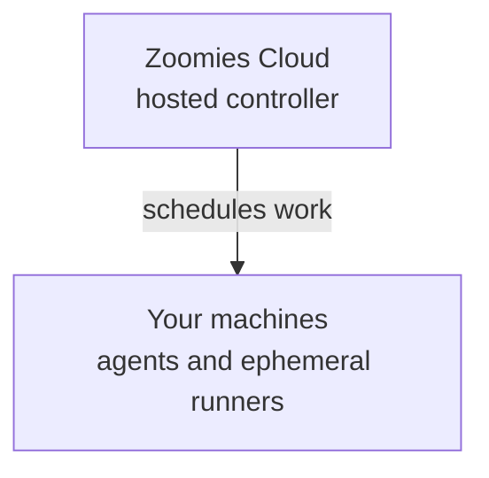

# Zoomies Cloud: the controller, hosted for you

Zoomies Cloud is the paid way to run Zoomies without running the controller.
It is the same controller as the open-source one, hosted and kept current by
Zoomies, and your jobs still run on machines you supply. The cloud VM, the lab,
the office server and the spare desktop stay yours; the controller's upgrades,
backups and recovery are ours.

If you would rather run everything yourself, the [quick start](quickstart.md)
installs the free controller on a machine you own.

[Start a free trial](https://cloud.zoomies.sh/signup?start=1){ .md-button .md-button--primary }
[See Cloud pricing](https://cloud.zoomies.sh/pricing){ .md-button }

A trial runs for 14 days: a card is taken, and nothing is charged until it ends.

## What you get

- **A hosted controller.** The same web UI and fleet features as a self-hosted
  controller, ready to open.
- **Upgrades applied for you.** New releases are backed up first and put back
  if a check fails.
- **Verified backups.** Encrypted, and checked after every one is taken.
- **Recovery.** A lost controller is brought back from its newest verified
  backup.
- **Team sign-in.** Invite people by email with a role; passkeys and two-step
  verification are included.
- **Support.** Open a ticket from the Cloud portal and the people who run the
  service answer.

The [Cloud site](https://cloud.zoomies.sh/) is the service's own home; use it
for the current terms and the sign-up flow. This page is the map from the
documentation.

## What stays yours

Cloud hosts the controller, not your runners. You still supply and look after
the machines that run jobs, including their Docker or Podman installation,
operating system updates, network access and capacity. You connect GitHub to the
hosted controller, create pools and join hosts the same way as a self-hosted
fleet.

Jobs still check out your code on your machines. The hosted controller holds the
fleet state and the job metadata it needs to schedule and show them.
[Security](security.md) explains the boundaries, and the
[Cloud privacy notice](https://cloud.zoomies.sh/privacy) covers the hosted
service's own data.

The controller is hosted; the agent and the ephemeral runner stay on your
machines.

## Self-hosted or Cloud?

| | Self-hosted | Zoomies Cloud |
| --- | --- | --- |
| Controller | You install and run it | Hosted by Zoomies |
| Upgrades and backups | Yours | Done for you, with verified backups and recovery |
| Runner machines | Yours | Yours |
| Price | Free software; your infrastructure | A flat monthly subscription per controller; runner compute is separate |
| Data | Stays on your controller | The hosted controller holds fleet state and job metadata; see its privacy notice |
| Best for | Full control, no subscription, a controller you already operate | A fleet without another service to patch, back up and recover |

The subscription is per controller and does not charge per runner, per minute or
per job. Your runner compute is billed by your own provider, or paid for in your
own power bill. [Current Cloud pricing](https://cloud.zoomies.sh/pricing) and the
trial terms are on the Cloud site.

## Start with Cloud

When your controller is ready, follow the [Cloud note in the quick
start](quickstart.md) to connect GitHub and join your first machine; the rest of
the documentation applies to the hosted controller and to a self-hosted one
alike.

[Start a free trial](https://cloud.zoomies.sh/signup?start=1) or [see Cloud
pricing](https://cloud.zoomies.sh/pricing).

If you are still deciding, [Should you self-host?](should-i-self-host.md) and
[what runners cost](costs.md) set out the work and the money on each side.
