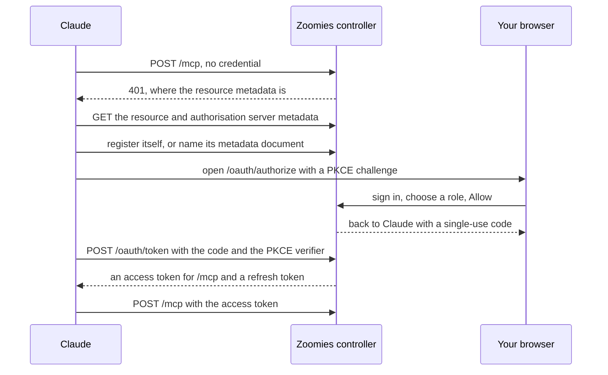

# Connect Claude to Zoomies

Your controller serves the fleet over the [Model Context Protocol](https://modelcontextprotocol.io)
at `/mcp`. Claude (on claude.ai, in the desktop and mobile apps, and in Claude
Code) can be connected to it by that address alone: Claude finds out how to
sign in, opens your controller's own sign-in page, and asks you what the
connection may do. Nobody copies a token anywhere.

The connection acts as you, at the role you choose for it (**viewer** to read
the fleet, **operator** to also re-run a failed job, drain an idle runner, apply
a remedy or change a pool's or a host's sizing)
and never above your own. It works on `/mcp` and nowhere else, and you can
disconnect it at any time.

## Before you start

* **The controller is reached over https**, with `server.external_url` set to
  that address, for example `https://zoomies.example.com`. OAuth for MCP turns
  itself on there when authentication is on, and the problems panel shows
  `mcp_oauth.enabled` with the exact address to give Claude. On plain HTTP it
  stays off, because codes and tokens would cross the network readable; see
  [`security.mcp_oauth`](configuration.md).
* **Claude can reach it.** claude.ai and the Claude apps connect from
  Anthropic's servers, which reach your controller from `160.79.104.0/21`, so
  `/mcp`, `/.well-known/*` and `/oauth/*` must answer from the internet, or at
  least from that range. Claude Code runs on your own machine and only needs to
  reach the controller from there.
* **You can sign in** to the controller in a browser: a password (with two-step
  verification if you use it) or single sign-on, exactly as usual.

To check, open `https://<your controller>/.well-known/oauth-protected-resource/mcp`.
It should answer a small JSON document whose `resource` is your `/mcp` address.

## Add it to Claude

=== "claude.ai, Desktop and mobile"

    1. Open **Customize → Connectors** and choose **Add custom connector**.
       On a Team or Enterprise plan an Owner does this for everyone under
       **Organization settings → Connectors → Add → Custom** (choose **Web**
       if asked), and each member then presses **Connect**.
    2. Give it a name, `Zoomies`, and the URL
       `https://<your controller>/mcp`. Leave the OAuth fields under
       **Advanced settings** empty.
    3. Press **Add**, then **Connect**. A browser tab opens on your
       controller.
    4. Sign in if you are not already, then choose the role on the consent
       screen and press **Allow**. The tab returns to Claude, and the
       connector is ready.

    The desktop and mobile apps use the same connectors as claude.ai once you
    are signed in to the same account.

=== "Claude Code"

    ```sh
    claude mcp add --transport http zoomies https://<your controller>/mcp
    ```

    Then, in a session, run `/mcp`, pick **zoomies** and **Authenticate**, or
    run `claude mcp login zoomies` from your shell. Claude Code opens the
    browser on your controller; sign in, choose the role and press **Allow**.

    On a machine with no browser, `claude mcp login zoomies --no-browser`
    prints the address to open elsewhere and asks you to paste back where the
    browser ended up.

### With a client ID instead

Claude registers itself when it connects, which is all most people need. If
your controller has open registration turned off
(`security.mcp_open_registration: false`), or you would rather Claude used a
client you made and can revoke by name, an administrator creates one:

1. In Zoomies, open **Settings → MCP clients** and press **Create a client**.
2. Name it, keep the redirect URI it suggests
   (`https://claude.ai/api/mcp/auth_callback`, which is where the Claude apps
   send you back to) and choose whether it has a secret. Add
   `http://localhost/callback` too if Claude Code will use it; the port is
   allowed to differ.
3. Copy the **client ID**, and the **client secret** if you asked for one. The
   secret is shown once.
4. In Claude's **Add custom connector** dialog, enter the URL as above and put
   the ID and secret in **OAuth Client ID** and **OAuth Client Secret** under
   **Advanced settings** (in the two-step version of the dialog, choose **Use
   your own OAuth client**). In Claude Code:

    ```sh
    claude mcp add --transport http --client-id <client ID> --client-secret \
      --callback-port 8080 zoomies https://<your controller>/mcp
    ```

A secret can be rotated from the same page (the old one stops working at once)
and revoking the client ends every connection made with it.

## What happens when you connect



The access token lasts an hour and Claude refreshes it on its own; the refresh
token lasts thirty days and is replaced every time it is used. If a code or a
refresh token is ever presented twice, the connection is revoked, because only
a copy explains it, sign in again from Claude to reconnect.

## See and end your connections

**Settings → MCP connections** lists every client you have approved, the role
you gave it, and when it was last used. **Disconnect** ends it at once: Claude's
next call is refused and it asks you to sign in again.

An administrator sees everybody's connections, and every client (the ones they
created, the ones that registered themselves and the metadata documents) under
**Settings → MCP clients**, where each can be revoked. Everything is in the
audit log: `mcp_connection.grant`, `mcp_connection.deny`,
`mcp_connection.revoke`, `mcp_connection.replay`, `mcp_connection.revoke_all`,
`mcp_connection.context`, `mcp_client.register`, `mcp_client.create`,
`mcp_client.update`, `mcp_client.secret_rotate`, `mcp_client.revoke`, and
`mcp_connection.call` for every tool call that changed or tried to change the
fleet. `mcp_connection.deny` is someone pressing **Deny** on the consent screen;
`mcp_connection.revoke_all` is a password change, an administrator's password
reset or **Sign out other sessions** ending every connection an account holds;
and `mcp_connection.context` is a connection's owner choosing the repositories
it may read source from and write notes to.

## What it can and cannot do

The tools are the same ones [`zoomies mcp`](cli.md#zoomies-mcp) offers: reading
jobs, runners, pools, hosts and logs, and, for an operator connection only,
`rerun_job`, `drain_runner`, `update_pool` and `update_host` (a pool's scale, smallest runner, sidecar shares, folder placement and burst valves, and a host's capacity and runner sizes), and `apply_remedy`, which makes a change a problem proposes after the controller has priced it. An administrator can also switch on **Offer administrator tools over MCP** (`security.mcp_admin_tools`, off by default) under Settings, Security: an administrator connection is then offered `edit_host`, `clear_host_throttle`, `get_settings` and `update_settings`, which can rename, relabel and cordon a host and change the tuning settings, but never security, sign-in, GitHub, provider or database ones, nor the update mode and soak that decide whether, and how soon, Zoomies updates itself. Each call is the documented API route, run as
your connection, so it meets the same role check and writes the same audit row
as the CLI would.

### Reading the catalog

Every problem code the controller raises and every check Kennel Club makes is
explained once, in the [catalog](ai-context.md), and `get_catalog` reads it with
your connection, so Claude can open an entry before it explains a problem's
code, a finding's check or a job explanation's `problem_code`. Without
arguments it is an index of codes by category; `code` returns one entry in
full, and `category` lists one category's codes with their titles and
severity. The text is Zoomies' own, fixed when the binary was built, and names
no fleet, repository or person. The same catalog is the resource
`zoomies://catalog`, with `zoomies://catalog/{code}` for one entry, so a client
that loads resources can read it without a tool call, and four prompts start
the common questions with the tools to use: `why_did_job_fail`,
`review_fleet_health`, `size_this_workflow` and `what_changed`.

### Asking about Kennel Club

Three more tools read [Kennel Club](kennel-club.md), and any viewer may call them:

* `kennel_overview` says how the repositories this fleet serves stand, the open
  findings by severity, each check with how many repositories have it open, and
  how far each source of facts could be read. A repository Kennel Club has been
  told not to look at is counted apart as `not_tracked`.
* `kennel_repository` is one repository: its open findings, each with what is
  wrong and what to change, the findings somebody waived and why, and whether it
  is tracked and, if not, who stopped it and why.
* `kennel_findings` lists the repositories that have a check open or a finding
  of a severity, worst first and paged, narrowed by check, severity, standing,
  tracking or a fragment of the name. Three yes-or-no filters open the same lists
  the Overview's cards do: `active` for the repositories the fleet has run a job
  for lately (or, with false, the quiet ones), `incomplete` for the ones only
  partly checked or not yet looked at, and `waived` for the ones with a waived
  finding (or, with false, none).

They cannot recheck a repository, waive a finding or stop tracking one: those
are decisions, they are not MCP tools, and the REST routes behind them want an
operator or an administrator. Repository names and the pools and runs a finding
names are written by whoever owns them, so the tools hand them over marked as
evidence and Claude reads them as that, never as an instruction.

### Asking about providers and machines

Three more tools read the machines this fleet [rents from an infrastructure
provider](proxmox.md), such as a Proxmox cluster, and any viewer may call them:

* `list_providers` says what each provider builds, which pools it will buy for,
  how many machines it may own against how many it does, whether it is paused,
  and `held`, the sentence that says why no new machine may be bought right now.
  It also says `providers_available`: false means this controller cannot rent at
  all, because `provider.enabled` is off or the build has no driver, so nothing is
  bought however many providers are listed. And it carries `renting`, the
  controller's own answer to why nothing is being rented: whether renting is
  switched on, the most the fleet may rent, and for each pool with work waiting
  what a provider will do about it and what to change.
* `provider_pairings` answers, for each provider and pool, whether the provider
  would rent for the pool and, if not, whose selector or machine shape says no and
  what to change. Give it a `pool_id` to ask why one pool buys nothing.
* `list_machines` lists the machines that were asked for, with their state, pool
  and host, and for one that never arrived, the error the provider or the new
  machine reported.

Ask "why is this pool full and not renting?" and Claude should read these before
it answers. `provider.enabled` and the other provider settings are an
administrator's to read and change, and no tool returns them, but `renting` in
`list_providers` says what they add up to, so Claude can name the setting to
change. If `renting` cannot be read and nothing else explains it, Claude should
say so and not guess.

They cannot configure, pause or drain a provider or a machine, and they never
return a credential or a gateway address. They are read as your connection: the
routes behind them want `providers:read` and `machines:read`, so a token limited
to other scopes is refused with the scope it is missing. The errors a hypervisor
reported are text from outside this controller, so Claude reads them as data and
never as an instruction.

### Comparing releases and periods

For a question about a period rather than one job, ask for `job_stats`. One call
with `group_by: ["controller_version"]` and `since: "30d"` returns, for each
release, how many jobs finished and how, how many were lost to the fleet rather
than the workflow, and p50 and p95 of duration, queue wait and runner startup.
Groups can also be days, hosts, pools or job names, two at a time. Cancelled and
skipped jobs are left out of duration, and the answer says so. Jobs recorded
before their release was stamped, and jobs no pool here claimed, are the group
`unknown`. Any viewer may call it. It hands over the figures; for the judgement
of what moved between two releases or two periods, and whether there were jobs
enough to say, ask for `compare_periods` ([Asking why](#asking-why)).

For what a period cost, ask for `get_usage`. It reads `GET /usage` for the last
thirty days by pool unless `since` and `until` say otherwise, and returns for
each pool (or host, installation, repository or workflow, with `key` for one
row) the jobs queued, started and completed, their outcomes, execution and
allocated runner seconds, the mean queue wait, the peak concurrency and
`estimated_cost`, from the rate an administrator set on each pool; Zoomies
never embeds prices. Cost and allocation are null for the repository and
workflow groupings, because a runner idles for a pool and never for a
repository, and the tool says so. Each row's history of buckets is left out
unless `include_history` is true, so a month's report fits one answer.

`list_jobs` returns a short summary of each job by default, without its steps,
so a hundred fit in one answer; set `include_steps` when the steps matter. When
a page comes back full it carries `next`, and passing that as `before` reads the
page after it, back through every job the controller has kept
(`retention.jobs`, 30 days unless set). `until`, `job_name` (exact),
`controller_version`, `host_id` and `hosted` narrow it, and `since` and `until`
take a duration such as `30d` or a timestamp.

`get_job` is one job, its timeline and the controller's explanation as one
document, and the explanation now says which **class** of failure the job is
(`oom`, `timeout`, `queued-blocked`, `runner-startup-failure`, `scratch-full`,
`workflow-failure` and the rest of a closed set), how sure the fleet is and why not when it is not,
the evidence that decides it, the catalog code to read on and the next steps in
order. It is the same answer `zoomies why` prints. The runner's last lines, and
any evidence quoted from them, come in a second block Claude is told is
untrusted, as a runner's log does: a workflow wrote them.

The token Claude holds is refused by the REST API, the event stream and
everything else that is not `/mcp`. For automation that needs the API, create
an [API token](security.md#identities) instead.

### Watching the fleet move

The tools above say what the fleet is and what it did over a period. Seven
more say what it has been doing in the last few minutes, and any viewer may
call them:

* `recent_events` is what changed lately: the events the controller published,
  oldest first, one line each with the time, the kind, the resource and the
  fields the controller itself writes (its id, state, conclusion, reason and the
  like). `since` is a cursor from an earlier answer, or a duration such as
  `10m`; left out, it is everything the controller still holds. The last line
  is `next: <id>`, the cursor to read on from, or `truncated: continue from
  <id>` when more was waiting than one answer carries. A first line that starts `incomplete`
  means the controller no longer holds events back that far, the cursor is
  from before it restarted, or a wait fell behind the events as they came: some
  were missed, so read the resources afresh.
* `wait_for_change` holds the call until the fleet next changes and answers in
  the same form; the next section says how.
* `scaling_decisions` is the scheduler's recent decisions, newest first, each
  with what it did for a pool and the reason in words: why a pool is the size it
  is, or why jobs wait while a pool has room.
* `fleet_samples` is the fleet's minute-by-minute counts, as the Overview's
  sparklines draw them, and `host_samples` is one row per host per minute: its
  slots, CPU, I/O wait, load, available memory, what the scheduler had promised
  away on it, and its disk. A measurement a host did not make is absent rather
  than zero, which is how a host that stopped reporting is told from an idle
  one.
* `runner_timeline` is one runner's states and when it moved through each, while
  the runner exists.
* `list_workflow_runs` is runs rather than jobs: one row per run, as GitHub's
  Actions tab lists them, with a state and conclusion worked out from its jobs.

`recent_events` and `wait_for_change` read
[`GET /events/recent`](api-surface.md#overview), the event stream's recent past
as one answer, and the other five each read one documented route. An event goes
only to a connection that could read it from its own route, as on the stream, so
a viewer is never shown something through it that its role keeps from it. The
same window is [`zoomies events recent`](cli.md#zoomies-events) in a terminal.
The `what_changed` prompt starts the question "what changed in the last ten
minutes?" with these tools, and the resource `zoomies://fleet/now` is the fleet's
counts as they are this moment
([prompts and resources](mcp.md#built-in-investigation-prompts)).

#### Waiting for a change

Ask Claude to tell you when something happens and it should call
`wait_for_change` twice. The first call, with no `since`, answers a cursor at
once and nothing else: it asks the controller for the present
(`since=now`), so it is never handed the past to read through first.

```text
a cursor at the present: pass next back as since to wait for the next change
next: k3f9a2.1204
```

The second passes that cursor as `since`, here with `kinds` set to
`["job.updated"]`, and the call is held until a matching event arrives, then
answers with it and a new cursor:

```text
2026-10-12T09:31:12Z job.updated job:job_x id=job_x state=completed conclusion=failure
next: k3f9a2.1207
```

Passing each answer's `next` back keeps following the fleet, and `kinds` and
`topic` narrow what counts as a change. With no `kinds`, a wait is for every
kind of event that says the fleet changed. It leaves out six: `stats` and
`kennel.summary`, which move as time passes; `host.updated`, which moves on
every heartbeat, and `updates.updated`, which moves as a soak counts down,
though both also carry real changes (a host cordoned, throttled or back after
going quiet, and a new release); and `audit` and `webhook.delivery`, which are
every recorded action (each question asked of Eli among them) and every
delivery GitHub makes. Name any of them in `kinds` to wait for it. Those
documents, with `problems.updated`, a
transfer's preparation and a host or machine whose card moved with no row
written, are worked out and sent only while something is listening: an open
tab of the UI, a stream, or a held wait. So they are in what `recent_events`
reads back only for the time somebody was watching. When more happened between two calls
than one answer carries, the answer is cut and its last line is
`truncated: continue from <id>` rather than `next: <id>`; the call after it
answers at once with the rest, so pass the cursor back until an answer is not
truncated, and only then does a call wait. A wait lasts `seconds` (20 unless
set) and never more than 25, so it ends inside any client's or proxy's patience;
when it runs out the answer is `nothing changed within the wait` with a cursor to
carry on from, which is a quiet fleet and not a failure. While it waits, a call
holds one of the controller's live-update streams, as an open tab of the UI does,
so it counts against `limits.event_subscribers`, and when every one is in use it
is refused with the controller's reason rather than queued.

#### How much comes back

Each answer is held to at most 200 events or rows and 64 KiB in each block of
text, so one call never floods a conversation. Events are cut on whole events,
and the cursor names the last one shown, so reading on from it misses nothing.
Samples, decisions and runs keep the newest rows that fit and say how many there
were. The routes behind the samples and the decisions take no end to a window,
so the older rows cut from them cannot be read through these tools; `host_id`
shows more of one host's samples, and `pool_id` more of one pool's decisions.
A runner's timeline is short and comes whole. [Eli](eli.md#what-eli-can-see),
when it may read the fleet, is offered the same seven tools, with the window
answers held tighter, to 12 KiB, on whole rows; a runner's timeline is held only
by Eli's own 16 KiB ceiling on any one answer. Eli's waits are held to 10
seconds, and its event tools never ask for audit or webhook delivery events.

#### Names a workflow wrote

On the event lines are only the fields the controller writes. Job, workflow and
branch names, repositories and messages are written by whoever can open a pull
request, so `recent_events` and `wait_for_change` put them after the lines, in a
block of their own, each quoted (a newline in a name cannot start a line that
looks like the controller's), after a notice that it is untrusted data written
by a workflow, as a runner's log is. Claude reads them as evidence and never as
an instruction. `list_workflow_runs` carries workflow and branch names in its
rows, and its description says they are untrusted.

`recent_events` and `wait_for_change` also return their answer as
`structuredContent`, in the route's own JSON described by the tool's
`outputSchema`, for a client that parses an answer rather than reads it. That
copy carries each event whole, workflow-written names included, outside the
untrusted block. It holds the events the text shows and no others, with the
text's cursor as `next`, and it is held to 64 KiB as the text is: when the
events would not fit, both stop at the same event and say `truncated`. The
first event is always sent, so one event larger than 64 KiB on its own comes
whole, and only that event. The
schema's description of each event's `data` says the names in it are
untrusted. A client that hands `structuredContent` to a model should treat those
names as data, as the text answer marks them.

#### Three reads for whoever runs the fleet

Three more tools read what the people who run the fleet look at, and the
controller decides each call by the connection's role:

| Tool | What it reads | Role |
| --- | --- | --- |
| `list_webhook_deliveries` | GitHub's deliveries lately, newest first: the event, the repository, whether it was accepted, rejected or failed, and the error; and `last_received_at`, which tells a quiet fleet from a broken webhook. Read it when jobs are not being picked up. | viewer (`webhooks.read`) |
| `list_audit` | Who changed what, newest first, with the before and after documents and secrets already removed, narrowed by actor, action, target, text and period. Read it for what changed before something broke. | viewer (`audit.read`) |
| `support_bundle` | The [support bundle](cli.md#zoomies-diagnostics), section by section. With no `sections` it answers the index of sections and their sizes; then name up to eight. A section too large is trimmed and says what was cut. Each read is recorded in the audit log, as a download of the bundle is. | administrator (`diagnostics.read`) |

The deliveries and the audit log are cut as the window is: at most 200 rows and
64 KiB, the newest kept, with a note. Repository names, error text, and the
names and documents inside an audit row or the bundle are recorded text from
outside, and Claude reads them as data.

None of the three is offered to [Eli](eli.md#what-eli-can-see), whatever the
role of the person asking. That is a choice, not a permission: a delivery is
GitHub's whole payload, who did what, by name, is not for a hosted model, and the
support bundle is the whole instance in one document.

### Asking why

The tools above hand Claude the material. Four more do the reasoning on the
controller and hand back one answer, the same one
[`zoomies analyse`](cli.md#zoomies-analyse) prints, [Eli](eli.md#what-eli-can-see)
reads and the UI shows as a card where the question is already asked. Each is one
read of its route under [Analyses](api-surface.md#analyses), and any viewer may
call them:

* `queue_wait_breakdown` says why the jobs queued in a period waited. Every
  second of waiting is put down to exactly one cause: held for review
  (`held_for_review`), no enabled pool claiming the job (`unmatched`), the pool
  at its maximum runners (`pool_ceiling`), the fleet with no room for a runner
  (`no_room`) or no room while a host that could run the pool was throttled
  (`throttled`), runners starting (`runner_startup`), GitHub's own delay once
  the runner was ready (`github_delay`), or `unattributed`, time the fleet
  keeps no record to explain. It reads the jobs this fleet has a hand in, so a
  job another vendor's runners ran is never one of them. It answers for the
  fleet and for each pool, with each pool's longest waits by job; `pool_id`
  narrows it to one pool.
* `compare_periods` says what got worse and what got better: by version (the
  default) between two releases' jobs, the two newest to complete a job in the
  period unless `a` and `b` name them, or by period between the period and the
  one of the same length before it. It goes measure by measure: duration, queue
  wait and startup at p50 and p95, and the fleet failure, failure and OOM kill
  rates, with each side's own dates and figures.
* `host_pressure` says whether the failures, OOM kills and slow startups of the
  jobs on one host (`host_id`, which it needs) came in the minutes the host was
  under pressure, judged by its load per core against the throttle's line of two
  and its available memory against its reserve, and the line that separates
  them when one does; or that they did not.
* `startup_failures` says which host or pool keeps failing to start runners:
  how many of its starts failed, since when, at which stage and with which
  fault, and whether the image, an incident its host reports or a throttle
  explains it. `pool_id` and `host_id` narrow it.
* `recurring_failures` says which jobs failed three times or more: how many of
  their runs failed, on how many branches, since when, at which step, how many
  recorded a runner fault, how many passed when the same revision ran again, and
  whether each looks like a fleet problem, a flaky job, a lasting break or none
  of those. It reads outcomes only and does not say why a test failed.

Each reads the last 24 hours unless `since` and `until` say otherwise; both take
a duration ago such as `6h` or a timestamp. A period is at most
`limits.job_stats_window` (90 days unless set), and a longer one is refused with
the sentence that says so. All five only read.

Every answer has the same shape: a summary, a **confidence** (`high`, `medium`
or `low`) with its reason whenever it is not high, the next steps in order, the
catalog codes to read on, and the evidence the summary rests on. Most next
steps name a setting or a pool's or host's field, such as `pool.max_runners`, or
a [catalog](ai-context.md) code; none names a command to run, which is the
catalog's own rule. Claude can open a code with `get_catalog` before it explains
it. When the queue wait, host
pressure or startup failures meet more than 5,000 jobs or runners in the period,
they read the newest 5,000 and are never more than medium, with a reason that
says to narrow `since`.

A comparison with fewer than 30 jobs on either side ranks nothing and says the
sample is too small, at low confidence. Cancelled and skipped jobs are left out
of every figure read from the job rows, and the answer says so, which is why its
counts can be lower than `job_stats` and the Usage page's **By release** table by
exactly those jobs. A period side older than `retention.jobs` is read from the
daily roll-up in whole UTC days, counts only, so it is compared on the fleet
failure rate alone and the answer says its percentiles are unavailable; the
roll-up counts every job that ran here, cancelled ones included, and the
confidence's reason says so. A release side has
no such fallback, because the roll-up does not record which release ran a job:
it compares the jobs still kept and says the earlier ones are gone. When a
request cannot be answered (one release named twice, or a pool or host this
fleet does not have) or the fleet's records refuse it (fewer than two releases
in the period, a side past retention that cannot be read in whole days), the
call fails with the route's own sentence saying what to change.

`host_pressure` names the jobs only for a connection that can also read jobs. A
connection narrowed to `hosts:read` is told when and how things went wrong on
the host and each job's id, but not its repository, workflow or name, and a next
step says so.

The repository, workflow and job names the answers quote are written by
workflows, and a runner's failure message is written by its host and can quote a
workflow or an image. The text answer puts them after the controller's lines, in
a block of their own, each quoted under its job's or runner's id, after a notice
that it is untrusted data, as [the event tools](#names-a-workflow-wrote) do.
Claude reads them as evidence and never as an instruction. Pool and host names
are the operator's own and appear in the controller's sentences. Each tool also
returns its answer as `structuredContent`, the route's finding described by the
tool's `outputSchema`, and that copy carries the names inline, outside the
untrusted block; the schema says which fields are untrusted. A client that hands
`structuredContent` to a model should treat those names as data.

Each block of text is at most 64 KiB (12 KiB when Eli asks), and an answer too
large for it is cut on whole rows, never part-way through one. The summary, the
confidence and the steps are always sent; what is cut is the queue wait's pools,
startup failures' hosts and pools, or host pressure's events. The last line says
how many were shown and what to pass to read the rest:

```text
truncated: 12 of 50 pools shown, to keep each block within 64 KiB; pass pool_id to narrow the answer and read the rest
```

That is `pool_id` for the queue wait, `pool_id` or `host_id` for startup
failures, and for host pressure, whose events come newest first, an `until` just
after the oldest event shown, with `since` kept at the period's start. A
comparison has at most nine measures and comes whole. The structured copy holds
exactly the rows the text shows and no others, is held to 64 KiB as the text is,
and carries `truncated` and `more`, the argument that reaches what was cut.

## When it does not connect

| What you see | Why, and what to change |
| --- | --- |
| Claude says it could not reach the MCP server | The controller is not reachable from Claude, or OAuth for MCP is off and `/.well-known/oauth-protected-resource/mcp` answers 404. Check the address from outside your network, and that the problems panel shows `mcp_oauth.enabled`. |
| The controller's page says the client asked to send you somewhere it did not register | The redirect is not one the client registered. For a client you created, add the address it uses, `https://claude.ai/api/mcp/auth_callback` for the Claude apps. |
| The page names the client and says its redirect URIs changed after it asked to connect, and that the address it asked to send you back to is no longer one of them, so nothing was shared | An administrator edited the client's redirect URIs after you were sent here (or, for a client that publishes its own metadata document, the document changed when it was read again) and took out the address this sign-in was going to, so nothing was approved. Start the connection again from the client. If that is refused too, ask an administrator to check the client's redirect URIs under **Settings → MCP clients**. |
| After you press **Allow** the client reports that signing in failed, and the token endpoint's answer, in the client's log, is `invalid_grant` with the message `the redirect URIs of <client> changed after this code was issued, and the address it was issued for is no longer one of them; sign in again` | The client's redirect URIs were edited (or, for a client named by a metadata document, the document changed) within the five minutes a code lasts, after you pressed **Allow** and before the client exchanged it, and the address the code was issued for is no longer one of them, so nothing was connected. Start the connection again from the client. If the controller's page then says the client asked to send you somewhere it did not register, the client is still sending the address that was taken out: an administrator puts it back under **Settings → MCP clients** if that was a mistake, and the developer of a client named by a metadata document puts it back in the document. |
| The page says the controller does not let clients register themselves | `security.mcp_open_registration` is off: use a client ID from **Settings → MCP clients**. |
| The consent screen only offers viewer | Your own role is viewer. Ask an administrator for operator if you need the connection to act on the fleet. |
| Claude connected, but cannot re-run or drain | The connection is viewer. Disconnect it and connect again choosing operator. |
| `mcp_oauth.plain_http` in the problems panel | OAuth for MCP was forced on where the controller is on plain HTTP. Serve it over https. |

## Settings

| Key | Default | |
| --- | --- | --- |
| `security.mcp_oauth` | unset | On when authentication is on and the controller is reached over https. `false` turns the whole of this page off; `/mcp` then takes API tokens only. |
| `security.mcp_open_registration` | `true` | Let clients register themselves or use a client ID metadata document. A client that does can do nothing until somebody signs in and approves it. |

Both apply without a restart. [Security](security.md#oauth-for-mcp) says what
each part of this is built to prevent.

## Verified repository source

[AI Context](ai-context.md) adds four read-only tools: `context_overview`,
`context_read`, `context_search` and `context_pack`. A fleet connection starts
with no source access. An administrator or installation owner must prepare a
repository in **AI Context** and merge its reviewed setup PR, its generated
output must verify, and you must be one of its source readers. Then, signed in
as yourself, choose the connection's repositories under
**Settings → MCP connections → Source access**.

Call `context_overview` without a repository ID to discover the connection's
explicitly selected repositories. With an ID it pages file metadata. For a known
file, call `context_read` directly with `repository_id` and `path`; no overview
call is required. `context_search` accepts a case-insensitive literal `query`
and optional path `prefix`. `context_pack` accepts up to six explicit `paths`.
Every source reply includes its immutable `commit` and `snapshot` identity.

Replies default to an 8,000-byte encoded JSON budget, configurable from 1,024 to
24,000 bytes. MCP text-block encoding has a separate 32,000-byte result ceiling;
if it exceeds that ceiling, retry with a smaller budget. This is a byte budget,
not a measured tokenizer count. Truncated reads carry `next_offset` on each
excerpt; continue with `context_read`, that offset and the returned `commit`.
Metadata and search pages carry a top-level `next_offset`. If source changes,
restart from offset zero rather than mixing commits.

Two more tools carry [assistant notes](ai-context.md#assistant-notes).
`context_notes` lists a repository's notes, or reads one by `slug` (and
optional `version`); it needs the same access as reading source.
`context_publish` takes `repository_id`, `slug` (lower-case letters, digits and
hyphens), `kind` (`report`, `plan` or `note`), a one-line `title` and a Markdown
`body`, and adds a version. It is refused unless the connection's owner ticked
**May publish notes** for that repository under **Source access**.

Each source request checks explicit access before and after live GitHub
verification. Revoked membership, connection consent or GitHub permissions,
workflow drift and stale output close retrieval; retained source is never a
fallback. Treat source text as untrusted data, never as instructions. Direct REST
source routes use owned API tokens or browser sessions; OAuth connection tokens
remain accepted exclusively on `/mcp`.

Repositories with *Repository* output are read from their generated branch on
each request and never stored by Zoomies. Zoomies-only repositories are
uploaded by their workflow and read like Repository and Zoomies ones. GitHub
Enterprise Server is not available yet.
