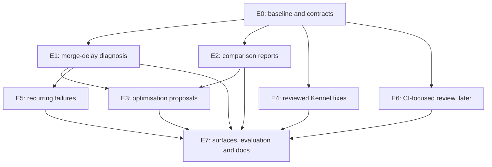

# Eli enhancement roadmap handoff

Prepared 12 October 2026. Planning baseline: local checkout
`1e745d258fdfce61d3395da97b72d575aab1fbbd`. Reconciled with the code on
19 October 2026, last against main `98e1e82` (see the next section).

This document turns the product review into implementation tracks that several
agents can work from. It describes proposed extensions, their dependencies,
contracts, acceptance criteria and evidence requirements. Creating this handoff
does not mark these features as implemented, approve external writes or start
the implementation programme.

[ROADMAP.md](ROADMAP.md) remains the sole active delivery-order source of truth.
This file supports it rather than replacing it. Before implementation, the
coordinating agent reconciles these tracks with current code and records new or
changed work in ROADMAP.md, using existing packages where the work overlaps.
The track IDs below are local handoff identifiers, not allocated ZF numbers.

## Reconciliation, 19 October 2026

Checked against main `87c5aa3b` and brought up to date at `98e1e82` after #1171,
#1176 and #1177 merged. Where this section
and an older row below disagree, this section is newer; the older rows are kept
as the record of how each slice landed.

| Track | Verified state in code | Correction to older text |
| --- | --- | --- |
| E1 (ZF-242) | Merged and used: `internal/analysis` (`merge_delay.go`), `get_pr_delay` on Eli's allowlist, CLI, contextual UI | None. Closed as `implemented` on 25 October 2026 at the owner's direction; live-model evaluation and a real performance experiment have not run and are not claimed |
| E2 (ZF-243) | Descriptive milestone merged (#1020); `get_retained_comparison` on Eli's allowlist; ZF-241's period comparison, queue breakdown, host pressure and startup failures are `implemented` | None. Controlled-experiment proof and dispatch stay deferred by the owner |
| E3 (ZF-244) | The first operator slice is on main: pure preview (`internal/optimisation`), private retention (migration 0107), admitted checkout evidence ([#1024](https://github.com/eyupio/zoomies/pull/1024)), the policy, routes and web flow from [#1171](https://github.com/eyupio/zoomies/pull/1171), attributed approval (migration 0119), reconciled draft publication (migration 0120), the two-way link between a published preview and E2's comparison (migration 0121), read access from the CLI, MCP and Eli, and the wider catalogue's setup cache preview through its pure foundation, retained history, bounded source, private retention/API, web page, bounded CLI/MCP/Eli replay, attributed approval (migration 0123), one reconciled draft pull request (migration 0124), a pure bounded readiness polling foundation, its bounded source/inspection route, the readiness inspection page, private retention/API and bounded CLI/MCP/Eli replay, all described under "E3: what is built, and what is not" below | The rows further down that call #1024 or the policy and web flow "pending" are out of date; both merged. Still absent: a real E2 comparison of a published change, any run against a real repository, and write access from the CLI, MCP or Eli (deliberately web-only). Closed as `implemented` on 25 October 2026 at the owner's direction, with the real-repository run and the real comparison left to the owner and not claimed |
| E4 | First slice merged on 26 October 2026 ([#1288](https://github.com/eyupio/zoomies/pull/1288), [plan](roadmap/plans/2026-10-25-eli-e4-timeout-fix.md)): one reviewed fix, a missing `timeout-minutes` on a `ci.no_timeout` finding, with operator-supplied minutes, a blob-bound preview, attributed approval and one reconciled draft pull request (migrations 0132 to 0134). Read from the CLI, MCP and Eli; approval and publication are web-only | No other Kennel fix (pins, concurrency, permissions). Nothing has run against a real GitHub App or repository. A retry after a lost publication record fails safe when the default branch has moved, as every E3 publisher does; the owner has not decided whether to change the shared publisher. No ZF package number is allocated |
| E5 | First slice merged on 26 October 2026 ([#1290](https://github.com/eyupio/zoomies/pull/1290), [plan](roadmap/plans/2026-10-26-eli-e5-recurring-failures.md)): a fifth analysis, `recurring_failures`, over finished job outcomes (route, CLI, MCP, Eli's allowlist and a Failed-view card). It reports the step, branch spread, runner faults, passes on a rerun of the same workflow run and whether a job has passed since, and classes a job as infrastructure, flaky, persistent or intermittent | No log is read, so it never says why a test failed, and there is no fingerprinting of messages or test names. Nothing has run against a real fleet's history. No ZF package number is allocated |
| E6 | First slice merged on 26 October 2026 ([#1291](https://github.com/eyupio/zoomies/pull/1291), [plan](roadmap/plans/2026-10-26-eli-e6-ci-review.md)): a findings-only review of what a pull request changes in the workflows, with Kennel's own checks over a pinned merge base and head. Route, CLI and an MCP tool; the tool is deliberately off Eli's list because each call spends GitHub quota. Rules are built in, changed instruction files are reported and never applied, and every changed file not judged is listed | No model, no comment on the pull request, no stored review or supersession, no fleet capacity evidence on findings, no Ask Eli route. Nothing has run against a real GitHub App or pull request. No ZF package number is allocated |
| E7 | Eli's repair history tools, repair identity relink, repair pages, automatic-repair visibility and stop controls (18 October), Eli protected-read recovery (19 October) and the analysis cards are all on main | The two E7 rows marked "Implemented, branch ..." are merged. Automatic repairs are repair-mode work, not Optimise or Review mode, and give those modes no new authority |

Newer work that this handoff did not plan but that later tracks should reuse:
the Eli repair pages and their readiness, policy and budget views, `run_event`
on a job, and `GET /assistant/repairs/automatic` with its stop route.

### E3: what is built, and what is not

Built and merged, all verified against fakes and mocked routes only. The policy,
routes and web flow arrived in #1171, #1176 and #1177; approval and draft
publication arrived on 23 October:

* **Policy.** `optimisation.source_reads` and `optimisation.workflow_edits`, two
  separate live instance settings, off by default and read on every call, so a
  withdrawal stops the next request. No request field carries policy.
* **Enablement without Settings.** `GET`/`PUT /optimisations/enablement`: the
  Checkout preview page opens with a card saying what turning the switches on
  allows, an administrator turns both on with one press, anyone else is told whom to
  ask and can copy the request. Repair setup offers it as an unticked box. Nothing
  turns it on silently.
* **Routes.** `POST /optimisations/checkout/inspections` (reads one workflow file,
  retains nothing), `POST /optimisations/checkout/previews` (re-reads, requires the
  head and digest the operator reviewed, keeps an immutable preview for 14 days with
  an audit row), `GET /optimisations/checkout/previews/{id}` (replay; the changed
  line, never the file). Actions `optimisations.read` and `optimisations.write`
  (operator, plus `jobs:read`); visitors refused.
* **No IDs to type.** A selection is a run, an attempt and a job. The server finds
  the job's one previewable checkout step (`workflow.FindCheckout`, zero or two
  candidates is an explained refusal). The page lists a repository's recent
  successful push jobs; the job drawer offers **Preview a checkout change** on those
  jobs; typing IDs is a collapsed fallback.
* **Cost.** Inspection and capture each take one of the 20 hourly diagnostic
  admissions, so one preview costs two.
* **Approval (23 October).** `POST /optimisations/checkout/previews/{id}/approval`
  records an explicit, attributed approval of one exact retained preview. It names
  the preview, the head and source digest it approved, and the actor, is audited as
  `optimisation.preview_approved`, and expires with the preview. The store keeps it
  in migration 0119 beside the immutable preview, and replay returns it. The same
  operator may approve their own preview, with both people recorded; a repeat of the
  same binding returns the existing act without a second audit row. It reads no
  source, consults neither optimisation setting and publishes nothing. The retained
  preview card offers the declaration and then shows who approved and when.
* **Draft publication (23 October).** `POST /optimisations/checkout/previews/{id}/publication`
  opens one draft pull request for an approved preview. It has its own live setting,
  `optimisation.publish`, and action, `optimisations.publish`. The controller
  re-reads the run, its branch, the live policy, the source and the approval, runs
  `optimisation.CheckCurrent`, and refuses any change. It commits the one reviewed
  file on a branch derived from the preview, against the branch the push ran on,
  and opens a draft; it never force-pushes and never merges. A deterministic branch
  and exact title/body reconciliation make a retry the same act. Migration 0120
  records the pull request and binding; publishing is audited as
  `optimisation.preview_published`. The App needs Contents, Pull requests and
  Workflows write, and a missing permission is named. The published preview links
  to E2's Comparisons page with the scope, workflow kind and the preview reference
  prefilled; the comparison remains a manual, inconclusive capture, and can be
  linked back to the preview after it is retained.
* **Read surfaces (23 October).** `zoomies optimisations get <preview-id>` and the
  MCP/Eli tool `get_checkout_preview` read the same bounded route as the web page:
  metadata, the commit and both digests, approval and publication status, the
  linked comparison, and the one changed line. They never return the full workflow
  file, and they neither approve nor publish. The MCP/Eli projection leaves out
  actor identities and future fields. The changed line and path are marked
  untrusted repository text; a scripted Eli scenario plants an instruction in the
  line and proves it stays inside the fence. No new route, migration or setting is
  added; the CLI preserves the raw JSON for `--output json`.
* **Cache preview foundation (23 October, pure).** `internal/optimisation` can
  turn one complete workflow file and one root lockfile at a pinned head into an
  exact proposal that adds the `actions/setup-node` package cache (`npm`, `yarn`
  or `pnpm`, chosen by the lockfile). It supports one pinned setup step, refuses
  ambiguity and unsupported YAML, requires caller-supplied repeated-setup
  evidence, preserves bytes and line endings, and always says inconclusive. It
  reads nothing, retains nothing and has no route or surface.
* **Cache setup history (23 October).** The fleet's `jobs` table now has a
  bounded `RecentSetupStepSamples` query for one repository, workflow name, job
  name and literal setup step name. It returns the newest successful
  GitHub-reported step timings with their exact local job identities, skips
  ambiguous or untimed steps, and a pure helper turns them into the preview's
  mean setup time and a deterministic evidence ID. No extra GitHub read.
* **Cache source binding (23 October).** `ReadSetupCacheSource` reads one
  completed successful push attempt, its commit tree, the root workflow and the
  one root lockfile at the commit, and matches literal job and setup step names.
  The controller binds it to the selected fleet job row and the retained setup
  history, then returns the pure cache preview. At most eight GitHub requests
  under the shared diagnostic admission.
* **Cache retention and API (23 October).** Migration 0122 adds a separate
  bounded, installation-scoped cache preview history with the same fourteen-day
  lifetime and twenty/one-hundred caps as checkout. `POST
  /optimisations/cache/inspections` computes and returns the insertion block and
  evidence summary without retaining; `POST /optimisations/cache/previews`
  re-reads and requires the same head, workflow digest and lockfile digest
  before keeping it; `GET .../{id}` replays from stored input. The full workflow
  source and setup samples stay private; the lockfile is kept as path, mode and
  SHA-256, never content.
* **Cache web page (23 October).** `/optimisations/cache` reuses the checkout run
  picker and optimisation gate. It shows the package manager, root lockfile,
  literal setup step, commit and digests, and the exact `with:` block as untrusted
  text. A declaration gates keeping; the kept card shows the insertion, evidence
  summary, preview ID and reviewer, says verification is inconclusive and
  currentness not checked, and publishes nothing.
* **Cache read surfaces (23 October).** `zoomies optimisations cache <preview-id>`
  and the MCP/Eli tool `get_cache_preview` read the same bounded route as the
  cache web page: metadata, the package manager, root lockfile, setup evidence,
  digests and the one `with:` block. They never return the full workflow or
  lockfile, drop actor identities from model output, and neither approve nor
  publish. The path and block are untrusted repository text; verification is
  inconclusive. No new route besides approval; no new setting.
* **Cache approval (23 October).** Migration 0123 stores one attributed approval
  per retained cache preview, cascading with it. The web card offers a
  declaration and approval after keeping; the approval names the exact commit,
  workflow digest and preview hash, is audited, expires with the preview and
  publishes nothing. The CLI shows the approval; MCP/Eli project its time and
  digests but drop who approved.
* **Cache publication (23 October).** Migration 0124 stores one draft per
  approved preview. The cache card offers **Open a draft pull request** after
  approval; the controller re-reads the selected job, branch, workflow and
  lockfile, rechecks the settings and approval, and commits the reviewed file on
  `zoomies/cache-<id>`. It opens one draft, never merges or force-pushes, and a
  retry reconciles it. Provenance (run, attempt, fleet job, branch) is part of
  the retained envelope; previews kept before it cannot be published.
* **Bounded readiness polling foundation (24 October, pure).** One literal
  `sleep <seconds>` step on a literal Ubuntu runner can become
  `timeout N sh -c 'until <condition>; do sleep 1; done'`. The condition is
  supplied by the operator, never guessed; the original duration is the bound.
  It refuses ambiguity, other commands, comments, non-Ubuntu runners and
  fractional or suffixed sleeps, preserves surrounding bytes and line endings,
  and always says inconclusive.
* **Readiness source and inspection (24 October).** `ReadReadinessSource` reads
  one completed successful push attempt, its commit tree and the root workflow
  (at most four GitHub requests under the shared admission), binds the literal
  job and wait step to the selected fleet job, and the controller turns the
  retained wait samples into the pure preview. `POST
  /optimisations/readiness/inspections` returns the exact before/after block,
  the bound, the condition and the evidence summary. It retains nothing and has
  no web page, CLI, MCP or Eli surface.
* **Readiness inspection page (24 October).** `/optimisations/readiness` reuses
  the checkout run picker and optimisation gate. The operator picks a job and
  types the readiness command; the page shows the bound, wait evidence and the
  exact before/after block. It says the condition is never inferred and that
  nothing was retained, approved or published.
* **Readiness retention and API (24 October).** Migration 0126 adds a separate
  bounded, installation-scoped readiness preview history with the same
  fourteen-day lifetime and twenty/one-hundred caps as cache. `POST
  /optimisations/readiness/previews` re-reads the source and requires the same
  head, workflow digest and condition before keeping it; `GET .../{id}` replays
  from stored input. The full workflow stays private; the transport shows the
  before/after block, condition and evidence. The web page keeps the reviewed
  preview and opens it from an `opr_` link. No approval, publication, CLI, MCP
  or Eli access yet.
* **Readiness read surfaces (24 October).** `zoomies optimisations readiness
  <preview-id>` and the MCP/Eli tool `get_readiness_preview` read the same bounded
  replay route as the web page: metadata, the operator's command, the wait
  evidence and the one changed run block. They never return the full workflow or
  actor identities and neither approves nor publishes. No new route, migration or
  setting.
* **Readiness approval (24 October).** Migration 0127 stores one attributed
  approval per readiness preview, cascading with it. `POST
  /optimisations/readiness/previews/{id}/approval` binds the preview's head,
  workflow digest and retained hash, is audited as
  `optimisation.readiness_preview_approved`, reads no GitHub and publishes
  nothing. The readiness page offers a declaration and **Approve preview**; the CLI
  shows the approver; `get_readiness_preview` projects the time and digests and
  drops `approved_by`.
* **Readiness publication (24 October).** Migration 0128 stores one draft pull
  request per approved readiness preview, cascading with it. `POST
  /optimisations/readiness/previews/{id}/publication` needs `optimisations:publish`
  and `jobs:read`, re-reads the selected job, branch and workflow with the stored
  provenance, requires the same head, workflow digest, condition, bound and after
  block, and opens one draft on `zoomies/readiness-<preview-id>`. It never merges,
  never force-pushes and reconciles a retry. A preview kept without provenance is
  refused with a message to make a new one. The CLI shows the publication;
  `get_readiness_preview` keeps the branch, URL, time and digests and drops
  `published_by`.

Not built, in the order to do it. The list below was the record on 19 October;
approval, draft publication and read access from the CLI, MCP and Eli have since
been built (see the 23 October sections at the end). The rest remains.

1. **Validate against one real repository first.** The reader, the policy gate, the
   web flow and the draft publisher have never met a real GitHub App, real Actions
   history or a real fleet. Pick one repository with a commit-pinned
   `actions/checkout` and a literal `fetch-depth: 0` in a root workflow, enable the
   switches, and run read, review, keep, approve and publish end to end. Record what
   GitHub actually returned (permissions, rate-limit headroom, step names, branch
   and draft behaviour) and fix what the fakes hid.
2. **E2 verification of the published change.** After merge, compare the checkout
   time before and after through the E2 comparison. The result is "inconclusive"
   unless a suitable control and candidate exist, and CI passing is never evidence of
   a saving. Projected savings stay estimates.
3. **Wider catalogue.** The dependency/build cache foundation, retained setup
   history, bounded source binding, private retention/API, web page and
   CLI/MCP/Eli replay, attributed approval, draft publication, the pure bounded
   readiness polling foundation, its source/inspection route, inspection page,
   private retention/API, bounded CLI/MCP/Eli replay, attributed approval and
   draft publication are described above. Next is test sharding, which has no
   agreed contract yet, each with its own
   evidence and refusals. Do not lead with test removal, relaxed assertions or
   blanket retries.

Owner decisions still open: whether a different person than the reviewer must
approve (the 23 October slice keeps the recommended default, that the same
operator may, with both recorded); whether the proposed
`optimisation.publish` name and off-by-default level should stand (the slice uses
them); whether the 10 GiB-per-runner disk allowance used by host auto-adjust
should become a setting. The private-envelope contract is settled: the CLI, MCP
and Eli read metadata and the one changed line, never the full file, and writes
stay on the web page.

### Related work that shipped in the same PRs, and is not E3

* **Runner names carry the host** (`zoomies-4vcpu-ubuntu-2404-fido-a3f9qz2m`), so a
  failed job can be traced to its machine from GitHub alone. Existing runners keep
  their kennel word. The job list still shows a host ID, not a name.
* **Host auto-adjust** (`scheduler.host_auto_adjust`, on by default; per host
  **Follow the fleet setting**, **Keep at recommendations** or **Never adjust**).
  The controller keeps each host's capacity and reserves at the Adjust
  recommendation, with the disk counted: capacity is the smallest of what CPU,
  memory and disk hold. See [the plan](roadmap/plans/2026-10-19-host-auto-adjust.md).
  Existing hosts are moved at the next housekeeping pass after upgrade. A runtime
  response to a disk that is filling now is not built.
* **Overview feed specs** now open the feed before asserting (#1177); the panel
  previews three entries.

Hold E4 to E6 until the E3 steps above are decided. E4 (one deterministic Kennel fix
preview) can run in parallel only if a second owner is free; it shares no files with
E3 beyond the coordinator-owned registries.

## Execution status, updated 13 October 2026

The owner subsequently authorised implementation and stacked PRs. This section
is the live handoff record for that work; ROADMAP.md and `roadmap/progress.md`
retain delivery-order and package-status authority. Update all relevant records
in the same implementation PR. A draft PR is not a delivered feature.

| Track / slice | State | PR and dependency | Verification and remaining work |
| --- | --- | --- | --- |
| Handoff document | Merged | [#928](https://github.com/eyupio/zoomies/pull/928) | Planning baseline published; this status section tracks subsequent implementation |
| E0 reconciliation | Completed for the first E1 slices | Upstream refreshed to `d382fb7a`; ZF-242 allocated in ROADMAP.md | Confirmed the analysis package was absent; preserve ZF-240/241 ownership and reconcile again before route integration |
| E1 calculation core | Merged | [#931](https://github.com/eyupio/zoomies/pull/931) | Go 1.27.2 formatting, analysis race tests and vet pass; no runtime surface yet |
| E1 bounded GitHub evidence | Merged | [#933](https://github.com/eyupio/zoomies/pull/933), following #931 | Full GitHub/analysis package race tests and vet pass; target-branch protection, bounded check reads, currentness recheck and explicit coverage |
| E1 snapshot assembly | Merged | [#935](https://github.com/eyupio/zoomies/pull/935), following its merged parents | Focused controller/analysis race tests pass; verifies repository/installation/run/job joins, preserves incomplete evidence, and separates check reporting from job execution |
| E1 on-demand collector | Merged | [#938](https://github.com/eyupio/zoomies/pull/938), following the merged foundations | Collector/assembly/core/reader race tests and changed-package vet pass; selects the existing job's installation, bounds collection, respects installation holds and labels the window basis |
| E1 admission and read-only API | Merged | [#943](https://github.com/eyupio/zoomies/pull/943), following #938 | Focused analysis/controller/API race tests, route/spec coverage, embedded contract equality, full lint and strict docs build pass; regenerated OpenAPI/server/web contracts; staticcheck was unavailable and skipped |
| E1 CLI and agent tools | Merged | [#947](https://github.com/eyupio/zoomies/pull/947), following merged #943 | One-request CLI and MCP wrappers, Eli read-tool allowlist and public-visitor refusal; focused race and reference tests pass against the resolved parent, as does strict docs. Contextual UI and scripted scenarios merged in #959 |
| E1 contextual UI and scripted scenarios | Merged | [#959](https://github.com/eyupio/zoomies/pull/959), following merged #947; baseline `66ff3857` | Desktop/mobile browser tests, scripted Eli race scenarios, focused UI checks, production asset budgets and strict docs pass. Snapshot-only context, nullable timings and manual Retry-After hold are covered. No live model evaluation has run |
| E2 eligibility | Merged | ZF-243, [#973](https://github.com/eyupio/zoomies/pull/973), following merged #971; baseline `1f4bcef8` | Pure selected-attempt contract, fixed rules and explicit inconclusive reasons. Measures, verified controller selection and transports follow. No dispatch or causal claim |
| E2 measurements | Merged | ZF-243, [#974](https://github.com/eyupio/zoomies/pull/974), stacked on #973 | Successful latency distribution, all-attempt execution/idle consumption, failure rate and descriptive changes. Complete analysis race tests and vet pass; no controller integration or live experiment |
| E2 bounded retained-attempt collection | Merged | ZF-243, [#977](https://github.com/eyupio/zoomies/pull/977), stacked on #974 | Scoped store reader and bounded controller collection; explicit retained-only/truncated/unavailable/held-back coverage. Focused store/controller race tests, full analysis race tests, changed-package vet and whitespace checks pass. Full workflow selection remains unverified; no runtime surface |
| E2 bounded GitHub attempt evidence | Merged | ZF-243, [#978](https://github.com/eyupio/zoomies/pull/978), targeting main after merged #977 | Exact run/attempt metadata and job enumeration, bounded bodies/pages and uncached identity recheck. Full GitHub package race tests and vet pass. No collector admission or runtime surface yet; workload/configuration evidence remains unknown |
| E2 admitted attempt joins | Merged | ZF-243, [#982](https://github.com/eyupio/zoomies/pull/982), following merged #978; baseline `a132e6a2` | Shared diagnostic admission, quota reservation and exact remote/fleet identity joins. Focused controller race tests and vet pass. Cohort completeness and configuration/input/cache evidence stay unverified; no transport |
| E2 observed snapshot assembly | Merged | ZF-243, [#985](https://github.com/eyupio/zoomies/pull/985), stacked on #982 | Versioned unknown-evidence handling, pinned outcomes and complete-enumeration job elapsed sums. Complete analysis and focused snapshot race tests, analysis/controller vet and whitespace checks pass. Selection stays unverified; no runtime surface or improvement ranking |
| E2 retained evidence and replay | Merged | ZF-243, [#986](https://github.com/eyupio/zoomies/pull/986), stacked on #985 | Immutable bounded SQLite envelopes, atomic audit and offline replay. Focused retention/replay race tests, upgrade/backup checks and vet pass. No API/tool surface, controlled comparison or real experiment yet |
| E2 capture and replay API | Merged | ZF-243, [#987](https://github.com/eyupio/zoomies/pull/987), stacked on #986 | Explicit operator capture with comparisons:write plus jobs:read, one whole-request budget, scoped viewer replay and generated contracts. Focused API race, role/scope/contract checks, full auth/GitHub race suites, changed-package vet and strict docs pass. CLI replay merged; MCP/Eli replay is in slice 10; UI and CLI capture remain outstanding |
| E2 CLI replay | Merged into API parent | ZF-243, [#988](https://github.com/eyupio/zoomies/pull/988), stacked on #987 | Explicit installation/repository scope, one retained GET, raw JSON preservation and unknown/zero display. Focused CLI race, generated command reference checks, vet and strict docs pass. MCP/Eli/UI and CLI capture remain outstanding |
| E2 MCP/Eli replay | Merged | ZF-243, [#990](https://github.com/eyupio/zoomies/pull/990), targets main after #987 merged | One scoped retained GET; bounded matching text/structured rows, quoted operator evidence, actor exclusion and explicit truncation. Full MCP race and focused scripted Eli route pass. UI and CLI capture remain outstanding |
| E2 web capture and inspection | Merged | ZF-243, [#991](https://github.com/eyupio/zoomies/pull/991), targets main after #990 merged | Owner prioritised web before CLI capture. Explicit operator form, scoped viewer bookmarks, full retained measurements/attempts, manual Retry-After, escaped text and responsive tables. Eight desktop/mobile browser fixtures, type/lint/unit/build/docs checks pass |
| E2 CLI capture | Merged | ZF-243, [#993](https://github.com/eyupio/zoomies/pull/993), targets main after #991 merged | Explicit bounded JSON file/stdin, exact int64 identities, strict selection validation, one POST and shared replay presentation. Focused CLI/reference/skill race, generation, vet and strict docs pass. Historical workload/configuration/cache evidence remains outstanding |
| E2 recorded grant provenance | Merged | ZF-243, [#994](https://github.com/eyupio/zoomies/pull/994), targets main after #993 merged | First-assignment controller grant stamps retained privately with versioned basis, nullable dimensions and pinned-job binding. Focused controller/store/API race, vet and strict docs pass. No resource equivalence, backend attestation or public field |
| E2 runner observation foundation | Merged | ZF-243, [#996](https://github.com/eyupio/zoomies/pull/996), stacked on #994 | Bounded immutable installation-scoped storage and non-secret issued/reported projection. Store/controller race, migration idempotency/name guard, backup metadata, vet and strict docs pass. Result integration merged in #998 |
| E2 runner result integration | Merged | ZF-243, [#998](https://github.com/eyupio/zoomies/pull/998), stacked on #996 | Dispatch-frozen whitelist, exact known create-result correlation, host ownership and best-effort retention before normal acknowledgement. Focused queue/result/ownership/cleanup race, vet and strict docs pass. No public comparison or eligibility change |
| E2 private runner observation joins | Merged | ZF-243, [#1000](https://github.com/eyupio/zoomies/pull/1000), based on main after #998 | Historical job/runner/pool scope, pinned GitHub job joins, independent observation digest and offline replay. Requested resources and agent claims do not promote eligibility. Focused controller/store race, shared admission, offline replay, vet and strict docs pass |
| E2 web runner evidence inspection | Merged | ZF-243, [#1003](https://github.com/eyupio/zoomies/pull/1003), based on main after #1000 | Bounded descriptive projection, explicit grant/request/claim labels, nullable facts, per-job web inspection and omitted-row counts. Immutable report and eligibility unchanged. Focused race, 14 desktop/mobile fixtures, 109 UI unit tests, type/lint/build, vet and strict docs pass |
| E2 MCP/Eli runner evidence | Merged | ZF-243, [#1004](https://github.com/eyupio/zoomies/pull/1004), based on main after #1003 | Reviewed REST-only whitelist, version/count/run-attempt validation, exact identities, null facts and whole-row bounds. Request/claim semantics and eligibility preserved. Full/focused MCP race, scripted Eli route, generated references, vet and strict docs pass |
| E2 CLI runner evidence | Merged | ZF-243, [#1006](https://github.com/eyupio/zoomies/pull/1006), based on main after #1004 | Shared capture/replay human view, validated REST whitelist, full coverage counts and explicit unknown/request/claim labels; raw JSON preserved. Focused race tests, vet and strict docs pass |
| E2 private trigger/workflow context | Merged | ZF-243, [#1007](https://github.com/eyupio/zoomies/pull/1007), based on main after #1006 | Bounded optional exact-attempt metadata, identity recheck and immutable private retention; no workload equivalence or public contract change. Focused GitHub/controller race tests, vet and strict docs pass |
| E2 push root-workflow digests | Merged | ZF-243, [#1012](https://github.com/eyupio/zoomies/pull/1012), based on main after #1007 | Commit-pinned bounded root-file read with private digests; eight-request reservation, no revision/equivalence promotion. GitHub/controller/API race tests, vet and strict docs pass |
| E2 web workflow evidence | Merged | ZF-243, [#1014](https://github.com/eyupio/zoomies/pull/1014), based on main after #1012 | Separate bounded REST/UI projection with exact run IDs, unknowns and root-only coverage; fingerprints exclude raw paths. Controller/API race, 20 desktop/mobile checks, 109 UI unit tests, type/lint/build, vet and strict docs pass |
| E2 MCP/Eli workflow evidence | Merged | ZF-243, [#1015](https://github.com/eyupio/zoomies/pull/1015), based on main after #1014 | Independent validated workflow whitelist with exact IDs/nulls and six-group whole-row budget sharing; original report binding and root-only labels. Full/focused MCP race, scripted Eli, generated references/catalogue, vet and strict docs pass |
| E2 CLI workflow evidence | Merged | ZF-243, [#1016](https://github.com/eyupio/zoomies/pull/1016), based on main after #1015 | Shared capture/replay human view with exact bindings, nulls and full counts; raw JSON future versions preserved. Focused CLI race tests, vet, strict docs and whitespace pass |
| E2 private root dependency inventory | Merged | ZF-243, [#1018](https://github.com/eyupio/zoomies/pull/1018), based on main after #1016 | Bounded root uses positions/fingerprints/literal pins and full counts during the existing read; unsupported shapes stay null, no dependency resolution. Full parser/GitHub race, controller fixtures, short fuzzing, vet and strict docs pass |
| E7 repair identity relink | Merged (verified on main 19 October) | After #1053 | A GitHub account already linked to another Zoomies user (the state an instance move leaves behind) is refused as `assistant.identity_held` with the holder named in message and detail instead of a driver's constraint text; the page's move press resends with `relink`, moves the row server-side in one transaction, lands it unconfirmed so the new owner allows provider use again, and the link audit row carries `moved_from`. Store, API, GitHub fake, schema and client regenerated, docs and unit tests updated; full store/API/docs/web suites pending CI |
| E2 descriptive-comparison milestone | Merged | ZF-243, [#1020](https://github.com/eyupio/zoomies/pull/1020), based on main after #1019 | Dependency inspection across REST/web UI/CLI and validated MCP/Eli summaries; broad controlled-experiment proof explicitly deferred by owner on 14 October 2026 |
| E3 checkout preview foundation | Merged | ZF-244, [#1021](https://github.com/eyupio/zoomies/pull/1021), based on main after #1020 | Pure supplied-evidence checkout-depth preview and source/head/policy recheck; no runtime route, publication or verified savings |
| E3 private preview retention | Merged | ZF-244, [#1022](https://github.com/eyupio/zoomies/pull/1022), based on main after #1021 | Bounded immutable private source/evidence/preview envelope and offline recomputation, scoped actor/audit and explicit unchecked currentness; admission and web flow remain outstanding |
| E3 admitted checkout evidence | Merged 14 October | ZF-244, [#1024](https://github.com/eyupio/zoomies/pull/1024), updated onto main after #1023 | Seven bounded data reads associate push source with unique literal job/step names, verify regular file mode and recheck timing; shared quota/flight and server policy rechecks before private retention. Web route remains next |
| E3 policy and web preview flow | Merged 19 October | ZF-244, [#1171](https://github.com/eyupio/zoomies/pull/1171), [plan](roadmap/plans/2026-10-19-eli-e3-checkout-web.md) | Two off-by-default settings, one-press enablement, inspect/capture/replay routes, Checkout preview page with run picker and job-drawer entry. Full API, controller, config, docs and auth race suites, browser checks on desktop and phone, unit tests and lint pass. Fakes and mocked routes only: no real GitHub, model or fleet. Approval, publication, verification, CLI/MCP/Eli remain |
| E4 to E6 | First slices merged on 26 October 2026 | The three rows above | One Kennel fix, one recurrence analysis and one findings-only workflow review exist; their limits are in the reconciliation table |
| E7 storage fixture correction | Merged | [#960](https://github.com/eyupio/zoomies/pull/960), following merged #959 | Explicit public fixture permissions; all aicontext package race tests pass. Broad run completed; corrected package reruns pass, as recorded below |
| E7 repair history in Eli's toolbox | Merged (verified on main 19 October) | After #1049 | The two read tools (`list_elis_repairs`, `get_eli_repair`) over `GET /assistant/repairs`, on the allowlist with the pinning test extended to the action tools, and the writes (request, accept, clear, policy) refused as not offered. Focused MCP/API/Eli scenario and docs tests pass; the generated MCP reference is refreshed. No live model evaluation has run |
| E7 fallback-copy mode correction | Merged | [#961](https://github.com/eyupio/zoomies/pull/961), stacked on #960 | Source permissions restored after copying; focused test fails before the correction and backend package race tests pass afterwards |
| E7 installer fixture correction | Merged | [#962](https://github.com/eyupio/zoomies/pull/962), stacked on #961 | Explicit previous-binary source mode; complete installer package race tests pass |
| E7 ledger fixture isolation | Merged | [#965](https://github.com/eyupio/zoomies/pull/965), following merged validation parents | Proxmox ledger package race tests pass with a temporary directory and checked opening error; no live e2e cluster run |
| E7 | Supporting each E1 slice | Plans, behavioural fixtures and status records in the stack | Focused race checks, full lint and strict docs build pass for the API slice; Broad run and complete corrective package checks finished; all failed packages now have passing reruns, with controller coverage split over its complete test list. The original full command did not pass. No live model evaluation or performance experiment has run |

The first validation attempt was blocked by a missing Go compiler and shell
network access. Explicit per-command network access resolved connectivity;
the official Go 1.27.2 release was installed in `/tmp` with its published SHA-256
verified. Do not carry the old toolchain blocker into later assignments.

Full checks initially exhausted the 5 GB `/tmp` filesystem. Build cache and
temporary build/test directories now use `/workspace/eli-tooling`, while the
toolchain remains in `/tmp/eli-toolchain/go`. Use
`GOCACHE=/workspace/eli-tooling/go-cache`, `GOPATH=/tmp/eli-go-path`,
`GOTMPDIR=/workspace/eli-tooling/tmp` and `TMPDIR=/workspace/eli-tooling/tmp`
for subsequent checks in this workspace. Interrupted full checks did not pass.
An early rerun was also interrupted during process cleanup. Those attempts were
not passes. The later broad run and corrective package checks are now complete;
the evidence below supersedes the old pending verification status. `make lint`
passed for the API slice (normal/e2e/drill/load vet, Go formatting and web lint);
staticcheck was unavailable and skipped. UI lint, Svelte checks and asset budgets
passed for #959. Strict MkDocs builds passed using the repository-only header
fallback when optional GitHub header lookups were denied.

PR #943 conflict resolution: merged `main` at `de28a68c` into the API
branch. The OpenAPI source merged cleanly; regenerated the embedded contract
and TypeScript schema from that combined source. Route/spec and diagnostic
race checks pass after resolution, as does the strict documentation build.

Current implementation plans:

- [Calculation core](roadmap/plans/2026-10-12-eli-merge-delay-core.md).
- [Bounded GitHub evidence](roadmap/plans/2026-10-12-eli-pr-delay-evidence.md).
- [Snapshot assembly](roadmap/plans/2026-10-12-eli-pr-delay-snapshot.md).
- [On-demand collection](roadmap/plans/2026-10-12-eli-pr-delay-collector.md).
- [Admission and read-only API](roadmap/plans/2026-10-12-eli-pr-delay-api.md).
- [CLI and agent tools](roadmap/plans/2026-10-12-eli-pr-delay-agent-tools.md).
- [Contextual UI and scripted scenarios](roadmap/plans/2026-10-12-eli-pr-delay-ui.md).
- [Validation fixture correction](roadmap/plans/2026-10-12-eli-validation-fixtures.md).
- [Fallback-copy mode preservation](roadmap/plans/2026-10-12-eli-copy-mode-validation.md).
- [Installer fixture permissions](roadmap/plans/2026-10-12-eli-installer-fixture-validation.md).
- [Ledger fixture isolation](roadmap/plans/2026-10-12-eli-ledger-fixture-validation.md).

## Completed broad validation

The original `go test -race -count=1 -p 2 ./...` finished with 44 passing
packages and seven failing packages. Four issues were corrected in merged PRs
#960, #961, #962 and #965: a public-directory fixture masked by umask 0077,
fallback copies losing source permissions, a previous-binary fixture with the
same umask assumption, and a ledger fixture writing outside its temporary
workspace and ignoring its opening error. API/controller/store hit package
wall-clock deadlines while continuing through tests.

Every originally failing package has successful corrective race checks:

| Package | Completed verification | Result |
| --- | --- | --- |
| aicontext | Complete package, after explicit fixture permissions | Pass, 18.349 s |
| backend | Complete package, after mode restoration; focused test failed before correction | Pass, 32.369 s |
| installer | Complete package, after explicit previous-binary fixture mode | Pass, 140.344 s |
| test/e2e/proxmox | Complete normal package, after ledger fixture isolation | Pass, 9.440 s; no live e2e tag or cluster operations |
| API | Complete package with `-timeout 30m` | Pass, 1380.705 s |
| store | Complete package with `-timeout 30m` | Pass, 1122.901 s |
| controller | All 1329 listed tests, disjoint 665/664 groups, each with its own race-test budget | Both pass, 801.357 s and 844.029 s |

Controller's single thirty-minute package run also reached its deadline without
an assertion failure. The complete partition is reproducible from the
[ledger validation plan](roadmap/plans/2026-10-12-eli-ledger-fixture-validation.md).
This is verification across the broad run and complete corrective runs; do not
claim the original full command passed. No validation command remains running.

See the [validation record](roadmap/validation/2026-10-12-eli-pr-delay-validation.md)
for commands, tested changes, environment and limits. A live model evaluation
and a real performance experiment remain unrun. E2 to E6 remain unstarted;
reconcile the E2 comparison contract with ZF-241 before activating new work.

The next agent should start from the stack tip, check which parent PRs have
merged and preserve each PR's focused diff. Never merge or retarget a parent
merely to unblock a child. For unfinished validation, report the actual command
and result; running or skipped checks are not passes.

## 1. Intended outcome

Zoomies runs CI on infrastructure its operators control. Eli should help them
understand failures, repair supported PRs and improve CI using evidence from the
fleet and repository.

The next substantial improvement is a complete, inspectable path:

> Here is why your team is waiting, here is a change to review, and here is the
> evidence that the change helped.

Build on the existing controller, deterministic explanations, Kennel Club,
resource measurements, MCP, AI Context and repair worker. Separate four modes:

| Mode | Result | Change authority |
| --- | --- | --- |
| Diagnose | Evidence, uncertainty and the next useful step | Read-only |
| Repair | A proposed fix to a supported failing PR | Existing repair policy and requester consent |
| Optimise | A proposed improvement to a slow or wasteful workflow, with a comparison report | Separate opt-in for publication and experiment execution |
| Review | Findings on a pinned PR revision | Separate opt-in for source reads and review publication |

An ordinary chat must not acquire source access or write permissions simply
because a new mode exists. A model does not choose whether it is authorised.

## 2. Read first and establish the current baseline

Every agent reads [AGENTS.md](AGENTS.md), the scoped guidance for its files,
[architecture](docs/architecture.md), [dependencies](docs/dependencies.md) and
the relevant sections of ROADMAP.md. Follow British spelling and the repository's
prohibition on em dashes. Use Mermaid for diagrams.

Use these entry points to verify behaviour before designing replacements:

| Existing foundation | Source to inspect | How the proposed work uses it |
| --- | --- | --- |
| Deterministic failure explanation | `internal/controller/explain.go`, `docs/troubleshooting.md` | Distinguish a workflow failure from a fleet fault before recommending an action |
| Job timings and resource measurements | `internal/store/queries_job_stats.go`, `internal/mcp/tools.go` | Queue, startup, execution, sample counts and sizing evidence |
| Usage and estimated costs | `internal/mcp/usage.go`, `docs/development/usage-analytics.md` | Compare consumption without inventing billing precision |
| Eli's permitted read tools | `internal/controller/assistant_tools.go` | Explicit tool allowlist and caller permissions |
| Eli chat, history and contextual entry points | `docs/eli.md`, `web/src/lib/assistant/`, `internal/store/queries_assistant_conversations.go` | Present results within the existing experience |
| Repair orchestration and readiness | `internal/controller/eli_repairs.go`, `internal/controller/eli_experience.go`, `internal/api/handlers_eli_repairs.go` | Reuse policy, budgets, pinned heads and durable work patterns |
| Bounded model editing | `internal/prrepair/repair.go`, `internal/prrepair/context.go` | Preserve edit validation and source limits |
| GitHub repair operations | `internal/github/eli_repairs.go` | Reuse scoped GitHub operations rather than adding a second client |
| Kennel parsing, evaluation and coverage | `internal/kennel/`, `internal/github/kennel_settings.go`, `docs/kennel-club.md` | Workflow facts, coverage states, waivers and verification |
| Verified repository context | `docs/ai-context.md`, `internal/aicontext/` | Revision-pinned, selective source retrieval where authorised |
| Existing workflow migration | `internal/migrate/`, `docs/migration.md` | Exact previews and publication patterns |
| Model evaluation | `internal/api/eli_eval_test.go`, `docs/eli.md#measuring-eli` | Extend the existing harness rather than creating another |
| Cache support and limitations | `docs/persistent-caches.md` | Respect host locality, trust boundaries and concurrent writers |

The baseline already includes saved conversations, contextual Ask Eli, usage
through MCP, and a scripted/optional-real-model evaluation harness. Do not list
these as new features. Historical reviews and roadmap summaries can lag code.
An existing harness does not prove real-model quality or successful live repairs.

Current repair behaviour is deliberately bounded: it reads source and failure
evidence, asks for a validated plan, publishes a non-force commit to a supported
PR branch and observes GitHub checks. It does not execute repository code on the
controller, run local tests or merge. Ordinary Eli chat has neither repository
source tools nor fleet mutation tools. Preserve these boundaries.

### Existing work to extend rather than duplicate

- **ZF-235:** assistant capabilities, including confirmation, deterministic
  Kennel fixes and bounded autonomy. Reconcile slice status against current code.
- **ZF-236:** the figures behind size advice. Reuse its observations and
  insufficient-data state.
- **ZF-240:** recent events and fleet movement over MCP.
- **ZF-241:** controller-computed queue breakdown, period/release comparison,
  host pressure and repeated runner-startup failures.
- [Fleet-analysis design](roadmap/fleet-analysis.md): approved design for
  ZF-240 and ZF-241. Its analysis package and contracts are the preferred
  foundation for new diagnostic work, subject to what has actually landed.
- **ZF-239:** shared App relay. This handoff does not depend on it or extend
  its authority. Existing App installations suffice.

## 3. Delivery sequence and agent ownership

Ship a useful read-only analysis before giving it publication or execution
authority. Deliver small vertical slices through controller, API, CLI/MCP, UI,
tests and documentation. A frontend can start with agreed fixtures while its
backend is built, but production acceptance requires the integrated route.

| Track | Priority | Owner | Dependencies | First useful slice |
| --- | --- | --- | --- | --- |
| E0: reconciliation and shared contracts | First | Coordinating agent | Current checkout and active roadmap | Verified baseline, contracts and file ownership |
| E1: PR merge-delay diagnosis | P1 | Analysis agent | E0; reuse ZF-240/241 interfaces where available | Read-only explanation for one PR head with coverage limits |
| E2: comparison experiments | P1 | Experiment agent | E0; E1 for bottleneck-led recommendations | Report from operator-selected comparable runs, without automatic dispatch |
| E3: optimisation proposals | P1 after measurement | Optimisation agent | E1, E2 | Exact preview and draft PR for one supported change |
| E4: reviewed Kennel fixes | P1, parallel | Kennel agent | E0; align with ZF-235 deterministic-fix slice | Preview one deterministic workflow fix and verify after merge |
| E5: recurring failure evidence | P2 | Analysis agent after E1, or a separate owner | E0; reuse ZF-241 startup recurrence | Group equivalent failures with first/last occurrence and supporting runs |
| E6: CI-focused PR review | P3 | Review agent, assigned later | E0; source/read policy and evaluation work | Findings-only review of CI-related changes |
| E7: product surfaces, evaluation and adoption | Alongside every slice | Experience/evaluation agent | Frozen contracts for the slice being integrated | Contextual result cards, scenarios, task documentation and install guidance |

Suggested initial team: one coordinator plus analysis, experiment, optimisation,
Kennel and experience/evaluation agents. E5 follows E1 for the analysis owner;
E6 starts later or replaces an agent whose first track is complete. This is a
dispatch plan for future implementation, not a request to spawn agents merely
to read this document.



## 4. E0: coordinating agent and contract freeze

The coordinator owns ROADMAP.md edits, API contract integration, migration
number allocation, shared policy/settings changes and final integration. It
does not assign the same shared file to two agents at once.

Before implementation dispatch:

1. Record the current commit, clean/dirty state and delivered status of the
   foundations above. Preserve unrelated work.
2. Map each accepted slice to an existing or newly allocated roadmap package.
   Keep unselected proposals explicitly proposed.
3. Agree the typed input snapshots, result envelopes, policy actions, bounds
   and error/coverage codes. Record which fields are trusted controller facts
   and which are repository-written data.
4. Assign exclusive ownership of new files and serial ownership of shared
   files. Allocate migrations from the current tree, never from this baseline.
5. Record the first slice's acceptance tests and the minimum fixture payload
   the experience agent can use.

### Proposed shared result vocabulary

These are design requirements to reconcile with existing contracts, not final
route names or schemas:

- Identity: installation/repository, PR number where relevant, analysed head
  SHA, workflow identity and model/provider only when a model participated.
- Provenance: analysis/rule version, snapshot or observation time, selected
  windows and immutable evidence references.
- Coverage: complete, partial, not permitted, not available, held back or
  failed, aligned with existing coverage states. Include what was omitted and
  why. Sampling and truncation are visible.
- Finding: stable code, affected resource/file, evidence, next action and a
  controller-written explanation. Qualitative confidence requires a documented
  basis; avoid invented numeric confidence.
- Quantities: explicit units, sample counts, source of each estimate and null
  for unavailable data. Missing measurements are not zeros.
- Change state: pinned baseline, currentness, superseded status, approval and
  execution/publication state where applicable.
- Outcome: measured improvement, regression, inconclusive or unverified.
  Projected savings remain estimates and never become measured results.

Public route shapes live in `api/openapi.yaml`. Pure calculation belongs in the
existing/planned `internal/analysis` boundary; SQL belongs only in
`internal/store`; orchestration belongs in `internal/controller`; GitHub reads
and writes belong in `internal/github`. API handlers and MCP tools render or
call contracts rather than reimplementing analysis. UI and Eli narrate the same
computed result.

Do not put experimental dispatch, model calls or slow GitHub reads inside the
scheduler's reconcile lock. Background work uses bounded, recoverable workers.

## 5. E1: explain what delays a PR

**User outcome:** from a PR or workflow run, see which observed required check
governs completion and whether the useful remedy concerns queueing, runner
startup, execution, resource sizing or workflow structure.

**Scope:** resolve one pinned PR head and target branch; map applicable required
checks to observed runs; build a deterministic timing analysis. Reuse Kennel's
protection reader patterns, but do not silently reuse default-branch requirements
for a PR targeting another branch. Existing required-check names are restricted
in Kennel's model-facing output: adding them to Eli requires an explicit
contract/privacy decision. Prefer opaque identifiers and safe labels initially.

**Calculation requirements:**

- Required checks include the applicable classic protection and rulesets,
  their producer identity and mapping coverage. A workflow job name is not
  automatically a required check.
- Keep reruns, attempts, matrix instances and concurrent workflows distinct.
  Never combine results from different PR heads into a current verdict.
- Distinguish the observed last-finishing required check from a proven workflow
  dependency critical path. Infer no `needs` graph from timestamps alone.
- Decompose observable queue/startup/execution intervals using current timing
  definitions. Check overlap before adding stages so time is not counted twice.
- Pending, absent, ambiguous and external checks remain visible. An unavailable
  protection read permits a run-duration analysis, not a confirmed merge gate.
- Report check completion delay separately from complete merge readiness.
  Reviews, merge queues, conflicts and other branch requirements are outside
  the initial timing verdict.
- Recommend a smaller runner only when the measurements and sample count
  support it. Explain queue capacity before recommending wider sharding.

**Acceptance:** deterministic fixtures cover a fast test waiting in a queue, a
slow execution with no queue, a missing external required check, duplicate check
names, matrix jobs, reruns, changed PR heads and partial permissions. The result
names its observation window and coverage. UI, CLI/MCP and Eli expose the same
figures. No recommendation relaxes tests or required checks.

**First PR:** pure snapshot/result types and table tests. Follow with bounded
reads and a read-only route, then transport adapters and one contextual card.

## 6. E2: repeatable comparison experiments

**User outcome:** compare two runner/workflow configurations and see whether a
change improved developer wait, runner consumption and reliability.

Start with operator-selected existing runs. Add explicitly approved dispatch
only after the comparison contract, workload eligibility and cost bounds exist.
E2's historical reports support diagnosis; E3 cannot claim verified improvement
unless there is a suitable control/candidate comparison.

**Experiment record:** hypothesis, initiating user, authorised repository,
baseline/candidate revision, intended configuration difference, workflow inputs,
runner/image/resource identity, host conditions, cache classification,
observation window, selected attempts, exclusions and comparison-rule version.
Where workflow or source changes require different commits, record the exact
delta; a runner-only comparison should use the same source commit. Both arms
retain the same test scope.

**Measurement requirements:**

- Keep wall-clock latency, execution runner time, allocated idle time, failure
  rate and estimated cost separate. Sharding can reduce latency and increase
  total runner time.
- Describe cold/warm cache state when observed, otherwise unknown. Never
  invent a cache hit or call unmatched workloads a controlled experiment.
- Exclude cancelled/superseded runs from successful-duration estimates while
  reporting their counts and consumption. Failed attempts remain in reliability
  and consumption evidence. Do not cherry-pick only successful candidate runs.
- Choose and version minimum sample and material-regression rules before
  collecting results. Show counts and dispersion; small samples are
  inconclusive. If confidence intervals are implemented, document the method
  and assumptions and verify it against known fixtures.
- Existing costs are administrator-rate estimates. Repository/workflow cost
  and idle allocation currently cannot be attributed by the usage contract.
  Keep that limitation, or label a separately designed allocation model and
  expose its unattributed remainder. Model cost is separate from runner cost.
- A release-period comparison can identify correlation; it is not automatically
  a causal performance experiment.

**Dispatch safeguards for the later slice:** jobs execute through approved
GitHub Actions workflows on ordinary runners, never on the controller. Allowlist
eligible build/test workflows; refuse release, publishing or deployment work by
default. Bound concurrency, run count, elapsed time and consumption, and show the
plan before execution. A workflow dispatch is not a rerun: verify the ref, inputs
and resulting revision. Cancellation and restart cannot duplicate dispatch.

**Acceptance:** tests cover unequal workloads, unknown cache state, noisy hosts,
missing samples, failure regressions, increased consumption despite reduced
latency and insufficient samples. Reports are reproducible from retained
evidence. Automated execution has an idempotent admission/dispatch lifecycle,
audited approval and a visible stop reason.

## 7. E3: propose and verify workflow optimisations

**User outcome:** turn an evidence-backed opportunity into an exact change to
review, followed by a report of what happened.

Use a separate optimisation lifecycle instead of treating a healthy-but-slow
workflow as a failed PR repair. Reuse the repair worker's bounded source/edit
validation, policy rechecks, non-force publication and provider accounting where
appropriate; extract shared helpers only when both consumers need them.

Proposed lifecycle: discovered, preview ready, approved, published, verifying,
then measured improvement, regression, inconclusive, stopped or superseded.
Keep proposal approval, repository publication and experiment dispatch distinct.
An uncertain publication after restart requires reconciliation, not blind replay.

**Initial catalogue:**

| Change | Required evidence | Important refusal/qualification |
| --- | --- | --- |
| Checkout scope | Transfer/timing evidence and the workflow's history needs | Keep history needed for versioning, comparisons or tooling |
| Dependency/build cache | Repeated setup cost, supported tool and known trust scope | No credentials, shared executable workspace or unsafe writer boundary |
| Bounded readiness polling | Fixed wait on a condition that can be checked | Preserve timeout and diagnostic failure behaviour |
| Test sharding, later in the track | Long gating suite, supported shard mechanism and available capacity | Preserve the complete test set; disclose consumption increase |

Do not lead with test removal, relaxed assertions, blanket retries, skipped
security checks or trigger/path changes that can strand required checks.
Resource-only advice can remain a reviewed fleet proposal until the existing
confirmation/mutation programme supplies the authorised action path.

**Policy:** separate enablement for repository/source access, workflow edits,
publication and experiment execution. A personal provider remains personal;
installation-funded unattended work requires its own selected policy and budget.
Do not fall back to another person's credentials. Bound proposals, model calls,
edits and daily work using explicit settings agreed in E0. Show who pays.

**Acceptance:** one supported optimisation has an exact preview, currentness
check, draft PR, evidence-linked explanation and E2 verification result. A changed
head or policy stops publication. Losing a cache affects speed only. Missing
measurements produce unverified/inconclusive, not a success claim. Passing CI
does not by itself demonstrate performance improvement. Publication never merges.

## 8. E4: reviewed Kennel fixes and focused check extensions

**User outcome:** preview a focused fix for a Kennel finding, publish it for
review, and see whether the finding closes once the change reaches the branch
Kennel inspects.

Extend the existing deterministic-fix programme, parser, registry, prompt
renderer and waiver model. Start with one unambiguous fix. A suggested timeout
value is not a fact unless it comes from sufficient history or the user supplies
it. Ambiguous concurrency groups, token needs or action updates require review.

For action pins, resolve and validate immutable identity; a pinned SHA alone
does not establish safe provenance. Preserve an updater mechanism. For token
changes, identify the consuming jobs rather than removing required permissions.
Keep formatting and unrelated bytes intact when feasible.

Potential additional checks are shell interpolation of attacker-controlled
values, privileged execution of contributor code and unsafe cache trust paths.
Each needs a supported parser scope, concrete evidence, contextual exploit path
and a clear unsupported/partial state. An unpinned action is a hygiene finding,
not automatically a demonstrated exploit.

**Acceptance:** preview cites the original file/blob, exact diff, check code and
verification step; stale blobs require a refreshed preview. A waiver is respected
and remains visible. Publication requires the relevant action authority. Online
and offline checks share the evaluator. Recheck closes a finding based on new
evidence, not because a PR was opened. Generate registry-derived references using
the existing tooling and test malformed/adversarial YAML and partial reads.

Do not add one opaque health score. Configuration adherence, measured
performance, reliability and exposure are separate dimensions; missing coverage
must remain visible in each.

## 9. E5: recurring failure evidence

**User outcome:** recognise repeated failures, see where they occur and choose
between a code investigation, fleet remedy or further observation.

Reuse ZF-241 for repeated runner-startup failures. Add workflow/test recurrence
only where logs or structured test evidence support it. Define a versioned,
deterministic fingerprint from failure class and normalised bounded evidence;
separate infrastructure and test/source failures. Scope it to repository,
workflow/job identity and relevant image/platform context. Do not cluster merely
by a generic final line such as an exit code.

Store first/last occurrence, supporting run IDs and revisions, attempts,
observed host/image distribution and associated repair outcomes. Define retention
and redaction before persisting excerpts. Prefer evidence references and hashes
over duplicated raw logs. Missing retained evidence produces an incomplete group.

Show "passed on a later attempt at the same source revision" as evidence of
possible flakiness, not proof: caches, dependencies, host conditions and external
services can change. Cross-host correlation likewise does not prove a host fault.

**Acceptance:** fixtures distinguish different failures with similar text,
normalise expected volatile values without merging distinct causes, keep separate
repositories separate and show missing evidence. No automatic rerun or repair
loop is introduced. An Eli scenario cites recurrence and uncertainty rather than
asserting causality. Repair success requires observed subsequent results, not
publication alone.

## 10. E6: CI-focused Eli review, a later track

**User outcome:** receive useful findings on changes to workflows, caches,
runner configuration and build/test scripts, informed by fleet evidence.

Start with findings-only review of a pinned PR revision. Review instructions,
scripts and policy come from the trusted base revision. A PR must not rewrite
its own review rules. Repository text is untrusted input throughout. Reusing
source access does not authorise executing repository scripts.

Findings include severity, current diff location, concrete evidence and a
recommended change. Explain missing coverage rather than publishing a broad
all-clear. Consolidate/deduplicate findings and update one review summary per
pass. Superseded heads cancel or retire the pass. Compare instruction/rule
changes separately against the base policy.

**Acceptance:** fixtures cover review-rule tampering, injected source/log text,
stale line references, duplicate findings, partial source, unsupported files and
changed heads. A supported CI change can be explained using actual capacity or
trust-boundary evidence. Model/provider and token/run budgets are visible. No
automatic edits, execution, approval or merge. Broad code-review personas and
script execution are separate future scope.

## 11. E7: experience, evaluation and adoption

Work beside each accepted track; do not create a parallel chatbot or another
dashboard. Integrate into the existing PR/run/job views, Usage, Kennel findings,
Eli repairs and Ask Eli. Use the shared result contract and existing UI tokens.

Each result presents the finding, evidence, uncertainty and next action. A change
preview shows affected files/resources, exact diff, who pays, intended benefit,
limits and verification plan. Keep implementation mechanics out of the normal
flow unless they help the operator decide. Preserve keyboard access, both themes,
small-screen usability and shareable views. A declined or stale proposal must
remain understandable.

Extend `internal/api/eli_eval_test.go` with scenarios for each shipped capability:
wrong bottleneck, incomplete required-check coverage, cost versus latency tradeoff,
insufficient comparison samples, infrastructure failure that needs no code edit,
possible flakiness, policy refusal and injected repository text. Scripted runs
verify routing and bounds. Real-provider runs require configured credentials and
record provider/model, date, scenario version, reported usage and outcomes.
Missing usage is unknown. Do not claim a live evaluation happened if it skipped.

Publish task-oriented documentation for explaining failed jobs, identifying PR
delay, choosing a size, comparing configurations and reviewing an optimisation.
Provide one tested skill installation path and generated command references.
Document read-only versus action permissions and support limitations. Keep
product framing about Zoomies and Eli's outcomes, without naming another vendor
or adding hosted-service tiers to public pages.

Proof consists of real reviewed changes and reproducible reports with workload,
sample counts, revisions and limitations. Synthetic demos are labelled as such.
Do not promise percentage savings from illustrative arithmetic or infer real
model quality from a scripted provider.

## 12. Parallel working protocol and dispatch briefs

Use isolated branches/worktrees where available. If agents share a checkout,
exclusive file ownership is mandatory. Each agent sends the coordinator its
planned files before editing; shared-file changes go through the coordinator or
a scheduled integration turn. Do not overwrite another agent's generated output.

The coordinator owns `api/openapi.yaml`, route/tool registries, settings/action
registries, migration allocation and ROADMAP.md integration. Track owners provide
small proposed patches or contract requirements for those files. The experience
agent owns assigned UI/docs files and the integration/evaluation scenarios;
backend owners own behavioural tests beside their code. Coordinate new entries
in shared Eli tests rather than having multiple agents edit them concurrently.

Every agent reports: baseline commit, track/slice, files changed, contracts used,
tests run and results, generated files, limitations, evidence artifacts and
remaining dependencies. Distinguish implemented, fixture-tested and live-verified.
Do not commit or merge another agent's incomplete work to clear a dependency.

Copy these briefs into future agent assignments, adding the agreed contract,
branch/worktree and exclusive file list:

| Agent | Dispatch brief |
| --- | --- |
| Analysis | Read this handoff, current ZF-240/241 design and scoped guidance. Implement E1's first pure-analysis slice using agreed snapshots. Preserve partial coverage and pinned revisions. Return deterministic cases and integration requirements; do not implement experiment dispatch or edit shared contracts independently. |
| Experiment | Implement E2's comparison model and report from selected retained runs. Version matching/outcome rules and expose all exclusions. Keep estimates distinct from measurements. Return fixtures for inconclusive and regression cases. Automatic dispatch is a later, separately scoped slice. |
| Optimisation | Implement one E3 proposal type after E1/E2 contracts exist. Reuse bounded edit/publication helpers and current repair policy patterns. Deliver preview before publication and verification integration. Do not broaden ordinary chat access, merge PRs or execute code on the controller. |
| Kennel | Reconcile ZF-235's fix slice and implement one E4 deterministic preview. Preserve waivers, blob currentness, evaluator parity and verification. Coordinate check/action registry updates and generated references with the coordinator. |
| Experience/evaluation | Integrate agreed result fixtures into existing UI/Ask Eli surfaces, then connect the real routes. Extend the existing evaluation harness and task docs. Label synthetic evidence and skipped live checks. Coordinate shared scenario edits and preserve UI guidance. |
| Review, later | Implement E6 findings-only review for CI changes with trusted-base instructions, pinned heads, bounded reads and one summary. Return adversarial fixtures and supported scope. Script execution, broad personas and automatic repairs are outside this slice. |

## 13. Validation and completion evidence

For this document, verify internal links, current baseline references and absence
of vendor-specific framing. No runtime test is needed for a handoff-only change.

For subsequent code slices, use repository commands and applicable scoped rules:

- `make build-nogui` before Go tests requiring the API embed on a clean checkout.
- Focused package tests with injected clocks, in-memory stores and fake GitHub.
- `make test` and `make lint` for integrated code changes, with failures recorded.
- `make openapi` when API shapes change; `make generate` when generated
  catalogues, commands or MCP references change. Review the generated diff.
- Relevant web unit tests and `make test-ui` for behaviour changed in the UI.
- `mkdocs build --strict` when published documentation/navigation changes.
- `make test-eli-eval` only for an explicitly configured live-provider run;
  inspect whether it executed rather than skipped.

Tests should demonstrate behaviour, authorisation, stale-source handling,
coverage, recoverability and resource bounds, rather than mirror implementation.
Verify cancellation/restart paths for any new durable work. No real credentials
are needed for deterministic integration tests.

A slice is complete when its documented user outcome works across the assigned
surfaces, its contracts and generated files agree, its meaningful checks pass,
and its evidence states exactly what was verified. An optimisation is not
measured-successful until the comparison supports that conclusion.

## 14. Scope decisions to resolve when selecting a slice

The coordinator records decisions with the selected implementation plan. These
do not block creation of this handoff or independent read-only design work:

| Decision | Recommended initial scope |
| --- | --- |
| PR-gate coverage | GitHub Actions checks that can be mapped reliably; external/ambiguous checks visible as unsupported or incomplete |
| Comparison execution | Historical/operator-selected runs first; allowlisted opt-in dispatch later |
| Optimisation publication | Reviewed draft PRs only; no unattended publication in the first slice |
| Optimisation catalogue | One narrow, evidence-backed change before a broad pattern library |
| Automatic work and payer | Existing ownership model, separate per-mode opt-ins and bounded budgets |
| Required-check names in Eli | Preserve current privacy restrictions until a specific contract decision permits more |
| Statistical acceptance | Versioned minimum samples, workload comparability and regression rules; no guessed thresholds in UI/model prose |
| Review scope | CI-related diffs and findings-only; broad code review and executable scripts deferred |
| Cost attribution | Existing pool/host estimates; explicit unknown/unattributed values elsewhere |
| Alerts and external services | No new notification service, relay dependency or hosting product in this programme |

Success is an evidence-backed improvement loop that operators can inspect and
control, delivered through the Zoomies capabilities they already use.

## E2 implementation handoff, 12 October 2026

ZF-241 now has a period comparison on main. ZF-243 supplies the distinct selected
historical configuration comparison; do not convert a period finding into a
controlled experiment. The first slice is `internal/analysis/experiment.go`.
`AssessExperiment` is pure and consumes a retained `ExperimentSnapshot`.

- `selected-runs-v1` requires 30 completed attempts per arm, counting success
  and failure. Cancelled/superseded outcomes are separate counts; pending and
  unknown outcomes make the result inconclusive. An eligible result does not
  assert success, causation, authorisation or verified improvement.
- Selection completeness is supplied evidence, not independently verified by the
  pure core. The controller must check access and load all selected attempts,
  including failures. Retain the snapshot beside the result. Identity is run ID
  plus attempt number, unique across both arms; the repository scopes it.
- Runner comparisons require identical source/workflow revisions, inputs and
  test scope. Workflow comparisons need a retained exact revision delta.
  Both arms retain configuration, image and resource identifiers. These
  identifiers refer to evidence; they do not prove its contents themselves.
- Cache classifications must be observed cold/warm and match. Mixed cache
  cohorts are conservatively inconclusive in v1. Quiet hosts must be observed;
  unknown or busy hosts are explicit caveats. No cache hit or host state is
  inferred. Observation windows are half-open, with at most 2000 attempts per arm.
- Stable reason codes are sorted. Structural errors refuse malformed records;
  missing analytical evidence returns an inconclusive result. No raw workflow
  text is rendered to an agent in this slice.

Next agent: implement pure measurement over retained attempt evidence. Keep
successful latency and all-attempt consumption separate, retain failed and
cancelled consumption, report missing measurements without inventing zero, and
show sample counts/dispersion. Version regression thresholds before observing
results. An eligible cohort still must not produce a causal claim. Follow with
bounded authorised controller assembly, read-only API, CLI/MCP/Eli and a contextual
card. Dispatch, optimisation publication and live model evaluation remain unrun.

Validation: the new behavioural tests failed to compile before the contract
existed. The complete analysis package race tests and vet pass with Go 1.27.2
for this pure slice, as does `git diff --check`. Earlier broad validation evidence remains linked above; it is not a
claim that the new slice passed a full repository run.

### E2 measurement contract

`MeasureExperiment` retains the eligibility result and outcome counts. The
version is `selected-measures-v1`. Successful latency reports nearest-rank min,
p50, p95 and max; p50 is ceil(0.50*n)-1 and p95 is ceil(0.95*n)-1 in a sorted
zero-based array. Failure rate is failed/completed, with cancellations and
superseded attempts visible in the eligibility counts, outside this denominator.

Execution and allocated idle are separate all-attempt distributions, including
failed, cancelled, superseded and pending attempts where measured. Missing counts
are explicit. Totals are null if any relevant value is missing or no value was
observed; known zero remains zero. Negative values and int64 sum overflow refuse
the record. Execution means running time, not wall-clock latency or monetary cost.
Allocated idle time must be independently observed and attributable; never derive
it by subtracting unrelated host-wide counters. The pure core only checks the
supplied figures, so controller verification remains essential.

Descriptive change labels are permitted only for eligible cohorts. Successful
latency needs at least 30 measured successes on both arms and no missing success
measurements; execution/idle need complete measurements and at least 30 selected
attempts per arm. Latency ranks p50; consumption ranks arithmetic mean per selected
attempt, keeping totals visible for unequal cohort sizes. A 1.10 ratio in either
direction is material. A five percentage point failure-rate difference is
material, computed with integer cross-products to preserve the boundary. These
fixed rules describe a difference, not statistical significance or causation.
No overall winner, confidence interval, cost estimate or verified improvement is
claimed, even when all descriptive directions improve.

The next slice is bounded authorised controller assembly of retained selections.
Prove repository/installation joins, completeness including failures, retention
limits and missing telemetry before adding read-only transports. Neither this
measurement slice nor its parent initiates jobs, writes GitHub or calls a model.
Validation: tests failed before measurement implementation. Complete analysis
race tests and vet pass, including exact thresholds, zero/missing values, nearest
rank, unequal cohort sizes, failure/exclusion consumption, overflow and purity.

## E2 collection handoff, 13 October 2026

Slice 3 follows draft #974. Main was reconciled at `266ad99f`; #973 and #974
remain open. Their older Go/Node dependency baseline is preserved in this stack;
no dependency update is mixed into this implementation.

`Store.ListExperimentAttemptJobs` scopes every read to repository, installation,
run ID and exact attempt number. It preserves every conclusion and pending state,
orders queued_at/id, takes a limit of 1..1000, fetches at most limit+1 and reports
truncation. Empty rows mean no retained evidence. It does not filter by window:
cutting jobs at window edges could make an incomplete attempt look complete.

`Controller.CollectExperimentAttempts` requires a transport-authorised caller;
installation coverage is checked here, but caller authorisation is not granted
by an installation/repository join. It selects 1..100 unique positive run/attempt
identities, imposes a 20-second deadline, returns at most 1000 jobs per attempt
and 2000 jobs across the selection. Queries fetch one extra row to detect a
per-attempt truncation. Remaining attempts after exhausting the total budget are
held back rather than silently omitted. The report has only job identity,
revision, state/conclusion and timestamps; no job names, workflow names, log tails
or workflow outputs. Repository/revision strings remain untrusted in any future
agent adapter. No REST route or tool exposes these reports yet.

Coverage values: `retained_only`, `truncated`, `not_available`, `held_back`.
`SelectionComplete` is always false. Retention and missed deliveries can hide
jobs, and full workflow coverage includes jobs the fleet may not run. Existing
rows do not prove workflow inputs, workflow revision, observed cache classification,
historical runner/image/resource configuration, quiet hosts or attributable idle.
Do not fill these with current pool settings, guessed caches, zero or a complete
selection assertion. The collector makes no GitHub call and mints no credential.

Next agent: design the bounded join to independently retained workload/configuration
and complete workflow-attempt evidence before building an ExperimentSnapshot.
Pin source revision, workflow revision, test scope, exact inputs and configuration
at the selected attempts, and retain every failure. Unknowns keep comparisons
inconclusive. Full workflow wall-clock latency must not be inferred from the
first/last retained fleet job. Execution sums need all selected job measurements;
allocated idle and monetary attribution need separate supported evidence.
Public-visitor refusal, role checks, repository scope and explicit incomplete
coverage must hold before any read-only API/CLI/MCP/Eli/UI surface is added.

Tests cover exact scoping, retries, all outcomes, invalid bounds, empty history,
repository-installation mismatches, duplicate selections, both collection caps
and minimal output. The behavioural tests failed to compile before implementation.
Verification results are recorded in the slice plan; earlier broad-run evidence
is not a claim that this new slice passed the entire repository suite.

### E2 exact GitHub attempt evidence, 13 October 2026

Slice 4 supplies `github.ExperimentAttemptReader`, an optional capability on the
installation client. `ReadExperimentAttempt` uses the exact run/attempt endpoint
and its jobs endpoint; it never substitutes the latest run, follows an API jobs
URL, reads logs/source or dispatches work. Source head, repository, run, attempt
and workflow numeric identity must match. All job outcomes remain visible.

The reader has a 20-second deadline, five pages of 100 jobs, at most seven GET
requests (two attempt metadata reads plus five pages), and the existing isolated
4 MiB per-response diagnostic bound. It disables conditional caching only on its
local clone, leaving the shared installation client unchanged. Names, labels,
step output, actors, workflow paths and display titles are absent from the report.
Repository/revision text still needs normal untrusted treatment in a future tool.

`JobsCoverage` is `complete` only for a completed attempt with a conclusion and
updated timestamp, consistent explicit total counts, unique pinned job identities,
terminal job outcomes and pagination ending within the bound. Missing counts,
duplicate jobs, inconsistent pagination, a cap or a non-terminal attempt produce
`partial`. Invalid identity or changed head/workflow/status/conclusion/update or
start timestamp refuses collection. Missing measurement timestamps stay nullable;
full enumeration is not a claim of measured duration. UpdatedAt is not asserted
to be the run's completion time. Failed jobs can coexist with an overall success
(for example continue-on-error), so outcomes are retained rather than reinterpreted.

Next: integrate into an on-demand controller join with installation holds,
per-installation admission/quota reservations and a whole-cohort request bound
before any caller can invoke it. A selected cohort of 100 attempts must not turn
into an unadmitted 700-request diagnostic. Join exact numeric job identities and
heads against #977's retained rows, keeping retention/missing fleet telemetry
explicit. Full job enumeration does not establish fair cohort selection, workflow
inputs/revision, test scope, observed cache/host state or historical image/resource
configuration. These remain unsupported evidence, not current-setting guesses.
No HTTP route, MCP tool, Eli allowlist entry or live provider call is added here.

Tests first failed before the reader existed. Fixtures cover exact old-attempt
paths, failures without private display text, foreign identities, collection
movement, missing counts, duplicate rows, non-terminal attempts, page/job/request
caps, oversized bodies, permission errors and invalid input before any read.
Final validation is recorded in the slice plan. No real GitHub experiment or model
assessment has run.

Stack reconciliation for slice 4: #973, #974 and #977 merged during this work.
Merged current main `b132dbfd` into the reader branch without conflicts; the
reader PR now targets main rather than an open comparison parent. Go-GitHub
remains v88.0.0. Main's dependency and analysis-route updates are included in the
validation baseline, without claiming their implementation as part of this slice.

### E2 admitted attempt joins, 13 October 2026

Slice 5 follows merged #978 and starts from main `a132e6a2`. The collector
`CollectExperimentEvidence` is only for a caller already authorised to read jobs;
there is no route or agent tool in this slice. It validates the repository's
installation and exact selected run/attempt identities before spending requests.

Remote collection accepts at most ten unique attempts under one 20-second
deadline. The PR-delay per-installation admission gate is deliberately shared:
one diagnostic flight and 20 admitted collections per rolling hour. A busy refusal
is free; quota/refusal/read failures after admission consume an allowance. The
memory gate resets on restart. Separate gates would allow concurrent diagnostic
spending of one installation's quota. Error translation supplies an E2-specific
admission sentinel and RetryAfter without changing E1's API contract.

Quota must be structurally valid and leave half the reported core allowance after
seven potential reads per selected attempt. The rate-limit request is uncharged.
Thus one ten-attempt batch is bounded to 70 charged reads plus the quota read.
Existing installation holds are checked before quota and each attempt; new rate
limit errors establish a hold. Every exit releases the shared flight. A cohort
of thirty attempts per arm needs explicitly retained batches; no automatic loop
or background poll collects it, and no fairness/completeness assertion is made.

The join requires exact repository, installation, run, attempt, source head and
numeric job identities. Missing jobs and extra retained fleet rows stay explicit.
`FleetIdentityCoverage` describes identity matching only, not measured execution,
cache state or full telemetry. It cannot be complete unless GitHub enumeration
and bounded local rows permit it. Truncation/unknown history remain separate
coverage facts. Reports retain no workflow names, step output or logs. Source and
repository strings still need untrusted treatment in any future agent adapter.

`SelectionComplete` remains false, regardless of an individual attempt's full
job enumeration. This slice derives no latency from the run's updated timestamp,
no cost from idle allocation, and no historical configuration from today's pool.
Next: establish independently retained workflow revision/inputs, test scope,
historical configuration and observed cache/host evidence; assemble reproducible
comparison snapshots and keep unsupported evidence inconclusive. Then add role-
and repository-scoped read-only transports with public-visitor refusal and bounded
responses. Dispatch/publication and real experiment/model evaluation remain unrun.

Slice 5 verification: all new behavioural cases pass under race detection across
focused runs, together with the existing PR admission/quota regression cases.
Controller vet and diff whitespace checks pass. Dependency downloads and localhost
fixture servers required explicit per-command network access. The first attempt
without that access was blocked; it was not a passing run. No full controller or
repository test command, real GitHub call or live model assessment is claimed.

### E2 observed snapshot assembly, 13 October 2026

Slice 6 follows #982. `AssembleExperimentComparison` accepts two admitted joined
collections plus an operator comparison record and returns the snapshot with its
pure descriptive measurements. No caller or repository access is granted here.
Retain the input collections beside the report; an evidence identifier/hypothesis
is not independent proof of workload/configuration or durable persistence.

Eligibility version `selected-runs-v2` replaces v1's rejection of absent arm
metadata with explicit inconclusive reasons: source_unknown,
workflow_revision_unknown, inputs_unknown, test_scope_unknown,
configuration_unknown, image_unknown and resource_unknown. Unknown attempt start
time has observation_time_unknown. Known mismatches, duplicate run/attempt IDs,
oversized identifiers, invalid records/windows and known out-of-window starts
still fail or retain their established mismatch reason as appropriate. A v1
snapshot is refused rather than silently reevaluated under v2. The minimum sample
rule and `selected-measures-v1` descriptive thresholds are unchanged.

The assembler retains each attempt's source SHA and numeric workflow ID. A common
source is recorded only if every attempt in the arm matches; mixed heads remain
visible on individual attempts with the arm's source unknown. Workflow ID is
never substituted for workflow revision or test scope. Repository and installation
must agree across both collections. Arms are bounded to 100 attempts, each with
at most 500 jobs, and a GitHub job cannot be reused to inflate different samples.
SelectionComplete remains false even if supplied collections claim otherwise.

Window basis is `github_attempt_started_at`, with unknown starts retained rather
than dropped. Completed success maps to success; failure/timed_out/startup_failure
to failure; cancelled to cancellation. Pending runs remain pending. Other terminal
conclusions stay unknown with the raw conclusion retained in the input evidence.
Every selected attempt survives assembly, including failures and cancellations.

Execution basis is `sum_of_all_github_job_elapsed_times`, across all jobs and
runner providers, not just the fleet. A total exists only with complete enumeration
and every valid started/completed pair; zero is observed zero, missing/empty/partial
measurements stay null. Reversed, overflowing or duration-saturated timestamps
refuse the record. This is summed observed job elapsed time, not CPU utilisation,
monetary cost or allocated idle. No workflow latency is inferred from UpdatedAt
or first/last fleet job, and no cache hit, quiet host, workflow inputs, historical
image or resource setting is invented. Those fields remain unknown.

Both arms can report objective outcome counts and observed consumption, while
eligibility stays inconclusive and every descriptive change label stays
not_enough. The next product boundary is retaining these evidence snapshots and
adding authorised read-only diagnosis surfaces, with explicit unsupported evidence.
Controlled comparisons still need independently retained workload/configuration,
input/test-scope and observed cache/host evidence. Do not require guessed metadata
to serve an honest incomplete historical report. Dispatch/publication and live
model/performance evaluation remain unrun.

Slice 6 validation: v1 first failed the new missing-evidence behaviour tests;
assembly tests failed before implementation. Complete analysis race tests and
focused snapshot race tests pass, including pure package boundaries, known
thresholds, unknown metadata, large inconclusive cohorts, mixed sources, duplicate
jobs, missing/zero elapsed time and bounded/overflowing evidence. Changed-package
vet and whitespace checks pass. No full controller/repository test pass, durable
snapshot storage, real provider/model call or causal experiment is claimed.

### E2 immutable evidence retention and replay, 13 October 2026

Slice 7 follows #985. Migration `0104_comparison_evidence.sql` stores a complete
versioned envelope, scope, initiating actor, digest and creation time. The `cmp_`
ID is minted by the controller; caller record identity/initiator are replaced by
server identity and the authenticated actor before assembly. SQL stays in store.
The transport still must authorise that actor and the repository action.

Bounds: 2 MiB per envelope, 32 records per installation, 256 globally and 30-day
read validity. New inserts prune expired/oldest records atomically, using insertion
sequence so equal timestamps cannot evict the just-created record. Reads hide
expired evidence even without a later insert. Same-ID/same-content retries preserve
original creation time and write no duplicate audit; changed content/scope/actor
conflicts. Corrupt payloads cannot succeed as retries. Expired retained rows cannot
be renewed by an idempotent retry. Eviction and installation deletion make evidence
unavailable, not an empty comparison. Row limits bound logical payload storage;
SQLite may retain freed pages for reuse rather than immediately shrink its file.

`RetainExperimentComparison` builds the envelope from the operator record,
baseline/candidate admitted inputs and assembled result. It returns only after the
row and comparison.evidence_retained audit commit in one transaction. No audit
payload includes the hypothesis or raw evidence; it records actor and comparison ID.
Hashes check content integrity, not authorisation or authenticity of external data.
No client-supplied raw envelope is accepted by a transport in this slice.

`ReplayExperimentComparison` reads by exact installation/repository/ID, checks
stored digest and envelope version, decodes a strict typed envelope, checks actor/
scope/server ID/current eligibility version and recomputes from the saved inputs.
The stored report must match recomputation. No GitHub client, current pool settings,
rate admission or model is involved; fixtures use a controller with no provider
factory. Unsupported versions are refused, not silently reinterpreted.

The envelope contains the complete inputs beside the snapshot/result, making the
saved observations reproducible within supported versions and retention. Metadata
unknowns and selection incompleteness remain unchanged; replay does not promote
confidence, infer configuration, issue jobs or claim verified improvement.
Full database backup retains this table. Installation-specific exports remain an
allowlisted archive and do not yet include comparison history: an import would need
explicit handling of immutable IDs/scopes and digests. Do not promise portability
of this history through installation export in the forthcoming product flow.

Next: authorised capture/read/replay routes with explicit public-visitor refusal,
actor ownership of the request record, payload/query limits and no-store responses.
Capture must have a whole-request remote budget rather than independently looping
baseline and candidate batches. Retained reads/replay must not refresh GitHub.
Then CLI/MCP/Eli/UI adapters should show incomplete historical evidence and retention
limits. Structured input/output and operator-written hypothesis text need the usual
untrusted treatment. Dispatch/publication and real model/performance runs remain
unimplemented; controlled comparisons still need independently retained workload,
input/test-scope, configuration and observed cache/host evidence.

Capture changes retained history and appends audit, so a future MCP capture tool
must describe that mutation accurately and must not be labelled readOnlyHint.
Retained get/replay can remain read-only. Eli's existing read-tool allowlist must
not silently trigger captures; start with explicitly initiated capture in the
operator flow and offer the already retained report to Eli.

### E2 authorised capture/replay API, 13 October 2026

Slice 8 follows #986. POST /comparisons changes shared local history and requires
operator plus both comparisons:write and jobs:read for bearer tokens. Viewer/read-
only job tokens cannot capture. GET /comparisons/{id} requires viewer/jobs:read.
Public visitors are refused on both routes before evidence collection. Capture
requires an identified principal; no actor, server evidence ID or raw envelope can
be supplied in its strict request. InitiatingUser records the authenticated audit
actor identifier, which can be a token rather than the owning account. The write
scope is deliberate: capture can evict old history and appends audit, so it must
not inherit write authority from jobs:read alone.

Capture combines baseline/candidate selections before any remote read: 2..10 unique
run/attempt identities total, one shared diagnostic admission and one quota request,
with seven possible reads per selected attempt reserved before collection. A single
20-second parent context covers collection and retention. The operator record is
prevalidated and the window must fit limits.job_stats_window. There is no automatic
loop, per-arm fresh budget, GitHub dispatch or external publication.

The 32 KiB JSON body rejects unknown fields and trailing content. Get/replay requires
exactly one installation_id and repo with no other query arguments and a bounded
cmp_ identifier. Replay uses saved input only; missing/expired/evicted/differently
scoped records are 404 rather than an empty cohort. Successful and handled-error
responses are no-store. Admission/GitHub refusals are 429 with Retry-After;
unsupported/deadline/storage-bound cases are 409. Hypothesis/configuration claims
stay unverified and selection completeness remains false.

The OpenAPI source now describes request, retained response, snapshot, counts,
measurements and nullable distributions. Embedded server contract and web types
are generated from it. The new capture action is in auth's role/scope table and
API role/scope route coverage. Capture must stay off Eli's read-tool allowlist;
retained get/replay can be a read-only MCP tool. Before adding adapters, test
whole-row model response bounds and untrusted operator text. No UI or model call
is introduced here. Authorised callers share retained report history, with its
30-day/32-per-installation/256-global limits explicitly documented.

Slice 8 verification: capture/replay and negative auth/body/quota cases pass under
race; viewer replay spends no GitHub reads and appends no duplicate audit. Token
write-only without jobs:read, read-only jobs tokens and viewer wildcard tokens
cannot capture. Cookie requests retain the same-origin guard. Public visitors are
refused on both paths. Metadata movement is a typed GitHub error rendered as 409
without automatic retry or retention. Strict queries reject duplicate, unknown
and malformed arguments. Full auth and GitHub race suites pass; scope/action,
operation role, router/spec and response-shape checks pass. Route normalisation
first failed on slash-bearing query values, then passed after stripping query text
and recognising cmp_ IDs. Contracts regenerated, vet/whitespace checks and strict
docs pass. No full API/repository test pass or live model/provider experiment is
claimed. CLI/MCP/Eli/UI adapters remain the next slice.


### E2 slice 9: CLI replay, 13 October 2026

Draft [#988](https://github.com/eyupio/zoomies/pull/988), stacked on #987,
`codex/eli-comparison-cli`. The `zoomies comparisons get`
command takes an explicit `cmp_` ID, `--installation ins_ID` and `--repo
OWNER/REPO`. It performs one GET through the existing API client. Invalid scope
fails before connecting. There is no capture, fallback collection or retry on
missing history. Viewer/jobs:read permissions remain enforced by the API.

JSON forwards the complete raw response, including future fields and integer
precision. Human output shows supported rule/measurement versions, eligibility,
all inconclusive reasons, separate change directions, sample/missing counts and
p50/p95/total integer milliseconds. Unknown and measured zero remain distinct.
The adapter refuses missing reports, mismatched evidence/repository identity and
unsupported rule versions. It does not recompute or reinterpret retained evidence.

Next: add a bounded read-only MCP/Eli retained-report adapter. Operator hypothesis
and intended delta are untrusted text; use the existing quoted evidence mechanism,
respect model/tool byte limits, and keep structured rows aligned with visible rows.
Never expose capture as an Eli read-only tool. CLI capture and UI remain separate
explicit operator write slices. Controlled comparisons still require independently
retained workload/configuration/input/cache evidence and complete selection.


Slice 9 validation: focused comparison fixtures and command reference/group-help
checks pass with the race detector. `go vet ./cmd/zoomies` and strict MkDocs pass.
`make generate` completed; only the command reference changed meaningfully.
Optional GitHub header metadata was unavailable, so the docs used the documented
repository-only header fallback. No live GitHub collection or model call ran.


### E2 slice 10: bounded MCP/Eli replay, 13 October 2026

Draft [#990](https://github.com/eyupio/zoomies/pull/990),
`codex/eli-comparison-tools`, targets main after #987 merged with #988 included. The new
read-only `get_retained_comparison` tool takes comparison_id, installation_id and
repo and makes exactly one GET to retained history. It is on Eli's explicit fleet
allowlist and has a human tool label. No capture tool, automatic replacement,
GitHub collection, polling or retry is introduced. Existing caller identity and
viewer/jobs:read authorisation remain enforced by the API.

A reviewed projection excludes initiating actor identity and unknown future
fields. Hypothesis, intended delta, revision-delta reference and arm text are
quoted JSON in a separate untrusted block. Free text is bounded and marks
text_shortened. Response shape, evidence/repository identity and current rule and
measurement versions are checked before presentation. Oversized or unsupported
responses fail closed, with CLI inspection suggested.

Both text and structured content carry the exact same shown whole attempt rows.
Their total text budget follows the server window limit (12 KiB for Eli, at most
64 KiB for MCP), including the fixed untrusted notice. If necessary, rows are
removed from the ends of the arms; baseline_shown, candidate_shown and rows_omitted
are explicit. Aggregates and eligibility counts still describe the full retained
selection, never a recalculated visible subset. Actor identity is not sent by this
tool. Full evidence remains accessible through authorised CLI/API replay.

A scripted Eli scenario runs retained fake evidence through the real chat,
toolbox, API and controller replay path. It checks an injected hypothesis remains
inside its untrusted boundary and that inconclusive state, selection unknowns,
failed-attempt execution and nullable latency reach the scripted model. This proves
transport and fences, not unscripted model reasoning.

Next: explicit CLI capture and UI initiation/inspection. Capture must require
operator plus comparisons:write and jobs:read; never expose it as an Eli read-only
operation. Complete controlled comparisons still require independently retained
workload/configuration/input/cache evidence and cohort completeness. No actual
experiment or live model evaluation is claimed.


Slice 10 validation before final base update: full MCP race suite, focused Eli
allowlist and scripted retained-report scenario race tests, changed MCP/controller/
API package vet, tool-label unit test and formatting check, generation and strict
docs pass. Docs used the repository-only header fallback for unavailable optional
GitHub metadata. Parent #987 is now merged, so this slice targets main; #988's
CLI replay was included in that parent. No live model evaluation has run.


Final base validation: after merging current main, the focused scripted comparison
scenario and Eli read-tool allowlist race tests pass, as do CLI/MCP generated
reference and tool-description consistency tests. MCP/controller/API vet and strict
docs pass on that final base. Full MCP race passed before the base update; adapter
code was unchanged by the merge. The UI tool-label unit fixture and formatting
check pass. Working-tree whitespace checks pass. CLI capture and UI remain next.


### E2 slice 11: web UI first, 13 October 2026

Draft [#991](https://github.com/eyupio/zoomies/pull/991).
The owner explicitly prioritised the web UI before CLI capture. Work starts from
merged #990 on main, branch codex/eli-comparison-web. A lazy /comparisons route
is reachable through Compare runs on Jobs. Reader replay takes explicit
installation, repository and comparison IDs; successful capture/replay writes only
those scope identifiers into the shareable URL, never the hypothesis or selections.
No history-list API exists, so the UI does not invent a history catalogue.

Operator capture is an explicit form submission: kind, hypothesis, intended
change, exact baseline/candidate run attempts and an increasing timestamp window.
Workflow capture additionally asks for a retained exact revision-delta reference.
The form validates positive safely representable IDs, duplicates across arms and
the ten-attempt combined bound before POST. API authorisation and budget enforcement
remain authoritative. Capture preserves failures, does not dispatch jobs or alter
runners, and saves bounded shared history. Viewer forms only replay; public
visitors receive a sign-in explanation without history requests.

The report shows separate change measures, eligibility reasons, sample/missing
counts, p50/p95/total, failure rate and all outcome counts. Unknown differs from
observed zero. Each arm exposes workload identity fields and exact attempt rows,
including failures and nullable latency/execution/idle, cache/host unknowns. Operator
text is escaped ordinary text, never HTML. The digest identifies the retained
server envelope. Reports are historical, not proof of causality or cost savings.
Tables scroll inside their regions rather than expanding the mobile viewport.

Replay never collects GitHub evidence. Missing/expired/evicted or differently
scoped history is unavailable, with no replacement capture. 429 holds manual
requests until Retry-After, with no automatic retry or polling. Request sequencing
and aborts prevent stale GET responses replacing newer navigation; mutations are
not silently cancelled or retried. Capture's successful response is shown directly
without an extra GET. Latest query scope can open a retained report automatically.

Browser fixtures drive the real controller/application shell, with shaped
comparison responses because CI has no live GitHub evidence. They verify explicit
capture, bookmark replay, unknown/zero, safe operator text, retained failures,
mobile overflow, unavailable history, rate limiting and viewer gating. These do
not prove live GitHub capture; backend capture/replay already has fixture tests.
Next after the UI: CLI capture, then independent historical workload/configuration/
cache evidence and cohort completeness. No actual experiment or live model run.


Slice 11 validation completed: Svelte check reports zero errors/warnings;
changed-file ESLint/Prettier and comparison input/design-token/block-spacing
unit fixtures pass. Production build and rebuilt Go binary pass, with app shell
141.0 KiB against 200 KiB and status 18.6 KiB against 30 KiB. Eight browser tests
(four scenarios each on desktop/mobile) pass against the real monitoring controller
with shaped comparison responses. Required-control and ErrorState selectors were
corrected during test development; the final browser run passes all eight.
Desktop/mobile screenshots were inspected. Capture/read focus the report heading;
errors receive focus so mobile and keyboard users can find the result.

Local browser command used a temporary focused Playwright configuration at
/workspace/eli-tooling/comparison-playwright.mjs and /usr/bin/chromium. It runs the
same monitoring fixture and desktop/mobile devices as the repository configuration.
For normal CI/local reproduction after make build, run comparisons.spec.ts with
Playwright's desktop and mobile projects. Strict MkDocs passes with the documented
repository-only header fallback for unavailable optional GitHub metadata. No live
GitHub capture, actual experiment, model evaluation or new backend route was added.


### E2 slice 12: explicit CLI capture, 13 October 2026

Draft [#993](https://github.com/eyupio/zoomies/pull/993).
After web #991 merged, codex/eli-comparison-cli-capture starts from main.
`zoomies comparisons capture --file FILE` takes one documented strict JSON request,
with `--file -` for stdin and a 32 KiB read bound. The caller supplies installation,
repository, comparison kind, hypothesis/change, RFC 3339 window and baseline/
candidate exact run/attempt pairs. Workflow capture also requires an exact retained
revision-delta reference. Actor and evidence identity remain server-owned.

Before any request, the CLI checks scope/metadata bounds, increasing window,
non-empty arms, the ten-attempt combined bound, positive exact IDs and duplicate
pairs across both arms. Decoder int64 fields preserve full GitHub run identity
without floating-point rounding; unknown fields and trailing JSON are refused.
The original validated JSON goes to one POST /comparisons, with no quota probe,
automatic retry, follow-up GET or mutation exposed to MCP/Eli. The existing client
and API enforce operator plus comparisons:write and jobs:read, configured history
window, shared diagnostic budget and durable retention.

Capture displays the returned immutable report through the same presenter as CLI
replay: current versions and identity scope required, raw JSON retained including
future fields/integer precision, and human unknowns/counts/directions/reasons.
Failures warn against automatic retry because a failed collection can consume
allowance or an unacknowledged response can leave retained evidence. Unsupported
success responses are not retried. No local evidence file is written automatically.

The agent skill classifies comparisons get as a read and comparisons capture as a
change; the former missing classification is corrected in this slice. This edits
the shipped agent guidance, not a request to operate a live controller here.
Next: independent historical workload/configuration/cache evidence and complete
selection. E2 remains in progress; no verified experiment, causal/cost-savings
claim or live model evaluation is made by these adapter slices.


Slice 12 validation: focused capture/replay race fixtures, generated CLI/MCP
reference and group-help consistency, command/skill classification and skill flag
checks pass. Generation, cmd/zoomies vet, strict docs and whitespace checks pass.
The mutation-name guard now includes capture. Docs use the repository-only header
fallback for unavailable optional GitHub metadata. No UI change, live controller
operation, real GitHub capture, model run or full repository test was performed.

Next agent should audit independently retained fields in internal/store job and
runner records before extending internal/controller/experiment_snapshot.go. Never
infer historical image/resources/workflow inputs/test scope/cache from current
pool settings or from the operator's intended delta. Unsupported fields stay
unknown. Design immutable observation provenance and cohort-completeness bounds
before changing eligibility/rule versions. The ten-attempt on-demand capture cap
is below the 30-completed-per-arm comparison threshold; it must not be silently
lifted, batched or relabelled complete to obtain a ranking. Separate descriptive
selected observations from any future independently matched cohort path.


### E2 slice 13: recorded grant provenance, 13 October 2026

Draft [#994](https://github.com/eyupio/zoomies/pull/994).
Starts from merged CLI capture #993 on main, branch
codex/eli-comparison-grant-provenance. The evidence audit found existing historical
job stamps: GrantedCPUs, GrantedMemoryMB and GrantedSource, written once by
store.StampJobGranted after migration 0071. Zero/empty mean unrecorded; partial
records cannot be made into known zero allocations. Runner.ImageDigest and current
pool/host settings are mutable and are not used to infer historical identity.

The recorded size is a controller calculation, not independent backend attestation.
controller/job_versions.go grantedSize can account for Docker-in-Docker using pool
settings at assignment time. These stamps therefore do not establish exact applied
limits, CPU/memory bursts, image digest, full resource/configuration identity, cache,
workflow inputs or test scope. No stamp observation time exists, so neither the
job's start nor its queued timestamp is fabricated as the observation time.

CollectExperimentAttempts projects an optional recorded_grant object from scoped
job rows. Its basis is retained_job_granted_size_v1, source is a known allocation
source, and CPU/memory dimensions are individually nullable. Legacy/missing/unknown
provenance stays absent; negative or non-finite figures refuse inconsistent evidence.
The join deep-copies grants only onto matched GitHub job IDs with the exact pinned
head, and comparison assembly validates version, source, positive dimensions and
binding to enumerated job identity before retention or replay. Failed jobs are not
filtered out. Collection bounds, shared admission/quota, ten-attempt capture cap
and all rule/measurement versions remain unchanged.

The grant facts live in the immutable private retained envelope, alongside joined
input evidence. They do not yet add a public API/report/MCP/CLI/UI field. Old records
omit the optional field and continue replaying. New grant-bearing records require
a controller that recognises the field: an older strict decoder refuses them on
rollback rather than silently interpreting new provenance. No migration, old-data
rewrite or new SQL/query is introduced. Current observed reports still have blank
ResourceID/ImageID/ConfigurationID and SelectionComplete false; the same recorded
stamp on two arms never manufactures eligibility or cost/confidence claims.

Next: design a bounded immutable runner-creation observation from authenticated
agent results and the exact issued task, with a whitelist of non-secret image/
resource fields. Do not retain the full backend.Spec or environment/JIT token.
Record controller-issued versus agent-reported/applied facts separately, bind them
to the runner and selected job identity, and plan retention/cleanup before wiring
those facts into a report. Workflow revision/inputs/test scope/cache and fair cohort
selection remain separate unresolved evidence. Keep the thirty-per-arm threshold
and on-demand budget; no automatic batches to turn selected observations eligible.


Slice 13 validation completed: focused controller race tests covering grant
projection/binding, collection/join/snapshot/retention/replay pass; store first-stamp
and pre-migration upgrade race checks pass. All comparison API race fixtures pass,
including a new capture test that freezes grants in the private envelope while
keeping the public schema/report unchanged and replay at zero additional GitHub/
quota calls. Controller/API vet, strict docs and whitespace checks pass. Docs use
the repository-only header fallback for unavailable optional GitHub metadata.
No new dependency, SQL, migration, public route/schema, tool, UI or model call.


### E2 slice 14: runner observation foundation, 13 October 2026

Draft [#996](https://github.com/eyupio/zoomies/pull/996),
codex/eli-runner-observation-foundation stacks on draft #994. This slice implements
storage and a pure projection only; it does not change ReportResult or begin
collecting runtime observations. That live integration is the next reviewable
slice, after the lifecycle and retention contract is established.

Migration 0104 stores one immutable retained create-result observation per runner,
with installation scope bound inside the hashed typed envelope. The store verifies
live runner/pool/host/installation identity on a first write. Identical retries
preserve controller receipt time and can acknowledge an existing observation after
runner pruning; conflicting values refuse. Reads require exact installation/runner
scope, valid hash, supported version, whitelisted fields and unexpired controller receipt
time. Installation removal cascades observations; runner/host/pool pruning does not
remove them. Logical limits: 4 KiB per payload, 2,000 per installation, 10,000 globally
and 30-day read validity. Eviction uses insertion sequence, including frozen clocks;
retries cannot renew expiry. Freed SQLite pages need not immediately shrink the DB.
Full database backups carry the table; installation archives currently omit it.

The version is runner-create-result-v1. Issued fields are only backend, fingerprint
of the exact image reference, nullable requested CPU/memory, allocation source,
Docker mode and typed-resource flags. The literal image reference is not retained,
since it could be a credentialed URI. Full Spec, credentials, environment/JIT
config, names, workload handles, logs, errors, cache paths and repository source are
excluded. Requested values do not prove applied limits; missing zero resource
settings remain unknown, not observed zero. Full resource/configuration identity
still cannot be established from this subset.

Agent-reported fields are a syntactically valid SHA-256 image digest and nullable
reported completion/container-start times. Missing versus unsupported digests are
explicit, with unsupported raw text discarded. Agent clocks are not controller
clocks; no ordering across them is asserted. An agent's successful create result
can represent adoption, so this is not proof of a newly created container. The pure
projection requires exact task/result/spec identities, a controller issue time,
successful create and no NotStarted flag. It deep-copies retained pointers and does
not infer facts from current pool/runner data. Result authentication and in-flight
queue correlation remain the caller's responsibility.

The migration guard exposed the existing shipped 0102 pair (comparison evidence
and provider minimums). Their ledger names are preserved, the pair is explicitly
grandfathered, and a third file under any grandfathered prefix is now refused.
New observation migration uses the unused 0104 prefix. No shipped migration renamed.

Next: call the projection from ReportResult only after authenticated host ownership
and exact known in-flight task/spec identity are checked. Resolve installation from
the matched runner/pool, persist before completing the task lease, and define
handling for retries, conflicts, unsupported legacy reports and storage failure
without blocking runner cleanup or inventing evidence. Keep not-started/failed,
foreign, unknown-after-restart and mismatched results unobserved. Add real result
handler fixtures before connecting observations to comparison joins. No public
API/UI/tool field or comparison ranking changes are introduced by this foundation.


Slice 14 validation completed: focused store/controller race fixtures pass for
immutable scoped observations, copied pointers, credential/JIT/env/handle/error
exclusion, legacy/unsupported unknowns, malformed identity, hash and shape integrity,
runner pruning, installation deletion, per-installation/global count bounds and
30-day expiry without renewal. Migration-name and idempotent-open checks pass,
as does the existing full database backup metadata check. Store/controller vet,
strict docs and whitespace pass. Docs used the repository-only header fallback
for unavailable optional GitHub metadata. No live ReportResult wiring, agent
operation, public API/schema/tool/UI change, GitHub/model call or experiment.


### E2 slice 15: runner result integration, 13 October 2026

Draft [#998](https://github.com/eyupio/zoomies/pull/998), branch
codex/eli-runner-observation-results, stacks on draft #996. ReportResult attempts
observation retention only after the existing host-to-runner ownership check.
The per-host in-flight queue must hold an exact successful create task with the
same task ID, runner ID, pool ID and spec identity; missing/unknown-after-restart,
failed, NotStarted, foreign and mismatched results do not create evidence.
Legacy missing Kind is accepted only through the known create-task identity.

At queue dispatch, an evidence whitelist is frozen in the leased task before it
leaves the controller. The delivered task gets its own top-level Spec copy so
embedded-agent scalar preparation cannot rewrite the controller's queued spec.
The frozen whitelist excludes credentials and environment; the in-memory image
reference is used only to compute the retained fingerprint. Requested scalar
resource fields and reported digest/timestamps retain the foundation's limits.
Redelivery takes a new dispatch snapshot; an existing immutable first observation
is never overwritten. Queue loss cannot reconstruct evidence from current state.

Installation ownership is resolved from the matched runner/pool at result receipt,
and the store verifies that ownership atomically. It is not proof of installation
ownership when the task was originally issued. No current resource/image settings
are copied into the issued evidence. Agent clocks remain distinct from controller
receipt/dispatch clocks; successful create may be adoption. Applied CPU/memory,
full configuration, workload/cache equivalence and cohort completeness stay unknown.

The explicit persistence policy is best effort for observation data. The attempt
happens before existing lifecycle writes and deferred task acknowledgement. A
projection/scope/storage failure, expired observation or immutable conflict logs a
bounded reason and leaves evidence missing; it does not create a new result error,
trap a live runner or block cleanup. Logs contain runner/task IDs and a stable
reason, not the Spec, raw result, credentials or backend errors. Existing lifecycle
write failures still return errors and keep their leases recoverable. Observation
writes are not automatic retries; an agent's existing result/lease retry is handled
idempotently by storage or leaves the first observation intact. A duplicate after
acknowledgement is unknown to the queue and cannot renew observation age.

Next: bind retained observations to selected job/runner/installation and pinned
GitHub job identity in the comparison collection/join, copy provenance into private
comparison envelopes, and expose only reviewed descriptive fields through a later
public report/UI contract. Do not populate ResourceID/ConfigurationID or verified
image/workload equivalence from requested fields or an unverified agent claim.
Keep admission, ten-attempt selection bounds, thirty-per-arm gate and fixed rules.


Slice 15 validation completed: focused new result/projection fixtures plus existing
embedded transport, poll/dedup/requeue, failed/not-started task, foreign-host,
create-secret and failed-log fixtures pass with race detection. Additional cleanup,
remove-lease recovery, lost-task-queue cleanup and closed-store lease-preservation
checks pass. Controller vet, strict docs and whitespace pass. Docs used the
repository-only header fallback for unavailable optional GitHub metadata. No live
agent/backend/GitHub/model run, new migration, public schema or ranking change.


### E2 slice 16: private runner observation joins, 13 October 2026

Draft [#1000](https://github.com/eyupio/zoomies/pull/1000), branch
codex/eli-comparison-runner-observations, starts from main after #994,
#996 and #998 merged. Collection reads the existing scoped job rows, then at most
one installation/runner observation per linked job. Missing runner or pool links,
missing observations, foreign installation lookups and expired source observations
remain absent. Existing pool links must match the observation; an available
historical job host stamp must also match. An absent job host stamp does not invent
one: the observation keeps its original reported-host binding. Conflicting links,
corrupt digests and storage errors refuse capture rather than substitute current
settings. No current runner, pool, host, image or resource lookup is performed.

The existing remote GitHub job ID plus pinned head revision join gates copying the
observation. Matched private rows retain job runner/pool/host links and the complete
bounded issued/reported whitelist, original installation-scoped digest and controller
receipt time. Every optional scalar pointer is copied. The observation digest covers
installation and Data; receipt time and job bindings are protected by the outer
comparison digest. Digests check integrity, not independent backend attestation.

Assembly/replay validate the versioned observation digest, installation, historical
runner/pool/available host, remote job identity and non-empty fleet job identity.
Observation-bearing attempts refuse duplicate GitHub/fleet job bindings, including
rows without an observation. The same observed ephemeral runner cannot supply two
selected jobs across either arm. This is conservative: repeated runner links need a
separate reviewed multi-job evidence contract. No current rows or source-observation
age are consulted on replay. Copied evidence follows the comparison's own retention;
the original observation can expire or be pruned independently.

Public reports, REST/OpenAPI, CLI, MCP/Eli and web contracts remain unchanged. No
ResourceID, ImageID, ConfigurationID, workflow/input/cache equivalence, agent clock
latency or cohort completeness is inferred. Missing CPU/memory/digest facts retain
their foundation's null/coverage semantics. Requested fields describe dispatched
requests; reported digest/times describe agent claims, including possible adoption.

Bounds remain 2,000 collected local jobs, at most 2,000 indexed observation reads,
one whole-request 20-second budget, ten total remote attempts and existing shared
quota admission. The 4 KiB source payload bound and 2 MiB private comparison envelope
bound remain enforced; an oversized comparison is refused, never silently trimmed.
The in-memory collection can exceed the final retention limit. Optional new private
fields preserve replay of older envelopes. Older binaries with strict decoders reject
new observation-bearing envelopes, so rollback can lose replay compatibility.

Next: design reviewed descriptive public comparison fields and web inspection for
recorded grants and issued/reported runner observations, with per-job scope, partial
coverage and request/claim labels. Keep eligibility and ranking inconclusive until
independent workload/configuration/cache/selection proof exists. Public schema changes
must regenerate the API and web clients and review the bounded MCP/Eli projection.

Validation completed: collection, pruning/expiry, private retention/replay,
shared-admission capture, deep-copy, revision/scope and malformed/duplicate provenance
fixtures pass with race detection; source digest JSON round-trip with offset and
sub-millisecond timestamps passes. Altered inner observations refuse replay even
with a fresh outer storage digest. Existing collection bounds, grant provenance,
snapshots, retention/replay and shared-admission fixtures pass. Controller/store
vet, strict docs and whitespace pass. Docs used the repository-only header fallback.
No live backend/agent/GitHub/model operation or new migration/dependency.


### E2 slice 17: web runner evidence inspection, 13 October 2026

Open [#1003](https://github.com/eyupio/zoomies/pull/1003), branch
codex/eli-comparison-runner-evidence-web, starts from main after #1000 merged.
The optional runner_evidence field is added to the existing scoped capture/replay
response, with runner-evidence-v1, baseline/candidate summaries and at most 100 job
rows per arm in retained attempt/GitHub job order. Summary counts cover all jobs in
the selected retained enumeration, including omitted rows; partial enumeration is
not complete workflow coverage. Unmatched jobs and missing grants/observations stay
visible as null facts. No current configuration, source observation or GitHub read
is added. Public visitors and existing role/scope/mutation guards remain unchanged. Run/job
identities in the new view are decimal strings so browsers cannot round int64 IDs.

Controller wiring builds an explicit response whitelist only after existing input
validation and durable capture or verified replay. Assignment stamps, requested
CPU/memory/backend/image-reference fingerprint/Docker settings and reported digest/
agent times remain separate. Observation SHA, controller dispatch/receipt stamps
and claim coverage are descriptive; hashes prove integrity, not backend attestation.
All optional pointer values are copied. Host/pool/runner/task/installation/actor IDs,
raw image references, credentials, environment, logs and handles are excluded from
the new view. Existing report actor semantics are unchanged.

The view is outside the immutable envelope and original report. Older envelopes
can gain descriptive projections without rewriting stored bytes, changing digests
or suppressing validation. The response version identifies the projection contract.
Selection, timing measures, ResourceID/ImageID/ConfigurationID, inconclusive reasons
and ranking are untouched. Counts and response truncation do not admit extra cohort
samples or establish workload/cache/configuration equivalence. Retention boundaries
and source observation expiry remain independent.

The web report shows counts and explicit missing/omitted facts, with expandable
job facts and observation details. Recorded assignment sizes and requested sizes
are separate columns. Agent digest coverage distinguishes reported, unsupported
and absent reports; null dimensions/times say Unknown. Controller and agent clocks
are labelled and are not subtracted. Image fingerprints and claims are not presented
as verified images. Escaped Svelte text, token styles, keyboard-scrollable tables
and phone containment follow the existing UI contract. Visual review found narrow
phone digest columns; observation detail grids now keep a one-off 20rem minimum
measure inside the horizontally scrolling table, with a browser readability guard.
Older controllers without
runner_evidence show an explicit unknown fallback.

OpenAPI and both generated API copies include the bounded optional response view.
CLI raw JSON preserves it; CLI human output is unchanged. MCP/Eli deliberately
excludes runner_evidence through its existing whitelist, with an explicit fixture
for the new field. No tool description, model data budget or generated tool catalogue
is changed. Follow-on MCP/Eli exposure needs its own reviewed projection and bounds.

Validation completed: pure public whitelist/deep-copy, null/bounded-count, old
report replay, source pruning, API scoped capture/replay and schema shapes, existing
permission/visitor/same-origin/quota fixtures and MCP exclusion pass with race detection. All 14 desktop/mobile web
fixtures pass on the rebuilt binary, including the visual-review spacing correction
and digest readability guard. All 109 UI unit tests pass; three relevant style/input
unit fixtures also pass after the spacing correction. Type/lint checks, production
UI build, changed-package vet, strict documentation and whitespace pass. App shell
is 141.3 KB gzipped within its 200 KB budget. Docs used the repository-only header
fallback for unavailable optional GitHub metadata. No live agent/backend/GitHub/model
operation, migration or dependency was introduced.

Next: extend bounded MCP/Eli and CLI human presentation from the reviewed REST shape
with the same request/claim and unknown/partial-coverage semantics. Do not forward
raw response fields wholesale to a model. Independent workload/configuration/cache
proof and fair complete selection are still outstanding; keep the thirty completed
attempts per arm and existing admission limits.


### E2 slice 18: bounded MCP/Eli runner evidence, 13 October 2026

Merged [#1004](https://github.com/eyupio/zoomies/pull/1004), branch
codex/eli-comparison-runner-evidence-mcp, starts from main after #1003 merged.
The existing get_retained_comparison tool still performs one installation/repository
scoped local-history GET. Its role/scope checks, read-only annotation and arguments
are unchanged; no capture, batching, refresh, direct store/controller access, GitHub
read or additional model/provider call is introduced. CLI human output is next.

Independent MCP structs whitelist reviewed grant, request, agent-report and coverage
fields. Future/private fields are excluded at every level, including actor/host/pool/
runner/task identities, raw image references, credentials and logs. Run/job IDs remain
canonical positive int64 decimal strings. Nullable dimensions and agent clocks remain unknown. Required counts and typed
flags never default from missing data. Older controllers without the
view produce runner_evidence:null; present unsupported/malformed v1 data is refused,
not silently treated as missing. Digest coverage preserves reported/not_reported/
unsupported with nullable claims and separate controller/agent clocks.

Validation checks runner-evidence-v1, both arms and required counters/flags/arrays,
at most 100 source job rows and 100 source attempts per arm, count ordering and
consistency with shown/omitted rows, canonical globally unique shown job IDs and
run/attempt membership in the original untrimmed corresponding report arm. Grant
basis/source and positive finite dimensions, backend/source/Docker enums, explicit
request typed flags, non-zero supplied clocks and digest/fingerprint syntax are
checked. Public fields cannot reconstruct the private observation hash: the server
checks durable scope/digests at replay; MCP checks formats and bindings available in
the public view. This is not independent attestation or proof of hidden row identity.

The JSON output schema names closed nested whitelists and nullable facts. Each
runner arm adds a locally computed shown count; any upstream shown field is ignored.
Source enumeration counters are never clipped into subset counters. Source omission
flags persist, and the global rows_omitted flag covers either source or model row
omission. Runner-job rows and original attempt rows are trimmed whole across arms,
keeping at least one of each available kind per arm when the byte budget permits.
If summaries alone cannot fit, the tool refuses. Text and structured JSON are the
same projection. Existing 64 KiB MCP and 12 KiB Eli text budgets include the boundary;
input response size remains capped at 2 MiB. No hashes or identities are clipped.

The boundary explicitly labels assignment stamps, dispatched requests and unverified
agent claims, distinct clocks, partial enumeration and missing evidence. No ResourceID,
ImageID, ConfigurationID, eligibility, measurement, sample count, causal improvement
or cost inference is changed. A returned subset is not a smaller experiment. The
original quoted operator/repository evidence boundary remains in force.

The scripted Eli scenario now retains a scope-checked observation plus one granted
CPU and two requested CPUs. It traverses the real tool/API/replay route, preserves
candidate missing facts and the injected hypothesis fence, and performs exactly one
read-only tool call. This verifies transport and scripted presentation, not live
model reasoning or a real fleet experiment. No external model evaluation occurred.

Validation completed: focused and full MCP race tests pass; budgets for both MCP/Eli,
private/future-field exclusion at all levels, decimal IDs above browser precision,
nullable claims, older controllers, source omission, malformed/version/scope/count/
resource/digest/clock rejection and impossible budgets; scripted Eli fixture; generated
MCP reference generation, CLI description/reference race checks, changed-package
vet, strict docs and whitespace pass. The normal catalogue source-revision metadata
was refreshed by make generate; catalogue content and schema checks pass. Docs used
the repository-only header fallback for unavailable optional GitHub metadata. No
live model/backend/agent/GitHub operation, dependency, migration or public API/UI
contract change.

Next: show reviewed descriptive runner evidence in CLI human-readable comparisons,
with scope, full counts, per-row unknowns, omitted-row flags and request/claim labels.
CLI JSON already preserves the REST view. Independent historical workload/configuration/
cache/selection proof and live model evaluation remain outstanding; do not convert
these descriptive facts into controlled experiment eligibility.


### E2 slice 19: CLI runner evidence, 13 October 2026

Merged [#1006](https://github.com/eyupio/zoomies/pull/1006), branch codex/eli-comparison-runner-evidence-cli, based on main after #1004
merged. Both explicit capture and scoped replay share one human presenter and their
existing single HTTP request. No additional collection, refresh or privileges.

An independent REST whitelist validates runner-evidence-v1, required counters,
arrays and flags, bounded rows/attempts, canonical job IDs, unique shown job IDs,
original arm run/attempt bindings and count/omission consistency. Grants require
known basis/source and positive nullable dimensions. Requests validate backend,
source, Docker mode and explicit typed flags. Supplied clocks and digest syntax
are checked; this cannot independently verify the private observation hash.
Unsupported or inconsistent views fail before any human report is printed.
Older absent views remain explicitly unavailable. Structured output bypasses this
human decoder and preserves the raw response, including future fields/versions
and exact numbers. Human output excludes unreviewed/private fields.

Each arm shows full enumeration/match/grant/observation counts, returned job rows
and controller omission flags. Every returned REST row is shown without a second
local truncation. Decimal IDs and fractional CPUs retain their numeric precision.
Assignment records, dispatched requests and unverified agent reports are labelled
separately. Missing resources, digest claims and clocks stay unknown; agent and
controller clocks remain distinct. Eligibility, measurement versions, sample
counts and inconclusive reasons are unchanged. No causal or cost inference.

Validation: focused CLI capture/replay race tests pass, including one-request
transport, omitted rows, unknown/zero values, int64 IDs, raw future-version JSON,
private-field exclusion and refusal before printing malformed facts. The presentation fixture also fails when the new output is removed. Vet, strict
documentation and whitespace checks pass. Docs used the repository-only header
fallback for unavailable optional GitHub metadata. No API/UI/schema/dependency/migration,
live model/provider/backend operation or generated command-description change.

Next agent: historical workload/configuration/cache and fair complete selection
proof remain outstanding. Inspect the ZF-243 rules and retained snapshot contracts
before choosing a new provenance slice. Do not promote requests or agent claims
into ResourceID/ImageID/ConfigurationID or controlled eligibility. Keep the thirty
completed attempts per arm and current admission limits. Live model evaluation
also remains outstanding; scripted fixtures only verify transport/presentation.


### E2 slice 20: private trigger/workflow context, 13 October 2026

Merged [#1007](https://github.com/eyupio/zoomies/pull/1007), branch codex/eli-comparison-trigger-provenance, based on main after #1006
merged. Exact-attempt GitHub reads now retain optional event and workflow_path
fields. The same initial/final attempt GETs recheck these fields around job
pagination, including appearance/disappearance. Movement refuses collection.
The seven-request maximum, response bound, deadline, quota and admission stay.
No logs, source files, event payloads, dispatch inputs or additional URLs are read.

Event is bounded to 64 lower-case ASCII letter/digit/underscore bytes. Workflow
path is bounded to 1024 UTF-8 bytes and refuses control characters. Paths remain
opaque untrusted descriptive strings, including GitHub's possible @ref suffix.
There is deliberately no path parsing, URL following or assumption that HeadSHA
identifies the executed workflow revision. Empty fields remain unknown. Alternate
readers and offline replay pass through the same controller validation, so they
cannot bypass these bounds.

The optional fields are private retained inputs with omitempty. Older absent-field
payloads remain byte-compatible and replay without enrichment. New retained bytes
include the optional metadata in the existing storage digest. No migration or
retention limit change. As with previous additive private-envelope fields, an older
binary with a strict decoder cannot replay new fields it does not recognise.
No public REST/OpenAPI/UI/CLI/MCP field or original report change is introduced.
Trigger/path never set WorkflowRevision, InputsID, TestScopeID or any configuration,
image/resource identity. SelectionComplete stays false; cache/host remain unknown.

Validation completed: GitHub fixture-backed race tests pass for context capture,
absence, movement and invalid fields with request counts unchanged. The movement
fixture fails when the context identity recheck is removed. Controller fixtures
cover private immutable capture/replay, legacy omission, alternate-reader refusal
and byte-identical reports/eligibility with and without differing context.
Focused controller comparison/snapshot tests and dedicated retention fixtures pass
with race detection. Changed-package vet, strict docs and whitespace pass. Docs used
the repository-only header fallback for unavailable optional GitHub metadata.
No live GitHub/fleet/model call or new dependency.

Next agent: expose a separately reviewed descriptive workload-context projection
if needed, keeping filenames/repository text behind the existing untrusted-data
boundary. Before collecting source, define which revision actually resolves the
executed workflow for each event (pull_request can involve a merge ref;
pull_request_target and reusable workflows need separate resolution). A run path,
workflow ID, event and head SHA alone are not workflow-content or input proof.
Bound any source reads in the whole-capture budget and persist content digests
before considering WorkflowRevision. Dispatch inputs/test scope, caches, host
conditions and fair complete selection remain unresolved. Live model evaluation
is also still outstanding; keep thirty completed attempts per arm.


### E2 slice 21: private push root-workflow source digests, 13 October 2026

Merged [#1012](https://github.com/eyupio/zoomies/pull/1012), branch codex/eli-comparison-workflow-source, based on main after #1007 merged.
For event=push only, a canonical direct .github/workflows file with .yml/.yaml
extension and no @ref/URL/query/fragment/percent/backslash ambiguity can be read at
the retained HeadSHA. This establishes root-file bytes at that push commit, not
proof of executed dependencies or workload equivalence. Other events, absent paths
and ambiguous paths skip source collection. There is no parsing or ref guessing.

One repository-scoped Contents GET uses Ref=HeadSHA on the same isolated bounded
GitHub client. It requires App contents read permission. The response must be one
inline base64 file with the exact requested path, no reported directory/symlink/submodule,
1 to 128 KiB declared and actual UTF-8 bytes, and a matching Git blob SHA. No
returned download URL, raw source URL, branch, logs or repository file is followed.
Source errors, missing files and permission failures fail capture through existing
error handling. No branch fallback, automatic retry or replacement observation.
The final attempt GET still rechecks the trigger/path/head/status/timestamps after
job and source collection. Overall deadline and 4 MiB response-body cap stay.

ExperimentAttemptMaximumRequests is now eight (two attempt GETs, five job pages,
one root-file GET). Controller admission and whole-capture quota preflight use the
same constant, reserving eight for every selected attempt, including unsupported
ones, before spending reads. Maximum ten selected attempts and half-core quota
reserve remain unchanged. No new privileges for the initiating API caller.

Private optional workflow_source has workflow-source-v1, push_head_sha_root_file
basis, commit/path binding, Git blob SHA, SHA-256 content digest and byte count.
Source text is not retained or projected publicly. The Contents API can resolve
a symlink as a file; this slice does not independently inspect tree modes and
does not attest that GitHub executed these bytes. Controller validates version,
basis, event/path/commit binding, bounds and hash syntax for alternate readers and
replay. Only collection validates actual content bytes; replay cannot independently
reconstruct the Git/content hashes from digests alone. Existing storage digest
covers the private stamp. Old absent stamps remain unknown and byte-compatible;
older strict-decoder binaries cannot replay new private fields they do not know.

Public report/runner-view schemas, report bytes, WorkflowRevision, InputsID,
TestScopeID, resource/image/configuration IDs and eligibility stay unchanged.
Differences in root-file digests are descriptive evidence, not a controlled delta.
No migrations, dependency, source retention expansion, UI/CLI/MCP/model changes.

Validation completed: fixture-backed GitHub race tests cover pinned commits,
unsupported contexts without extra reads, identity/encoding/type/size/integrity
failures, source privacy and final metadata movement. Controller fixtures cover
private immutable retention, unchanged reports/eligibility, alternate-reader
binding checks and the exact eight-request quota boundary. Capture/replay API
race tests pass. The bad-blob fixture fails when the integrity guard is removed.
Changed-package vet, strict docs and whitespace pass. Docs used the repository-only
header fallback for unavailable optional GitHub metadata. No live GitHub/model/
fleet operation. Keep all completed/failed selections and current sample limits.

Next agent: add a reviewed descriptive source-provenance projection if useful,
with nullable unsupported facts and explicit root-file-only coverage. Keep paths
behind the untrusted repository text boundary. Resolve pull_request merge refs,
pull_request_target and reusable dependencies separately before broadening
collection; never infer the executed workflow solely from HeadSHA for those
triggers. Root digests alone cannot fill WorkflowRevision until transitive
workflow/action coverage is specified. Dispatch inputs, test scope, caches, host
conditions and fair complete selections, plus live model evaluation, remain open.


### E2 slice 22: descriptive workflow evidence in REST/UI, 13 October 2026

Merged [#1014](https://github.com/eyupio/zoomies/pull/1014), branch codex/eli-comparison-workflow-evidence-web, based on main after #1012
merged. Capture and verified offline replay now return optional workflow_evidence
outside the immutable private envelope/report. The whitelist contains version
workflow-evidence-v1, baseline/candidate full selected-attempt/root-source counts,
omitted-row flags and at most 100 attempt rows each. Run IDs are exact decimal
strings. Events, SHA-256 fingerprints of the complete opaque retained path and
root sources are nullable. A root source exposes only basis, commit SHA, Git blob
SHA, SHA-256 content digest and byte count. No raw paths, filenames, source text,
private fleet IDs, event payloads or dispatch inputs. Returned fields are copied.

No new collection, repository source read, privilege, migration or dependency.
Older inputs project null facts without enrichment; older controllers omit the
view. Original report bytes, digest, measurement/rule versions, verified identities
and eligibility remain unchanged. The OpenAPI and generated Go/TypeScript copies
are updated. CLI JSON preserves the new raw field; MCP/Eli and CLI human output
need separate reviewed presenters rather than forwarding it wholesale.

The UI adds Recorded workflow evidence, full coverage summaries and native details
for each exact run/attempt. Digests and identities wrap in a token-based grid on
mobile. The explanatory boundary distinguishes path fingerprints from content,
root-file collection from executed bytes, and root coverage from reusable
workflows/actions, dispatch inputs and test scope. Missing facts stay Unknown;
unsupported view versions are explicitly unknown. Rows omitted from a view do
not change selected cohort counts or sample eligibility.

Validation completed: controller fixtures check exact max-int64 IDs, nullable
facts, copied values and bounded rows/full counts. Capture/replay API fixture
checks retained source transport, privacy, immutable replay and unchanged reads/
quota/report eligibility. Older foundation fixtures now allow deliberately public
whitelisted events/content digests while continuing to refuse private raw paths.
Desktop/mobile browser fixtures check unknown/older/future versions, root-only
coverage, exact IDs, digest readability, one read and no page overflow.
All 20 comparison browser checks pass on desktop/mobile, including digest
readability and no overflow. All 109 UI unit tests, type/lint checks and both UI
builds pass within shell/status budgets. Changed-package vet, embedded OpenAPI
source matching, strict docs and whitespace pass. The exact-ID fixture fails when
decimal-string encoding is removed. Docs used the repository-only header fallback
for unavailable optional GitHub metadata. No real source/model/provider/fleet
operation; fixtures verify presentation.

Next agent: independently validate and present this reviewed shape to MCP/Eli
within existing 64 KiB/12 KiB budgets and quoted untrusted-evidence boundaries,
then add CLI human presentation. Preserve original arm bindings, full counters,
nullable facts and root-only claims. Do not copy future/raw response fields to a
model. Workload/configuration/cache/test-scope/dependency and fair-selection proof,
non-push revision resolution and live model evaluation remain outstanding. Keep
thirty completed attempts per arm and admission limits; descriptive digests do
not justify workflow equivalence or an improvement ranking.


### E2 slice 23: bounded MCP/Eli workflow evidence, 13 October 2026

Merged [#1015](https://github.com/eyupio/zoomies/pull/1015), branch codex/eli-comparison-workflow-evidence-mcp, based on main after #1014
merged. get_retained_comparison still makes exactly one installation/repository
scoped local-history GET with its existing read-only annotation and caller scope.
No capture, refresh, source/log read, extra quota/provider call, action or direct
store/controller import. CLI human presentation remains a following slice.

Independent REST structs and a closed nested nullable output schema whitelist
workflow-evidence-v1 trigger events, path fingerprints and root basis/commit/blob/
content digests/byte counts. Private filenames, raw paths, source text, event
payloads, actor/fleet identities and future fields do not reach models. Older
missing views become workflow_evidence:null. Present unsupported/malformed views
are refused. Required counters/flags/arrays never default missing data to zero.
Run IDs must be canonical positive int64 decimal strings. Attempt keys are unique
across arms and bind to the original untrimmed report arm. Full selected counts
must match the original attempt inventory; root counts and source omissions must
be consistent with shown rows. Event grammar, fingerprint/hash syntax, fixed
root-file basis and 1 to 128 KiB source byte counts are validated. Root claims
require event=push, a path fingerprint and commit equality with that exact
attempt's original SourceRevision, before clipping or local row removal.

Public hashes cannot reconstruct private path/source bytes or independently verify
the storage digest. The controller verifies retained scope/input bindings; source
collection checks bytes. MCP validates only public formats/associations. The
boundary labels path versus content and root collection versus executed bytes,
reusable workflows/actions, inputs and test scope. No workflow identity,
controlled equivalence, eligibility, ranking, causal or cost claim is promoted.

Workflow arms add locally computed shown counts, ignoring upstream shown fields.
Full counters persist, including source-omitted rows. Global rows_omitted includes
runner/workflow source omissions and any model truncation. Whole rows are balanced
across six groups: runner, workflow and original attempt rows, per arm. Keep one
of each available kind/arm when the budget allows; refuse if even summaries cannot
fit. Text/structured projections match. Existing 64 KiB MCP/12 KiB Eli budgets
include the expanded boundary, with the same 2 MiB input cap. Digests/IDs are never
clipped. Validation binds against full source arms, not locally shortened ones.

The scripted Eli fixture retains one push root stamp, one granted versus two
requested CPUs and an unknown candidate root. It uses the real API/replay/tool
path with one read-only call and keeps the injected hypothesis inside the quoted
boundary. This proves transport/scripted presentation, not unscripted model
reasoning or authentic workflow execution. No live model evaluation occurred.

Validation completed: focused MCP race fixtures cover private/future exclusion,
exact max-int64 IDs, nulls, legacy views, unsupported/malformed versions/counts/
run/commit/hash/event/basis/size refusal, source/model omissions, combined six-group
budgets and impossible budgets. Full MCP race suite, scripted Eli fixture,
generated tool/command references and catalogue checks, vet, strict docs and
whitespace pass. The wrong-commit fixture fails when its binding guard is removed.
make generate refreshed only the normal catalogue source-revision metadata;
entries are unchanged. Docs used the repository-only header fallback for unavailable
optional GitHub metadata. No migration, dependency, public API/UI change or live provider run.

Next agent: CLI capture/replay human workflow facts with the same original-arm
bindings, counters, nulls and root-only labels, preserving raw structured JSON
and the existing single request. Do not infer workflow execution/equivalence
from a root digest. Independent transitive dependencies, non-push revisions,
dispatch inputs/test scope, caches/host conditions, complete fair selections and
live model evaluation remain open. Keep thirty completed attempts per arm and
current admission limits.


### E2 slice 24: CLI workflow evidence, 13 October 2026

Merged [#1016](https://github.com/eyupio/zoomies/pull/1016), branch codex/eli-comparison-workflow-evidence-cli, based on main after #1015
merged. Explicit capture and scoped replay share the human presenter and their
existing single POST/GET respectively. No new collection, retries, scope or
provider/model/source call. Help/flags/command descriptions remain unchanged.

Independent REST structs validate workflow-evidence-v1, both arms and required
counters/flags/arrays, at most 100 rows and original attempts per arm, canonical
positive decimal int64 run IDs, positive attempt numbers, unique keys across arms
and membership in the original corresponding report. Full selected counters must
match that original inventory; root/source omission counts remain consistent.
Events use bounded grammar, path/content fingerprints and Git hashes validate
syntax, roots require push, a path fingerprint, known root-file basis, 1 to 128 KiB
bytes and exact source-commit equality with the corresponding attempt revision.
Private/future fields are omitted from human output. Public hashes cannot verify
missing source/path bytes or independently reconstruct the private storage hash.

Both runner and workflow views are decoded/validated before any human report is
printed. Present unsupported or malformed facts return an actionable error to
inspect JSON/check controller version. Absent older workflow views remain unknown.
Structured output bypasses human decoders and preserves raw JSON, including future
workflow versions/fields and exact numbers. Original comparison scope/report-version
checks remain in force for all output formats.

Human output shows full selected/root-source counts, controller omission notices
and every returned workflow row without local truncation. Per-row exact identities,
trigger, path fingerprint and root-only digest/byte details retain null/unknowns.
Path fingerprints are labels, not content identity. Root collection is not attested
execution, reusable dependency/input/test-scope or workload-equivalence proof.
Eligibility, measurement versions, original counts and unknown/zero timings stay.
No API/UI/MCP schema change, migration, dependency or generator-description change.

Validation completed: focused CLI capture/replay race fixtures cover one request,
exact max-int64 IDs, full counts/source omissions, null/legacy values, unknown/zero
measures, unsupported/inconsistent fields refused before printing, original commit/
run binding, private/future terminal-text exclusion and raw future-version JSON.
Vet, strict docs and whitespace pass. The presentation fixture fails when workflow
output is removed. Docs used the repository-only header fallback for unavailable
optional GitHub metadata. No live provider run.

Next agent: descriptive runner and root-workflow evidence now has REST/UI, MCP/Eli
and CLI presenters. E2 remains in progress: do not confuse these with independently
verified workload/configuration/cache evidence. Consider a bounded private dependency
inventory during the existing push root-file read, without retaining raw source or
spending extra requests. Define known static pins versus expressions, floating refs,
reusable workflows and unresolved local actions, with explicit unknown coverage,
before adding collection or promoting WorkflowRevision. Persist any new provenance
inside the immutable private envelope, keep legacy absence and replay semantics,
and review future public/model fields separately. Non-push revision resolution,
dispatch inputs/test scope, cache/host conditions and fair complete selections are
also unresolved. Keep the thirty completed attempts per arm, ten-attempt capture
limit, eight-request reservation and current admission bounds. Live model evaluation
remains outstanding; fixture passing does not demonstrate unscripted reasoning.


### E2 slice 25: private root dependency inventory, 13 October 2026

Merged [#1018](https://github.com/eyupio/zoomies/pull/1018), branch codex/eli-comparison-workflow-dependencies, based on main after #1016
merged. The existing push-only immutable root-file read now inspects its already
validated bytes before discarding them. No additional source, blob, action, image,
local path or reusable workflow is fetched or executed. Eight-request reservation,
whole-capture admission/deadline, 128 KiB source and 2 MiB retained limits stay.

The pure internal/kennel/workflow parser now shares parseRoot with the existing
Kennel inspector: one UTF-8 YAML document, at most 256 KiB, 20,000 nodes and depth
50, no aliases/anchors/merge keys or duplicate mappings. Inputs above MaxBytes are
refused before hashing. Its explicit pure-import allowlist adds crypto/sha256,
encoding/hex, strconv and unicode for fingerprints and metadata validation; no
clock, filesystem, environment, network or repository-package imports. Existing
Kennel behaviour stays under the same parse/refusal rules.

workflow-dependencies-v1 / root_uses_declarations inventories root job-workflow
and step-action uses positions. Each row has job/step index, line, declaration
kind, reference kind, pin kind, SHA-256 of the exact scalar value and nullable
literal pin revision. Literal remote 40-hex commits and Docker SHA-256 pins are
classified separately from floating refs, unresolved local paths, expressions
and unrecognised values. Job-level remote references require a canonical reusable
workflow path; malformed job/image references cannot become known pins. Names,
raw paths, scalar reference text, inputs and source text are not retained.

At most 100 rows persist in stable root job/step order. Full counters retain all
declarations and each classification, with rows_omitted covering the remainder.
Enumeration means recognised root uses syntax only, not valid workflow execution
or complete runtime dependencies. Unsupported YAML/shapes discard partial facts,
record unsupported coverage with null counts and empty rows. Runs/scripts and
container/service declarations are outside this inventory, as are transitive
workflow/action dependencies. A literal pin is not proof the object exists or ran.

An optional dependencies stamp lives inside the private WorkflowSource and is
bound to its content SHA-256. Retention/alternate readers/replay validate version,
basis, source binding, coverage/nullability, total/class counters, omission bounds,
unique positions, known declaration/reference/pin combinations, fingerprints and
nullable literal revisions. Replay does not reconstruct discarded YAML or
independently rehash references; the storage digest covers the retained metadata.
Older absent stamps remain unknown without enrichment or byte changes. Older
strict-decoder binaries cannot replay new fields they do not recognise.

Public REST/UI/MCP/CLI workflow views keep explicit existing whitelists, excluding
the new inventory. Original reports, eligibility, WorkflowRevision and all workload/
configuration identities are unchanged. No API schema, dependency or migration.

Validation completed: full workflow-parser and GitHub race suites pass, covering
classification, privacy, unknown shapes, row bounds/full counts, invalid metadata
and source collection with four requests unchanged. Controller fixtures check
private immutable capture/replay, source binding/refusal and unchanged public
reports/views/eligibility. Vet, strict docs and whitespace pass. The digest-binding
fixture fails when its guard is removed. A short two-worker fuzz run passed 2,249
inputs without inconsistent retained metadata; known zero uses and unsupported
null counts are checked separately. Docs used the repository-only header fallback
for unavailable optional GitHub metadata.
No live source, provider, model or fleet operation.

Next agent: review a separate descriptive dependency-provenance projection for
REST/UI first, preserving root-declaration-only coverage, null unsupported counts,
full totals/omissions, exact positions and no raw names/source/refs. Model and CLI
presenters follow independent reviewed whitelists and current budgets. Before any
new collection, define immutable resolution and whole-request bounds for reusable
workflows, action manifests, local actions and container images. Authorise each repository/caller/installation
before crossing repository boundaries; never follow arbitrary response/reference
URLs or enrich replay history. Root uses syntax
and literal pins alone cannot promote WorkflowRevision or workload equivalence.
Non-push revisions, inputs/test scope, caches/host conditions, fair complete
selections and live model evaluation remain outstanding; keep the current thirty
completed attempts per arm and ten-attempt capture limit.

### E2 descriptive-comparison milestone, 14 October 2026

Owner agreed to finish E2 as the next milestone PR, rather than continue provenance
expansion indefinitely. Branch codex/eli-e2-descriptive-comparison-milestone starts
from main after #1018 merged and rebases onto main after #1019.
PR [#1020](https://github.com/eyupio/zoomies/pull/1020) merged.
This is the closing descriptive milestone, not a
claim that controlled experiments or the original broader E2 requirements are met.

Delivered scope: explicit bounded historical capture, scoped immutable replay,
separate measurements and failure/exclusion counts; descriptive runner/root-workflow
facts and root dependency declarations; REST/UI, CLI and bounded MCP/Eli presenters;
unknowns, coverage/omissions, privacy and quoted untrusted evidence. Current API
capture selects at most ten attempts total, while eligibility requires thirty
completed attempts per arm. Those rules remain unchanged: ordinary captures are
descriptive and cannot meet controlled eligibility by themselves. No automatic
batching or relaxed sample rule is introduced.

RootSource.dependencies is an optional nullable root-dependencies-v1 whitelist,
separate from private parser/store types. It binds to the root content digest and
copies nullable coverage/counts, exact positional references, fingerprints and
literal revisions without raw names, paths, refs, source or inputs. At most fifty
reference rows are shared across each arm's root sources in stable retained order.
Full class/declaration counts persist, and rows_omitted includes private and display
omissions. Unsupported inspection has null counts; an enumerated zero is known
zero. Older absent inventories stay unknown. Current report/envelope bytes, original
digests, measurements, eligibility and scope/admission limits are preserved.

A shared pure analysis whitelist validates public metadata for CLI and MCP without
store/controller imports: required counters/flags/positions, versions/basis/source
binding, count totals and omission consistency, unique positions, reference/pin
classes, fingerprints and nullable literal revisions. CLI validates before any
human output, shows bounded detail and preserves raw future JSON in structured
output. MCP validates detail before discarding references into explicit summaries;
full counts and omission flags persist, global rows_omitted covers the loss, and
text/structured outputs agree within existing 64 KiB/12 KiB budgets. No extra GET,
source read or model/provider call. UI shows native details with mobile wrapping.

Deferred, not silently marked done: transitive workflow/action/image resolution,
non-push revision selection, actual dispatch inputs/test scope, configuration/image/
applied-resource equivalence, cache/host conditions, fair complete selections,
controlled dispatch, cost attribution and live model evaluation. Literal pins are
syntax evidence, not proof that an object exists or executed. Root uses excludes
scripts and container/service declarations. Any later evidence programme requires
its own scoped plan, budgets and authorisation checks; offline replay never enriches.

Validation completed: focused analysis/controller/API/CLI race fixtures and the
full MCP race suite pass for replay/scope/schema, copied full counts and fifty-row
arm budget, exact IDs, null/zero/future versions, privacy, missing-field refusal
and model summaries inside both answer budgets. The scripted retained-comparison
Eli scenario passes without a live model call. All 28 desktop/mobile comparisons
and 110 UI unit checks pass, alongside UI type/lint/build budgets, changed-package
vet, strict docs and whitespace. Removing the public source-binding guard makes
its fixture fail; the guard is restored. Generated references/contracts are
refreshed and their command/MCP/catalogue drift checks pass. Docs used the
repository-only header fallback for optional GitHub metadata. No live source,
model, provider or fleet operation.

Next agent: check this milestone PR and its CI, update merge state when appropriate,
then proceed to E3's first supported optimisation preview. Reuse bounded source/edit
validation and produce a concrete reviewable proposal; do not claim verified
improvement from these historical snapshots or add dispatch/publication implicitly.
The first slices of E4 to E6 are merged (see the reconciliation table), E7 validation continues. Do not resume E2 expansion merely
because its deferred evidence list remains open.


### E3 checkout preview foundation, 14 October 2026

E2 descriptive milestone #1020 is merged. Owner continued into E3; ZF-244 is
allocated in ROADMAP.md. Branch codex/eli-e3-checkout-preview starts from current
main after #1020. PR [#1021](https://github.com/eyupio/zoomies/pull/1021)
merged. This is a pure calculation foundation, not full E3 delivery.

internal/optimisation accepts one complete regular root workflow file, a pinned
head, caller-supplied successful checkout timing and explicit history review.
Timing carries evidence ID, exact decimal run ID/attempt, job/step positions,
source SHA-256 and head. History review binds the same source/head and must state
that repository tooling and downstream consumers do not need full history.
Unknown or required history refuses the proposal. These supplied records are not
independently attested by the core and are not admitted from ordinary chat.

The supported edit changes only a unique plain integer fetch-depth: 0 to 1 on a
commit-pinned actions/checkout step. Floating actions, quoted/expression depths,
flow-style inputs, duplicate/ambiguous YAML or preimages, checkout ref/repository
overrides and explicit fetch-tags are refused. Source is at most 32 KiB, UTF-8,
regular and complete, with credential checks. Shared bounded parser rules apply.
Comments, unrelated bytes, line endings and mode persist. No YAML reserialisation.
The public parser helper returns only the requested before/after line in memory;
collection, persistence and public disclosure remain separate future contracts.

ApplySuppliedEdits reuses repair preimage/overlap checks without a model or reader,
with complete text/files/edit budgets and protected-path/credential refusal.
CheckCurrent rechecks head/source/path, source/edit policy, the deterministic edit,
result bytes/mode and digest. It is a local precondition, not remote currentness
or publication authority. Preview verification is always inconclusive; no
performance or causal savings claim. No database, source/model call, mutation,
approval, draft publication or experiment dispatch.

Validation completed: full optimisation/repair/workflow-parser race suites pass,
including supplied-evidence purity, exact LF/CRLF edits and refusal/currentness
fixtures. Removing timing-source binding makes its fixture fail; the guard is
restored and tests pass. A fifteen-second two-worker fuzz run passed 183,362
inputs without an ambiguous/repeatable edit or invalidated supported YAML.
Changed-package vet, strict docs and whitespace pass. Strict docs use the
repository-only fallback for optional GitHub metadata. No live source, model,
fleet, experiment or publication operation.

Next agent: wire a separately authorised bounded collector and retained preview
contract before adding the web flow. Prefer web inspection before CLI/MCP. Bind
source and timing to exact installation/repository/head/run/attempt/step, record
history review actor/scope and who pays, recheck policy, and refuse unavailable
evidence. Do not trust submitted Timing, HistoryReview or Policy as server proof.
Keep previews immutable and escape repository text. Approval, reconciled draft
publication and E2 verification integration follow as separate slices; changed
head/policy stops publication. Do not mark E3 complete or resume E2 scope expansion.


### E3 private preview retention, 14 October 2026

Preview foundation #1021 merged. Branch codex/eli-e3-preview-retention starts from
main after #1021. PR [#1022](https://github.com/eyupio/zoomies/pull/1022)
merged. This slice retains an already admitted internal preview; it does
not implement source/timing admission or expose a runtime route. ZF-244 stays in
progress. Do not accept client timing/history/policy booleans as server proof.

Migration 0107 adds installation-scoped optimisation_previews, opv IDs, an opaque
checkout-retained-v1 envelope and SHA-256. Bounds: 256 KiB per record, twenty rows
per installation, one hundred globally, fourteen-day lifetime. Oldest rows are
pruned on successful new insert, installation deletion cascades, and expiry is
enforced at reads. While an ID remains stored, identical retries retain its
original date and single audit; conflicting changes refuse. A miss never fetches
replacement source or recreates a preview. These are storage bounds, not an
automated work or model-spending policy.

Controller retention computes the exact preview from complete supplied source,
timing and history review before writing. The private envelope binds ID, version,
installation/repository, review actor and no_model_call funding, original regular
file mode/content/head, exact timing/history records and computed preview. Actor
identity comes from the authorised server audit object. Preview/audit are atomic;
audit contains neither original source nor replacement text. Source-bearing
payloads are private database records and included in backups. They are not
exposed by comparison APIs, existing viewer/jobs:read, public routes, CLI or MCP.

Replay verifies the storage digest, strictly decodes known fields, binds envelope
metadata to the scoped row, recomputes the deterministic preview and compares the
complete result. Original file mode is explicitly retained because prrepair.File
omits mode from its JSON transport. Replay uses no provider, source or policy
service. Recompute allowance permits historical calculation only: currentness is
not_checked, verification remains inconclusive, and no current source/edit or
publication authority is granted. Fresh currentness/policy checks remain required
before any later approval/publication action.

Validation completed: focused store/controller/backup race fixtures pass for
immutable scope/audit, counts/expiry, corruption/rollback, restored mode, exact IDs,
actor/funding/source/calculation binding and unknown-field refusal. Migration
name/idempotency, read-only backup/audit and backup metadata checks pass. Disabling
recomputed-preview binding makes its fixture fail; the guard is restored and
the fixture passes. Changed-package vet, strict docs, repository prose and
whitespace checks pass. Docs used the repository-only fallback for optional
GitHub metadata. No full repository race suite or live source/model/fleet/experiment.

Next agent: source/timing admission and scoped web inspection. Define separate
source/edit/history-read controls and caller/installation bounds. Resolve exact
job/step correspondence conservatively; default generated step numbers/names and
matrix labels do not independently prove a YAML position. Root push source is
associated evidence, not attestation of executed bytes. Record review actor/scope
and funding using server context, never request assertions. Refuse absent evidence
and recheck head/policy. Do not expose this private envelope as a public DTO. Add
a reviewed bounded source-bearing view for authorised web users, with escaping,
unknowns and explicit historical/currentness labels. Then separately approved and
reconciled draft publication and E2 verification. CLI/MCP follow web; no automatic
merge, dispatch, enrichment or E2 scope expansion.


### E3 admitted checkout evidence, 14 October 2026

Retention #1022 merged. Branch codex/eli-e3-checkout-evidence starts from main
after #1022 and is updated onto main after #1023.
PR [#1024](https://github.com/eyupio/zoomies/pull/1024) merged on 14 October 2026.
This adds the bounded optional GitHub reader and internal capture
adapter; no HTTP route, source policy setting or web flow is exposed yet.

ReadCheckoutEvidence selects one exact run/attempt/GitHub job and YAML job/step
index. At most seven data GETs under a twenty-second deadline and isolated 4 MiB
response cap: initial run/job, push-commit contents, exact commit/tree mode, final
run/job. No conditional cache, logs, redirects, response URLs, branch lookup, pagination or batching.
Source is at most 32 KiB, base64/size/UTF-8/Git-blob checked. Commit SHA, tree SHA,
path/blob identity and regular 100644/100755 mode are checked; missing/truncated
or over-ten-thousand-entry trees refuse. Contents mode is never guessed.

Root workflow association requires unique literal job names (explicit on the
selected job), explicit unique names on all selected-job steps, no dynamic/matrix/
reusable job names and a supported pinned full-history checkout. API job name must
match; selected API step name must appear exactly once. API step numbers are
positive distinct identities, never translated into YAML ordinals. Successful
run/job/step timing is required, bounded within enclosing run/job times. Final
reads refuse changed head/path/workflow/event/timestamps or job/step identity.
Push source and name association are descriptive, not executed-byte attestation.

Capture requires an authorised server actor and policy callback, explicit bound
history review, valid selection and installation/repository join. The callback
reads current server source/edit authorisation before any source read and again
before saving. Request booleans cannot implement it. Shared diagnostic twenty-per-
hour/one-flight admission, installation holds and half-core-quota reserve apply;
one quota check precedes seven data reads. Failures release the flight and rate
limits retain existing holds. Independently validate alternate reader shapes
before private retention. Client timing/policy flags are not server evidence;
history review remains an attributed operator declaration, not independent proof.

An optional private collection stamp retains version/basis, exact selection/API
step number, Git blob and literal-name fingerprints, and installation_github_read
source funding. Replay revalidates those facts against stored source/timing; actor
and model funding remain server-owned. Older absent collection stamps stay
unknown without enrichment; older strict decoders cannot read the new optional
field. Full source remains private, verification inconclusive and currentness
not_checked. No current publication authority or performance claim.

Validation completed: full GitHub/parser/optimisation/repair race suites and
focused controller capture/retention fixtures pass for fixed bounds, redirects,
foreign/moving/ambiguous evidence, exact non-ordinal steps, mode, quota, policy
withdrawal and offline provenance replay. Removing the final server policy refresh
makes its withdrawal fixture fail; it passes after restoration. Changed-package
vet, strict docs, repository prose and whitespace checks pass. Docs used the
repository-only fallback for optional GitHub metadata. No live source, model,
fleet or performance experiment, and no full repository race run.

Next agent: scoped source/history policy and web preview flow before CLI/MCP.
Provide explicit enablement and permission checks, make OptimisationPolicyCheck
read actual current server auth/settings, and do not expose the private envelope.
Use decimal-string external run/job identities and a bounded reviewed source view.
Explain required literal names, unsupported matrix/default names, source/history
review and historical currentness. Escape repository text and preserve manual
rate-limit retry. Bind the review to the displayed source digest/head and actor,
then call CaptureOptimisationPreview. No model provider/key is needed for this
deterministic preview. Approval, reconciled draft publication and experiment
execution remain distinct later slices. Do not claim E3 complete.


### E3 policy and web preview flow, 19 October 2026

Delivers the first end-to-end operator slice of ZF-244: read, review, keep. It
merged in [#1171](https://github.com/eyupio/zoomies/pull/1171) with the one-press
enablement, the run picker and the job-drawer entry. The designs are in
[the plan](roadmap/plans/2026-10-19-eli-e3-checkout-web.md). Policy is two live
instance settings read at every call, inspection and capture share one admitted
read, replay never returns the file, and nothing is published.

Next agent: read "E3: what is built, and what is not" near the top. Start with a
real-repository validation run, then approval, then draft publication with its own
opt-in and fresh head, policy and source rechecks (non-force, never merges, restart
reconciliation), then E2 verification. CLI and MCP/Eli access wait on a contract
decision because the retained envelope is private source; do not add the routes to
Eli's allowlist without it. Approval and draft publication have since merged;
the next free migration number is 0121 at that time; it is 0127 now.


### E3 preview approval, 23 October 2026

Delivers the explicit approval of a kept preview that the 19 October record left
out. The design is in
[the plan](roadmap/plans/2026-10-23-eli-e3-preview-approval.md).

Migration 0119 adds `optimisation_preview_approvals`, keyed by the preview and
cascading from it. The immutable preview envelope is not rewritten; replay reads
the approval beside it and still recomputes the preview from retained input. An
approval names the preview ID, the head and source digest the operator approved,
the preview's storage digest and the actor. The controller verifies the head and
source digest against the retained preview before the store records anything; a
moved binding is refused. An approval is audited as
`optimisation.preview_approved`, expires with the preview's fourteen-day lifetime,
and returns the original record without a second audit row when the same binding
is approved again.

The recommended default is kept: the operator who reviewed may approve, and the
answer carries both `reviewed_by` and `approved_by`. Requiring a different person
remains an open owner decision and would be a later setting. Approval reads no
GitHub source, calls no model and consults neither optimisation setting, because
it neither reads source nor edits a workflow. It does not re-read the head, so
`currentness` stays `not_checked`, and it publishes nothing. The retained preview
card shows the commit and source digest, gates the approval button behind an
explicit declaration, and then shows who approved and when.

Validation: store tests cover binding, scope, idempotency, audit rollback,
corruption, expiry and cascade; controller tests cover both people, a moved
binding, replay and expiry; API tests cover the route authorisation and scopes,
malformed and moved bindings, one audit row and the replay shape; browser tests
cover the declaration, the exact request body, the approved state replacing the
form and a phone layout. All against fakes and mocked routes only.

Next agent: read "E3: what is built, and what is not" near the top. A real
repository run is still first. Draft publication has since merged; E2
verification of a published change is the next separate slice. CLI and MCP/Eli
access still wait on the private-envelope contract decision.


### E3 draft publication, 23 October 2026

Delivers the reconciled draft pull request that follows an approved preview. The
design is in
[the plan](roadmap/plans/2026-10-23-eli-e3-draft-publication.md).

`optimisation.publish` is a third live instance setting, off by default. The
one-press card beside an approved preview turns it on together with the two
preview grants; turning it off leaves those alone. The route asks for the
separate action `optimisations.publish`, so a token that may preview need not be
able to write to a repository.

Checkout evidence now records the push's head branch. A preview retained before
that has none and is refused for publication with a request to preview again;
replay and approval of the older preview are unchanged. Publication re-reads the
run, job, branch, live policy, source and approval through the same admitted read
as inspection, runs `optimisation.CheckCurrent`, and refuses any change. It then
commits the one reviewed file on a branch derived from the preview, against the
preview's head commit on the run's branch, and opens a draft pull request. It
never force-pushes and never merges. The branch and the exact title/body are
deterministic, so a retry after an uncertain response reconciles the same branch
and pull request; a differing existing branch or pull request is preserved and
refused. A lost pull-request response is reconciled by listing the branch's
pull request; if that read fails, the branch is kept for the retry.

GitHub needs Contents write, Pull requests write and Workflows write for this
write. The App is probed before any object is made, and a missing permission is a
403 that names it. Migration 0120 records the branch, base, both commits, the
approval and preview digests, the actor and the pull request; the store refuses
an expired, unapproved or differently bound preview, and a repeat returns the
existing record. Publishing is audited as `optimisation.preview_published`. The
pull request title, body and commit message carry server-owned wording and the
preview ID, never repository text or the changed line.

Validation: store tests cover binding, the approval requirement, idempotency,
audit rollback, expiry, cascade and corruption; controller tests cover fresh
source, branch, policy and approval checks, one draft, retry reconciliation,
permission refusal and no record after a failed GitHub write; GitHub tests cover
the pinned base, the draft flag, one commit on a new branch, a lost response,
the permission hint and conflicting-branch preservation; API tests cover route
authorisation, scopes, an unapproved or moved binding, the live publish setting,
audit and replay; browser tests cover approval gating publication, the exact
request body, the draft link, the page gate and a phone layout. All against fakes
and mocked routes only.

Next agent: run the whole flow against one real repository first. The published
preview now links to the E2 comparison page; capturing a real control and
candidate after merge is the remaining verification step, and it stays
inconclusive without them. CLI and MCP/Eli access still wait on the
private-envelope contract decision. The cache approval took 0123, publication 0124, the host sample change 0125 and readiness retention 0126; readiness approval took 0127 and readiness publication 0128; the next free migration is 0129.


### E3 verification link, 23 October 2026

The published preview card now offers **Compare runs for this preview**. It opens
E2's Comparisons page with the installation, repository and workflow kind filled
in, and the retained preview ID as the revision-delta reference. The operator
still chooses the runs and writes the hypothesis; Zoomies does not read the
merged pull request, choose evidence or claim a saving. A comparison captured
afterwards remains a separate retained record and is inconclusive without a
usable control and candidate.

After capture, the Comparisons page offers **Link this comparison to the
preview**. The comparison must be a retained workflow comparison whose revision
delta is the preview ID. The server replays both records, stores one link in
migration 0121 and audits it as `optimisation.comparison_linked`. The published
preview then shows the comparison and who linked it. It does not copy the report
or turn its result into a saving claim. A different comparison already linked is
refused.

The design is in
[the plan](roadmap/plans/2026-10-23-eli-e3-verification-link.md). Validation:
store, controller, API and browser tests cover the published-preview
requirement, scope, one-link rule, audit, the prefilled Comparisons page and
linking a retained report back on desktop and phone. All against fakes and
mocked routes only.

Next agent: a real repository run and a real comparison of a published change
remain. Do not describe the link as verification; it is the route to an explicit
capture and a way to read it again.


### E3 read surfaces, 23 October 2026

The owner chose the bounded view for the CLI, MCP and Eli: metadata, the commit
and both digests, approval and publication status, the linked comparison, and the
one changed line, never the full workflow file. `zoomies optimisations get
<preview-id> --installation ID --repo OWNER/REPO` and the MCP/Eli tool
`get_checkout_preview` read the existing replay route through the caller's token.
They need `optimisations:read` and `jobs:read`, and they neither approve nor
publish. The MCP/Eli projection excludes `reviewed_by`, `approved_by`,
`published_by` and `linked_by`; the CLI, run by the operator, prints them.

The path and the two lines are quoted untrusted repository text. The MCP answer
puts the JSON after a boundary saying so, and a scripted Eli scenario plants an
instruction in the changed line to prove it reaches the model only inside that
fence. The preview remains `inconclusive` and `not_checked`; the checkout time is
descriptive, and a linked comparison is evidence to open, not a saving claim. No
new route, migration or setting is added.

Validation: CLI tests cover the human view, raw JSON preservation and refusal
before any request. MCP tests cover one scoped GET, the bounded projection, actor
identity exclusion, invalid arguments and inconsistent evidence. The API
allowlist test holds the tool on Eli's list, and the scripted Eli scenario passes.
`make generate` rewrites the CLI and MCP references from the binary. All against
fakes and mocked routes only.

Next agent: a real repository run and a real comparison of a published change
remain. Approval, publication and the read surfaces are all present; do not add
write tools for them.


### E3 cache preview foundation, 23 October 2026

The wider catalogue's first slice is a pure supplied-evidence preview for the
`actions/setup-node` package cache. One complete workflow file and one root
lockfile at a pinned head produce an exact insertion: `cache: npm`, `cache:
yarn` or `cache: pnpm` under the one pinned setup-node step. The lockfile decides
the manager (`package-lock.json` or `npm-shrinkwrap.json`, `yarn.lock`,
`pnpm-lock.yaml`); a nested, unknown, oversized or non-UTF-8 lockfile is refused.
Zero or two setup-node steps, an unpinned action, a cache already named, an
inline or empty `with` mapping and a non-unique preimage are refused.

The caller supplies repeated-setup evidence: an evidence ID, the same head and
source/lockfile digests, 2 to 100 runs and the mean setup milliseconds. It is a
declaration, not independent attestation. The preview preserves bytes, comments
and line endings through the existing repair edit bounds, and verification stays
inconclusive: the setup time is descriptive, the cache is the action's own, and
CI passing alone cannot establish improvement.

The design is in
[the plan](roadmap/plans/2026-10-23-eli-e3-cache-preview-foundation.md). There is
no collector, store row, route, CLI, MCP, Eli or UI change. Tests cover manager
mapping, insertion and byte preservation, CRLF, unsupported setup shapes,
lockfile refusals, policy/evidence/currentness refusals. No live GitHub, model or
fleet.

Next agent: bind this calculation to a bounded real evidence read before adding
retention or a route. Do not describe the foundation as a usable cache
optimisation yet.


### E3 cache setup history, 23 October 2026

The cache preview's repeated-setup evidence now comes from the fleet's retained
job history rather than extra GitHub reads. `RecentSetupStepSamples` takes one
repository, workflow name, job name and literal setup step name, plus a window
and limit, and returns the newest successful jobs whose steps carry exactly one
matching name with both timestamps and a positive duration. Ambiguous or untimed
steps are left out; the exact local job ID, run, attempt, head and step number
travel with each sample.

A pure helper sorts the samples by job ID, refuses duplicates and malformed
values, computes the mean setup milliseconds and a deterministic evidence ID from
the exact identities and timings. The same set gives the same evidence whatever
order it was read in. The design is in
[the plan](roadmap/plans/2026-10-23-eli-e3-cache-history.md).

There is no source read, retention, route, CLI, MCP, Eli or UI yet. Tests cover
success/failure filtering, exact and ambiguous step names, window and limit,
order and timing, the mean and deterministic evidence ID, and refusals for thin
or malformed history. All against the test store only.

Next agent: bind this history to one selected run and read the workflow and root
lockfile at its commit before adding retention or a route. Do not describe the
cache optimisation as usable yet.


### E3 cache source binding, 23 October 2026

The cache preview can now be computed from one selected fleet job and its exact
GitHub attempt without retaining anything. `ReadSetupCacheSource` reads a
completed successful push attempt, its complete commit tree, the root workflow
and the one root lockfile at that commit. It refuses redirects, non-push
attempts, a truncated tree, zero or two root lockfiles, oversized or non-UTF-8
files, a changed final attempt, and a setup step without one literal job and
step name. At most eight requests.

The controller binds that source to the selected fleet job row: same installation
and repository, run, attempt and head, successful, one completed step with the
literal name and a positive duration. It then uses the retained setup samples
from the last ninety days, requiring the selected job among them, and runs the
pure cache preview. The read takes one of the shared twenty-hourly diagnostic
admissions and the half-quota reserve. No model is called.

There is no retention, approval, publication, route, CLI, MCP, Eli or UI. The
design is in [the plan](roadmap/plans/2026-10-23-eli-e3-cache-source.md). Tests
cover the source, lockfile, literal names, push/success, tree/file refusals, the
selected job binding, history, policy, quota and reader failures. All against
fakes.

Next agent: add retention and the API/web surface for this preview before
considering CLI/MCP/Eli or publication. Do not describe the cache optimisation as
usable yet.


### E3 cache retention and API, 23 October 2026

Cache previews now have their own private, bounded history. Migration 0122 adds
`optimisation_cache_previews` with a fourteen-day lifetime, twenty per
installation and one hundred globally, an `opc_` ID, an atomic
`optimisation.cache_preview_retained` audit row and cascade on installation
deletion. The envelope retains the before workflow source, the setup evidence
and its samples, and the preview; the lockfile is kept as path, mode and
SHA-256, never content.

`POST /optimisations/cache/inspections` computes a preview without retaining and
returns the `with:` block, package manager, head, workflow digest, lockfile
digest, setup summary and explanation. `POST /optimisations/cache/previews`
re-reads the source and history and requires the same head and both digests,
then keeps it. `GET /optimisations/cache/previews/{id}` replays from stored
input. The views never carry the full workflow or lockfile. Replay verifies the
storage digest, strict-decodes the envelope, recomputes setup evidence from its
samples and compares the complete preview. The source/edit settings still gate
inspection and capture; visitors are refused.

The design is in
[the plan](roadmap/plans/2026-10-23-eli-e3-cache-retention-api.md). Store,
controller and API tests cover scope, immutability, audit rollback, caps,
expiry, global bound, installation deletion, corruption, backup, exact
inspect-then-capture, a moved source, an altered envelope, a disabled setting
and replay without GitHub. All against fakes.

Next agent: add the cache web page before CLI/MCP/Eli, then approval and
publication. Do not put the retained envelope on Eli's allowlist.


### E3 cache web page, 23 October 2026

`/optimisations/cache` is the first web surface for the wider catalogue. It
reuses the checkout run picker and one-press gate, lists successful push jobs,
and on **Review** asks the inspect route for the cache preview. The review shows
the package manager, root lockfile, literal setup step, commit and both digests,
the mean setup time over the fleet's retained runs, and the exact `with:` block
as untrusted text. The full workflow and lockfile are never returned by the API
or rendered.

The operator must declare that they reviewed the block; **Keep a preview for 14
days** sends the exact selection, head, workflow digest and lockfile digest the
server showed. The kept card shows the insertion, evidence summary, preview ID
and reviewer, says verification is inconclusive and currentness not checked, and
publishes nothing. The page opens a kept preview from an `opc_` link and is
linked from Checkout preview.

The design is in [the plan](roadmap/plans/2026-10-23-eli-e3-cache-web.md).
Validation: desktop and phone browser tests cover picking a job without typing
IDs, the exact inspect and capture bodies, the escaped insertion block, the
declaration gating the button, opening a kept preview from its link and no
horizontal overflow. No live GitHub, model or fleet.

Next agent: add cache CLI/MCP/Eli read access, then approval and publication.
Do not expose the retained envelope to a model.


### E3 cache read surfaces, 23 October 2026

The owner's bounded view applies to the cache too: metadata, the package manager,
the root lockfile, the setup evidence, the digests and the one `with:` block,
never the full workflow or lockfile. `zoomies optimisations cache <preview-id>
--installation ID --repo OWNER/REPO` and the MCP/Eli tool `get_cache_preview`
read the existing replay route through the caller's token, needing
`optimisations:read` and `jobs:read`. They neither approve nor publish. The
MCP/Eli projection drops `reviewed_by` and any future field, and the block is
quoted untrusted text because it came from a repository. Verification is always
inconclusive; the setup time is descriptive, not a saving.

The design is in
[the plan](roadmap/plans/2026-10-23-eli-e3-cache-read.md). Validation: CLI tests
cover the human view, unchanged JSON and invalid scope before a request; MCP
tests cover one scoped GET, the exact projection, dropped actor/source fields,
invalid arguments and unavailable or inconsistent evidence.

Next agent: add cache approval and publication, then bounded readiness polling
and sharding. Real-repository validation and a real E2 comparison remain the
owner's after merge. Do not expose the full retained envelope to a model.


### E3 cache approval, 23 October 2026

A cache preview can now be approved as a separate, attributed act. Migration
0123 stores one approval per retained cache preview, cascading with it; the
store joins and validates it, and a partial row is corrupt evidence. The route
is `POST /optimisations/cache/previews/{id}/approval`, needing
`optimisations:write` and `jobs:read`; visitors are refused. It reads no source,
opens no pull request and runs no job.

The kept card asks for a declaration, then shows the approver, time, commit and
digests and says nothing was published. A repeated approval of the same binding
is a no-op with no second audit row; a different head, source or preview is a
conflict. `zoomies optimisations cache` shows the approval, and
`get_cache_preview` projects its time and digests while dropping who approved.
OpenAPI and both generated clients carry the new route and nullable approval.

The design is in
[the plan](roadmap/plans/2026-10-23-eli-e3-cache-approval.md). Validation:
store tests cover binding, repeat, audit, foreign scope and expiry; API tests
cover the route, audit, replay and a mismatched head; browser tests cover the
disabled button, declaration, request body and approved card on desktop and
phone.

Next agent: add cache publication, then bounded readiness polling and sharding.
Real-repository validation and a real E2 comparison remain the owner's after
merge. Approval is not publication; do not describe it as applying the change.


### E3 cache publication, 23 October 2026

An approved cache preview can now become one draft pull request. Migration 0124
stores one draft per approved preview, cascading with it, and the store joins and
validates it. Cache previews now retain provenance: the selected run and attempt,
the fleet job and the run's head branch. Previews kept before that cannot be
published, because their branch cannot be rechecked.

`PublishCachePreview` re-reads the selected job, branch, workflow and lockfile
under the shared diagnostic admission. It requires the same head, workflow
digest, lockfile digest and after block, rechecks the live settings and approval,
probes the App's permissions, and commits the reviewed file on
`zoomies/cache-<preview-id>` against the run's branch. It never merges or
force-pushes, and a retry reconciles the branch and draft it left behind. The
route needs `optimisations:publish` and `jobs:read`; visitors are refused.

The cache card offers **Open a draft pull request** once the preview is approved,
then shows the draft link, branch and publisher and says nothing was merged. The
CLI shows the publication; MCP/Eli project its branch, URL, time and digests but
drop who published it. OpenAPI, both generated clients and the handoff pages
carry it.

The design is in
[the plan](roadmap/plans/2026-10-23-eli-e3-cache-publication.md). Validation:
store tests cover one draft per approval, repeat, audit, foreign scope, missing
approval and expiry; controller tests cover the exact request, one draft, read
count, audit, retry and refusals; API tests cover the route, shape, scopes and
replay; browser tests cover the publish button and draft link on desktop and
phone.

Next agent: bounded readiness polling and sharding. Real-repository validation
and a real E2 comparison remain the owner's after merge. Publication is not
evidence of a saving, and the draft is not merged by Zoomies.


### E3 bounded readiness polling foundation, 24 October 2026

A fixed sleep is a wait with no condition. The pure preview replaces one literal
`sleep <seconds>` step on a literal Ubuntu runner with:

```sh
timeout <N> sh -c 'until <condition>; do sleep 1; done'
```

The condition is supplied by the operator, never inferred from a service name, a
port or a nearby command. The original duration becomes the bound, so a service
that never becomes ready fails at the same point the old wait stopped waiting. A
timeout exits non-zero, preserving the failure boundary.

`internal/kennel/workflow/readiness.go` finds the one candidate and replaces only
its run block, preserving surrounding comments, bytes and line endings. It
refuses more than one candidate, a non-Ubuntu or expression runner, a comment, a
second command, a folded scalar, fractional or suffixed sleeps, and values below
two seconds or above one hour. `internal/optimisation/readiness.go` computes the
preview from supplied source, evidence and condition, quotes the command for
`sh`, applies the edit and reports inconclusive verification.

The design is in
[the plan](roadmap/plans/2026-10-24-eli-e3-readiness-foundation.md). Validation:
workflow tests cover plain and block scalars, CRLF, ambiguity, non-Ubuntu
runners, comments, extra commands, suffixes and short waits; optimisation tests
cover the exact edit, apostrophe quoting, currentness and refusals.

Next agent: bind one selected fleet job and its retained wait history to this
preview, then add the web page that asks for the readiness command and shows the
exact block. CLI/MCP/Eli, approval and publication follow the cache pattern. Test
sharding remains separate. Do not infer a condition or describe the change as a
verified saving.


### E3 readiness source and inspection, 24 October 2026

`github.ReadReadinessSource` reads one completed successful push attempt, its
commit tree and the root workflow, at most four GitHub requests under the shared
diagnostic admission. It verifies the attempt and file again before returning and
binds the literal job and wait step. The controller matches the selected fleet
job and its retained wait samples, then asks the pure preview for the exact
before and after run block.

`POST /optimisations/readiness/inspections` takes the installation, repository,
selected run/attempt/job and the operator's condition. It returns the bound (the
original sleep), the wait evidence, the quoted before/after block and an
inconclusive verification. It retains nothing, reads no lockfile, calls no model,
and has no web page, CLI, MCP or Eli surface yet.

The design is in
[the plan](roadmap/plans/2026-10-24-eli-e3-readiness-source.md). Validation: the
reader validates attempt/tree/file identity and the fixed sleep; the controller
test binds the selected job, samples and condition; API tests cover the response
shape, one read and no retention.

Next agent: add the readiness web page with the run picker and a condition field,
then CLI/MCP/Eli, retention, approval and publication. Do not infer the condition
or present the preview as a verified saving; test sharding remains separate.


### E3 readiness inspection page, 24 October 2026

`/optimisations/readiness` is the first web surface for bounded readiness
polling. It reuses the checkout run picker and optimisation gate. The operator
picks a successful push job, types the readiness command, and the page asks the
inspection route for the preview. The review shows the file, commit, the one
wait step, the old fixed duration (which becomes the bound), the observed wait
mean, and the exact before and after block as untrusted text.

The condition is operator-supplied, never inferred. The page says the old wait's
duration is the bound, so a service that never becomes ready fails where the old
wait stopped waiting, and that passing CI alone cannot establish a saving. It
retains, approves and publishes nothing; there is no keep button, CLI, MCP or Eli
surface yet.

The design is in
[the plan](roadmap/plans/2026-10-24-eli-e3-readiness-web.md). Validation: browser
tests cover picking a job without typing IDs, the exact inspect body, the bounded
block, the no-retention statement, and phone width. No live GitHub, model or
fleet.

Next agent: add readiness retention, then CLI/MCP/Eli, approval and publication.
Do not add a keep button before the retained envelope exists, and do not infer
the condition. Test sharding remains separate.


### E3 readiness retention and web keep, 24 October 2026

Migration 0126 adds a separate, bounded, installation-scoped readiness preview
history with the same fourteen-day lifetime and twenty/one-hundred caps as the
cache history. The envelope keeps the exact workflow source, the operator's
condition, the wait samples and the computed edit privately; the API returns the
before/after block, condition, bound and evidence, never the full workflow.

`POST /optimisations/readiness/previews` re-reads the source and wait history and
requires the same head, workflow digest and condition the operator reviewed
before keeping it. `GET .../{id}` recomputes from stored input alone. The web page
adds a declaration and **Keep a preview for 14 days**, then shows the retained
card and opens it from an `opr_` link. It says nothing was approved or published.

The design is in
[the plan](roadmap/plans/2026-10-24-eli-e3-readiness-retention.md). Validation:
store tests cover immutability, scope, audit and expiry; the controller test
covers capture, provenance and replay; API tests cover the route, shape, one
read, audit and replay; browser tests cover the disabled keep button,
declaration, exact body, retained card and opening from a link.

Next agent: add readiness CLI/MCP/Eli read access, then approval and publication.
Do not infer the condition or apply the change from a read surface. Test sharding
remains separate.


### E3 readiness read surfaces, 24 October 2026

The owner's bounded view applies to readiness too: metadata, the operator's
readiness command, the wait evidence and the one changed run block, never the
full workflow. `zoomies optimisations readiness <preview-id> --installation ID
--repo OWNER/REPO` and the MCP/Eli tool `get_readiness_preview` read the existing
replay route through the caller's token, needing `optimisations:read` and
`jobs:read`. They neither approve nor publish.

The MCP/Eli projection drops `reviewed_by`, the selection and any future field.
The block is quoted untrusted text because it came from a repository; the
condition is marked operator-supplied, not inferred. Verification is always
inconclusive and the wait time is descriptive, not a saving.

The design is in
[the plan](roadmap/plans/2026-10-24-eli-e3-readiness-read.md). Validation: CLI
tests cover the human view, unchanged JSON and invalid scope before a request;
MCP tests cover one scoped GET, the exact projection, dropped actor and selection
fields, invalid arguments and unavailable or inconsistent evidence.

Next agent: add readiness approval and publication, then test sharding. Do not
infer the condition or expose the full retained envelope to a model.


### E3 readiness approval, 24 October 2026

A readiness preview kept from `/optimisations/readiness` can now be approved as a
separate, attributed act, mirroring the cache slice. Migration 0127 stores one
approval per preview, cascading with it; `GetOptimisationReadinessPreview` joins
and validates it, and a partial or mismatched row is corrupt evidence.
`ApproveReadinessPreview` replays the retained preview, requires the named head
and source digest, and never reads GitHub. `POST
/optimisations/readiness/previews/{id}/approval` needs operator,
`optimisations:write` and `jobs:read`; visitors are refused. A repeat by the same
binding is a no-op with no second audit row; anything else is a conflict.

The web card offers a declaration and **Approve preview**, then shows the
approver, time, commit and digests, and says nothing was published. The CLI shows
the approval line; the MCP/Eli projection keeps the time and digests and drops
`approved_by`. `ReadinessPreview.source_sha256` is now required in the OpenAPI
schema because approval depends on it.

The design is in
[the plan](roadmap/plans/2026-10-24-eli-e3-readiness-approval.md). Validation:
store, controller, API and auth-matrix tests, CLI and MCP tests, and browser
specs on desktop and phone.

Next agent: add readiness publication (migration 0128) from the retained
provenance, then write the test sharding contract for the owner to accept.


### E3 readiness publication, 24 October 2026

An approved readiness preview can now be published as one draft pull request,
mirroring the cache slice. Migration 0128 stores one draft per approved preview;
`GetOptimisationReadinessPreview` joins and validates it (a partial row, or one
bound differently from the approval, is corrupt evidence) and
`PutOptimisationReadinessPublication` is idempotent and audited as
`optimisation.readiness_preview_published`.

`PublishReadinessPreview` replays the preview, requires the approval at the same
head and source, re-inspects the selected job and branch with the stored
provenance, and refuses any change to the head, workflow digest, operator
condition, bound, after block or branch. It requires all three live settings
(`source_reads`, `workflow_edits`, `publish`) before and after the read, probes the
App permissions, and calls the existing `github.OptimisationPublisher` on
`zoomies/readiness-<preview-id>`. The pull request body says the command is the
operator's, that no saving was measured and that Zoomies will not merge it.

The web card offers **Open a draft pull request** after approval, then shows the
draft link, branch and publisher and says nothing was merged. The CLI shows the
publication line; the model projection drops `published_by`.

The design is in
[the plan](roadmap/plans/2026-10-24-eli-e3-readiness-publication.md). Validation:
store, controller, API and auth-matrix tests, CLI and MCP tests, and browser
specs on desktop and phone. The controller tests cover an unapproved preview, a
moved head, branch, workflow or bound, a withdrawn setting (including one
withdrawn mid-read), missing App permission, a conflicting existing draft, and a
retry that returns the existing publication without another GitHub write.

Next agent: test sharding has no implementation contract. Write the dated plan
and decision record in `roadmap/plans/2026-10-24-eli-e3-test-sharding-contract.md`
and ask the owner to accept it before any code. Real-repository validation and a
real E2 comparison remain the owner's.


### E3 test sharding foundation, 24 October 2026

The owner accepted the sharding contract for a Playwright-only first slice
([decision 0014](roadmap/decisions/0014-test-sharding-is-offered-for-one-native-shard-flag-and-preserves-the-whole-suite.md),
[the contract](roadmap/plans/2026-10-24-eli-e3-test-sharding-contract.md)). The
pure foundation is in `internal/kennel/workflow/sharding.go` and
`internal/optimisation/sharding.go`: it finds one Playwright test step, refuses
by name anything that shards, filters, narrows, uploads artifacts or coverage or
already has a matrix, and rewrites the job into a shard matrix plus an
aggregator that keeps the original job name. The count is the largest that keeps
every shard at least 90 seconds, within eight and the pool's headroom. The
contract's first wording ("smallest") was corrected: it was always two.

It has no source read, route, migration or surface yet. See
[the plan](roadmap/plans/2026-10-24-eli-e3-sharding-foundation.md).

Next agent: bounded source binding and inspection for sharding, then retention
and replay, the web page, CLI/MCP/Eli replay, approval and publication, each as
its own slice mirroring readiness. The next free migration is 0129. Do not widen
beyond Playwright, and do not drop the aggregator.


### E3 sharding source and inspection, 24 October 2026

`github.ReadShardSource` binds one selected push attempt's root workflow to the one
Playwright step, `Controller.InspectShardingPreview` takes the test and lead timings
from the fleet's retained history and the headroom from the matching pool, and
`POST /optimisations/sharding/inspections` returns the preview without keeping
anything. The shared root-workflow read is now one helper that readiness also uses.
`store.SetupStepSample.LeadMS` is the work every shard repeats. See
[the plan](roadmap/plans/2026-10-24-eli-e3-sharding-source.md).

Next agent: retention and replay for sharding (migration 0129), then the web page,
CLI/MCP/Eli replay, approval and publication. Do not accept a shard count or command
from a request.


### E3 sharding retention and API, 24 October 2026

Migration 0129 keeps one immutable, private, fourteen-day sharding preview with its
exact source, samples, evidence and provenance. Capture requires the head, workflow
digest and shard count the operator reviewed; replay recomputes the evidence and
preview and reads no GitHub. See
[the plan](roadmap/plans/2026-10-24-eli-e3-sharding-retention.md). The next free
migration is 0130.

Next agent: the sharding page and keep flow, then CLI/MCP/Eli replay, approval and
publication.


### E3 sharding page, 24 October 2026

`/optimisations/sharding` reviews and keeps a sharding preview: choose a run, read
the workflow, review the shards, the extra runner time, the runners needed and the
estimated wall clock, then keep it for fourteen days. No count or command is a
field. See [the plan](roadmap/plans/2026-10-24-eli-e3-sharding-web.md).

Next agent: CLI, MCP and Eli replay, then approval and publication.


### E3 sharding read surfaces, 24 October 2026

`zoomies optimisations sharding <preview-id>` and the MCP/Eli tool
`get_sharding_preview` read the replay route in the bounded form: shard count,
evidence, runner time before and after, runners needed, the estimated wall clock
and the one changed job block, never the full workflow or actor identities. Neither
approves nor publishes. See
[the plan](roadmap/plans/2026-10-24-eli-e3-sharding-read.md).

Next agent: attributed approval (migration 0130), then publication (0131).


### E3 sharding approval, 24 October 2026

Migration 0130 stores one attributed approval per sharding preview, bound to its head,
workflow digest and retained hash, audited as `optimisation.sharding_preview_approved`.
It reads no GitHub and publishes nothing. The page offers a declaration that names the
shard count and the extra runner time; the CLI shows the approver; the model
projection keeps the time and digests and drops `approved_by`. See
[the plan](roadmap/plans/2026-10-24-eli-e3-sharding-approval.md).

Next agent: publication (migration 0131): one reconciled draft pull request that
re-reads the job, branch and workflow and refuses any change, then the sharding
work is complete bar the owner's real-repository validation.


### E3 sharding publication, 24 October 2026

Migration 0131 stores one draft pull request per approved sharding preview.
`PublishShardingPreview` re-reads the job, branch, workflow and history with the stored
provenance, requires all three live settings, probes the App's permissions and opens
one draft on `zoomies/sharding-<preview-id>`; it never merges, never force-pushes and
reconciles a retry. The shard count may only rise on the fresh read, so a busy pool
does not refuse a good change, but a count that is no longer supported is refused.
The request carries no count. See
[the plan](roadmap/plans/2026-10-24-eli-e3-sharding-publication.md).

Test sharding is built end to end for Playwright, which is all decision 0014 covers.
The next free migration is 0132. What remains is the owner's: a run against one real
repository and a real E2 comparison of a published change. Jest and Vitest would be
separate, equally reviewed slices if the owner wants them.
